# Implementation Plan: home-project-sketching

**Date**: 2026-11-09 (patched after three rounds of architecture and adversarial review; see "Review resolution" at the end) | **Complexity**: 3 | **Inputs**: `requirements.md`, `research/{app-survey,wiki-corpus-summary,codebase,stack-and-pitfalls}.md`, carry-over from `project_plans/annotation-memory-and-nav-ia/implementation/plan.md` | **ADRs**: `../decisions/ADR-001..009` (ADR-006 and ADR-007 are PROPOSED until OD-H7 and OD-H4 are answered)

**PRIVACY (repo is PUBLIC)**: nothing under `project_plans/home-project-sketching/` or in committed fixtures may contain a street address, a household member's name, a wiki page title, details of any other home project (room sizes, quantities, costs, near-verbatim prose) or a real project slug; plan prose refers to wiki pages by role (`<page A>`). The project is `proj-closet-1`; zone owners are the roles `left`/`right`. Private research lives in `~/.cache/stelekit-private/home-project-sketching/` and is enforced out of the repo by Story 0.2. Real closet quantities (scales, widths, counts) are NOT written in plan prose: the plan uses the fixture-constant names `FC.*` (vocabulary in Section 8); their values live only in `~/.cache/stelekit-private/home-project-sketching/closet-constants.md` and, if OD-H1 is "yes", in the committed `BT/fixtures/FixtureConstants.kt`.

Path abbreviations: `CM` = `kmp/src/commonMain/kotlin/dev/stapler/stelekit/`, `BT` = `kmp/src/businessTest/kotlin/dev/stapler/stelekit/`, `CT` = `kmp/src/commonTest/kotlin/dev/stapler/stelekit/`, `AU` = `kmp/src/androidUnitTest/kotlin/dev/stapler/stelekit/`, `FIX` = `kmp/src/businessTest/resources/home-sketch/closet/`. New packages: `CM/units/`, `CM/fusion/` (pure domain, import nothing from the others), `CM/sketch/` (pure scene and export), `CM/ui/sketch/` and `CM/ui/sketchimport/` (Compose and ViewModels), `CM/sketchimport/` (pure import), `CM/projectbridge/`.

Labels: VERIFIED = read in research or this repo; INFERRED = reasoned, to be confirmed by the named spike. Cost classes and units follow `~/.claude/skills/sdd/skills/ESTIMATION.md` (no human time).

## 1. What we know and do not know

Known (VERIFIED in research): the closet corpus has 27 listed quantities plus two list-valued ones (6 standard positions, 9 stud offsets), 11 `<text>` labels in the elevation SVG and 8 in the section SVG (the five zone-width labels and most others parse with one grammar; `Ceiling Heights` and similar captions are not lengths), 12 documented discrepancies (D1-D12), and deterministic CadQuery SVG transforms (scales `FC.scaleElevation` and `FC.scaleSection` px/in). Existing code (VERIFIED, opened by the reviews): `TableBlockNode` AST, `TargetWriter`/`ActiveTargetWriter`/`MarkdownTargetWriter`/`RoundTripGuard` (splice-only, no replace), `GitSyncCoordinator.syncState`, `LlmFeature`/`LlmSettings` (unset = Auto), `JobKind` closed enum, `AssetIndexService.registerAsset`, `CloudClaudePlugin`, `ImageSidecarManager`, `AllBusinessTests` suite list, `business_common_tests` explicit `srcs`, Ksoup already in `kmp/build.gradle.kts` and `MODULE.bazel`, no YAML library.

Not yet known (each has an owning spike):
- Whether Ksoup XML mode preserves `viewBox` case and `<text>` whitespace on JVM and compiles for wasmJs (Story 4.1a).
- Exact cost of `OwnedPageWriter.replaceOwnedPage` on `ActiveTargetWriter` (delete and re-insert blocks through the actor and `GraphWriter`, `PageBeingEdited` retry, whether the owned marker survives as a page property or is demoted to a first block, whether a canonical block hash is stable across re-saves) (Story 5.1 finds it; 5.4a/5.4b are sized from its finding; 5.4b is already sized L).
- Whether wiki page UUIDs are stable across devices (INFERRED stable if derived from the file name; Story 5.9b checks it; fallback is a device-local binding plus content hashes in the sidecar).
- Which Epic C tasks already shipped on main (Story 6.0); codebase research only proves C.1 is unshipped.
- Whether Library (#565) and bench harness (#564) merge before the stories that depend on them (blockers B1/B2).
- `asset_index.media_type` is `TEXT NOT NULL` with no CHECK (VERIFIED, `SteleDatabase.sq:1147`), so a new `DRAWING` class needs no migration; but `SqlDelightAssetRepository` decodes with `AssetMediaType.valueOf` (VERIFIED, lines 52 and 91), which throws on an unknown value, so Story 0.3 adds a tolerant decode for downgrade. Already-released builds still use `valueOf` and would crash on a `DRAWING` row, so Story 0.3 ships at least one release BEFORE `homeSketch` can graduate; with the flag off by default no `DRAWING` row is ever created, which is what makes the staged rollout safe (R3-A m8).

## 2. Domain glossary

| Term | Meaning |
|---|---|
| `Rational` | normalised fraction of `Long`s with checked ops; the value type of every observed dimension and of solver coefficients |
| `Inches` | `Long` sixteenths of an inch; a view type used only for sheet geometry (sketch primitives, snap, grid) and for display of grid-aligned rationals |
| `Precision` | smallest representable step of a source value, stored as a `Rational` (1/16, 1/200, 1/20) |
| `Dimension` | named quantity with a stable key, e.g. `zone.left-long.width`, a kind (`length` or `count`) and an entry in the project's `DimensionRegistry` |
| `DimensionRegistry` | versioned per-project map: key, kind, label, per-source-kind aliases (table `(row key, column header)`, yaml path, svg label hint, svg geometry rule, prose anchor), optional derivation (`radius*2`); user editable; stored in the sidecar |
| `Observation` | `(dimension, value: Rational, precision: Rational, kind, Source)`; a `count` observation has precision 0 and compares by equality |
| `Source` | `(kind: table/svg/yaml/prose/user/derived, ref, valueAsWritten, confidence)`; `ref` is `<kind>:<opaque-id>` (no path, no page title); the device-local `refTable` (a cache under `.stelekit/`, not the synced sidecar; OD-H8) maps opaque ids to human locators and never leaves the device |
| `Constraint` | linear equality over rationals: `Sum`, `Equal`, `Offset` |
| `FusionResult` | per dimension: status (confirmed, single-source, conflict, derivable, under-constrained, not-representable), sources, blame; plus invariant verdicts and warnings (`mirrored-view`) |
| Sheet | plan, elevation or section drawing surface with unit, scale and view direction (mirror flag, discrepancy D1) |
| Owned page | a digest page the app creates wholly and later replaces under the owned-file contract (ADR-006): first property bullet carries `stelekit-owned:: true`, `stelekit-digest:: <slug>` and `stelekit-digest-hash:: <OwnedHash>` (sha256 over the canonical block form of the body, renderer-independent; the marker is recognised as page properties or as a first block); excluded from extraction at page level |
| Slug | opaque generated project id `proj-<6 hex>` (fixtures: `proj-closet-1`); never derived from a page title; the only project identifier in an LLM payload |
| Sidecar bundle | `project-model.json` plus `sheets/<sheetuuid>.json` under `assets/stelekit-sketch/<slug>/`; authoritative for registry, observations, zones, sources, sheets and primitives; its bundle hash is `sha256` over the sorted `(relative path, file sha256)` list and is the unit of the three-way reconcile (Story 2.5) |
| `SidecarFileState` | `Absent`, `Valid`, or `Corrupt(ConflictMarkers / Truncated / InvalidJson / InvalidUtf8 / NewerSchema)`; only `Absent` means "no sidecar"; `Corrupt` is never overwritten |

## 3. Pattern decisions

| Concern | Decision | Where recorded |
|---|---|---|
| Sketch persistence | New unit-space tables, no cascade reliance | ADR-001 |
| Length arithmetic | `Rational` for observations, `Inches` for sheet geometry, no `Double` | ADR-002 |
| Fusion | Constraints then observations; bitset blame; count kind; page-level self exclusion | ADR-003 |
| Interchange | SVG `data-*` plus own minimal Ksoup reader; DXF and FreeCAD/STEP descoped | ADR-004 |
| Storage of fused model | Sidecar BUNDLE authoritative and SYNCED inside the graph `assets/` dir (`project-model.json` plus one `sheets/<sheetuuid>.json` per sheet, so sheets and primitives sync too), DB cache with base-hash columns and a three-way reconcile, owned digest page (asset digest if OD-H7 is no) | ADR-005 |
| Wiki write | Dedicated owned digest page: create as a new file, replace under the owned-file contract via a separate `OwnedPageWriter` interface implemented only by `ActiveTargetWriter` (delegated by `RoutedTargetWriter`); a writer that does not implement it (`RefusingWriter`, the off-graph Markdown writer, a wrapper) maps to the existing `MergeError.Retryable`; `TargetWriter`, `MarkdownTargetWriter` (for this feature) and the 14 implementors/fakes untouched; one canonical-block hash; splice machinery untouched; fallback if OD-H7 is no: digest as an asset file (option E) | ADR-006 (PROPOSED) |
| LLM | `PROJECT_ANALYSIS`, unset = disabled, explicit provider plus acknowledgement, closed-vocabulary payload with an owner-visible label preview, hard-block gate of structural patterns plus an explicit private-term list (no graph-page-name denylist) | ADR-007 (PROPOSED) |
| Editor | Pure scene, single pointer state machine, `PlacementController` built new in Story 3.0 (sketch first consumer; annotate adopts in 6.5a), snapshot undo, flag | ADR-008 |
| Carry-over and merge | Separate lane; schema merge-queue rule instead of story dependency; walking skeleton merged incrementally to main behind `homeSketch`, no integration branch | ADR-009 |

## 4. Tech debt disposition

| Hotspot | Disposition |
|---|---|
| Two table parsers (`BlockParser.tryParseTable`, which is `private`, and `ui/components/TableBlock.kt:41 parseTableContent`) | Extend: Story 5.2 adds a PUBLIC table-extraction entry point on the block parse (a thin wrapper, `tryParseTable` stays private) with a characterization test of unescape behaviour first; the extractor consumes the AST only; UI splitter unchanged, noted in recommendations |
| Tag JSON built without escaping (`SqlDelightImageAnnotationRepository.kt:61`) and `LIKE '%"tag"%'` (`SteleDatabase.sq:1084`) | Refactor-first: Story 6.1 |
| `Calibration` pixel basis (Epic C.1) | Refactor-first: Stories 6.2a/6.2b before the PNG sheet story 4.5 (not before the sketch schema) |
| Old Gallery/Assets screens | Remove after parity: Story 6.7 |
| No reusable non-drag placement logic exists (`AnnotationEditorViewModel` has only `pendingLabelPoint`/`pendingGridRefPoints`; C.8 is unshipped) | Build `PlacementController
`/`NudgeStepper` new in `ui/placement/` (Story 3.0, sketch first); the annotate editor adopts it in Story 6.5a (a hotspot refactor, not an extraction) |

## 5. Migration plan and table definitions

All additive, idempotent `CREATE TABLE/INDEX IF NOT EXISTS`, each in `SteleDatabase.sq` (new section at the END of the file, header comment `-- home-sketch (Story 2.1)`) and in `MigrationRunner.all` (appended block); `RestrictedDatabaseQueries` stubs for every mutating query; regenerate and commit `kmp/src/generated/sqldelight/` (commands in CLAUDE.md). Single authoritative definitions:

- `sketch_projects(uuid PK, slug UNIQUE, name, created_at, settings_json, fusion_results_json, source_hash, last_digest_hash, model_revision, base_revision, last_synced_sidecar_hash NULL)`; `model_revision` is informational and never compared across devices; `last_synced_sidecar_hash` (the bundle hash this device last wrote or accepted) and `base_revision` are the base of the Story 2.5 three-way reconcile; `slug` is generated `proj-<6 hex>`; `settings_json` never holds a filesystem path or SAF URI.
- `sketch_sheets(uuid PK, project_uuid, kind, view_direction, unit, scale_sixteenths_per_unit, source_asset_uuid NULL, layer_json, zones_json, position)`; index on `project_uuid`.
- `sketch_primitives(uuid PK, sheet_uuid, kind, x1, y1, x2, y2 (sixteenths), name, layer, z)`; index `(sheet_uuid, z)`.
- `sketch_dimensions(uuid PK, project_uuid, key, kind, value_num, value_den, precision_num NULL, precision_den NULL (a count has no precision, ADR-002; `MigrationRunner` is hash-guarded, so every column the plan needs is declared in Story 2.1 and a later column is a NEW migration, never an edit), source_kind, source_ref, tolerance_num, tolerance_den, locked)`; UNIQUE `(project_uuid, key, source_kind, source_ref)`, index `(project_uuid)`; saves use `INSERT OR REPLACE` through a stub.
- Authority (R3-A B1, R3-V M3): the sidecar bundle (`project-model.json` plus `sheets/<sheetuuid>.json`) is authoritative for registry, observations, zones, sources, sheets and primitives; `sketch_sheets` and `sketch_primitives` are a CACHE that `SidecarReconciler` rebuilds on another device. The alternative "primitives are device-local" was rejected because the stated intent is that a sketch drawn on one device reaches the others.
- No foreign-key cascade is relied on (`foreign_keys` varies by driver); `deleteProject` deletes leaf-first in one actor transaction (Story 2.2).
- C.1 (Story 6.2a) adds `image_annotations.calibration_basis_version` through the `AddColumn` migration op (`MigrationRunner.kt:44-53`), not the `IF NOT EXISTS` form; `MigrationRunnerSchemaSyncTest` covers tables only, so 6.2a adds an explicit column assertion. Legacy rows are never rescaled.
- Schema merge queue (replaces the former 6.2 -> 2.1 dependency): `MigrationRunner.all` is append-only and the sketch SQL lives at the end of `SteleDatabase.sq` while C.1 edits the `image_annotations` section, so the HAND-EDITED files do not conflict textually. The GENERATED files do (`SteleDatabaseQueries.kt` is one 8,551-line file and `SteleDatabaseImpl.kt` another; C.1 also changes the `Image_annotations` row class and its mappers). Rule: on a rebase conflict under `kmp/src/generated/`, take main's copy and re-run `generateCommonMainSteleDatabase` plus rsync, never hand-merge, and commit the regenerated sources (the CI job "SQLDelight generated sources" enforces it). Every story merges to main separately (no integration branch), so the queue order is real: 6.1, then 0.3 (one UPDATE query in the asset section of `SteleDatabase.sq`, regenerated sources, R3-V B1), then 2.1, then 6.2a.
- Rollback: `homeSketch` off, tables ignored.

## 6. Observability plan

`Logger` lines for fusion runs carry counts only (`dims=N conflicts=N underConstrained=N ms=N`), never values, names or paths. The digest job is `JobTracker.begin(JobKind.ProjectDigest, "Project digest")` (new enum value `JobKind.ProjectDigest("Project digest")`, Story 5.7a; exhaustive `when (JobKind)` sites updated; title never contains a project name). Probe scenarios `SketchCanvasPan200` and `FusionScale500` reuse `DiagnosticsSample` and the Epic B harness. A source-scan audit `NewPackageLogAuditTest` (businessTest, modelled on `EgressSurfaceAuditTest`) checks every `Logger` call in `units`, `fusion`, `sketch*`, `projectbridge` and `llm/ProjectAnalysis*` for interpolated values, names or paths; the `LogRedactor` regression asserts a fusion log line contains no digits-with-inch-mark.

## 7. Risk control

Feature flag `homeSketch` (default off, registered in Story 5.0, a `Settings` boolean; the post-sync hook, the digest write and every UI entry are gated on it, so every story that merges to main is dormant until graduation); no wiki write without the per-graph digest opt-in (Story 5.0, default off); the LLM step has its own opt-in (default off) and requires an explicitly chosen provider (an unset provider is disabled, never Auto); sidecar and digest writes are idempotent; every store write goes through `DatabaseWriteActor` on one priority (carry-over pre-mortem failure 4). The outbound gate is a hard block (Story 5.5b). Drawings and sketch-managed files never enter the cloud image pipeline (Story 0.3: by path, by hash identity and by file content).

## 8. Owner decisions and open questions

| ID | Question | Plan default | Blocks |
|---|---|---|---|
| OD-H1 | Commit a frozen, sanitised snapshot of the closet sources (dimensions only; neutral role names; no titles or address) into the public repo? Framing (R3-V M8): fixtures containing real numbers are the owner's data, so this is the owner's call and the plan works with either answer; the real quantities stay out of plan prose (names `FC.*`, values in the private cache). | Yes, sanitised by `scripts/home-sketch/sanitise-fixture.py` run locally by the owner (the script reads private files, so it runs only after an explicit go); the numbers live in `BT/fixtures/FixtureConstants.kt` | Story 1.5a AND every story that consumes the fixtures: 1.5b, 4.1a, 4.1b, 4.2, 4.3, 4.8, 5.2, 5.3a, 5.3b, 5.8. Fallback if "no" or unanswered when W1 starts: Story 1.5s generates purely synthetic fixtures; its ONLY purpose is to avoid committing real dimensions (it is not a stand-in for correctness); every AC quoting an `FC.*` constant uses the synthetic parameter; the code is still proven, but success metric 1 is NOT claimable. Until the answer is recorded the Story 0.2 guard flags the real constants in any covered file |
| OD-H2 | Where does the YAML source come from? | User picks the file once; its CONTENT is snapshotted into the sidecar (hash-named, no path); no wiki-repo scanning | Story 5.9c |
| OD-H3 | Digest page title | `<display name> Digest`, set as the default in Story 5.0 (a normal page in the owner's own graph, never sent to an LLM); the owner answers only to change it | none |
| OD-H4 | Authorise "Analyse projects after sync" as an opt-in (never on by default) | Opt-in per graph, plus explicit provider and acknowledgement; ADR-007 stays PROPOSED until answered | Stories 5.6a, 5.6b and the LLM step of 5.7b |
| OD-H5 | Which of the 12 real discrepancies are actual errors to fix in the wiki | Report only, to the private output file | the wiki edit itself (Story 7.2 only produces the report and runs after 5.8) |
| OD-H6 | UX review of sketch tooling and graduation of `homeSketch` after a Pixel_Fold pass; graduation also converts `@HelpExempt` to `@HelpPage` and moves the screen into `FirstOpenSmokeTest` | Review after Story 3.8 | Flag-on and Story 7.3 |
| OD-H7 | Approve the scoped exception to the CLAUDE.md rule "never re-render an existing file": a page may be replaced only when it is an owned page whose canonical hash matches (ADR-006, PROPOSED) | Yes; the CLAUDE.md paragraph is a separate owner-approved commit in Story 5.4a | Stories 5.4a, 5.4b, 5.4c, 5.7b and 7.1 do not start until answered (not only the merge); if "no", Story 5.4x replaces 5.4a-5.4c (see "If OD-H7 is no" below) |
| OD-H8 | May the synced sidecar map opaque ids to page TITLES (a `refTable` in the wiki remote)? | No: the synced sidecar carries opaque ids, page UUIDs and content hashes only; the title map is a device-local cache rebuilt from the local database (Stories 1.7, 2.5, 5.9b) | none (default applies); a "yes" would only add convenience on a fresh device |
| OD-A1 | Owner's `importance=` Logs line after the next kill | Pending since carry-over plan W1 | Story 6.12 |
| OD-R1 | Approve release v0.107.0 asset recovery (rerun or dispatch, chosen by the Story 6.13 root-cause step) | Pending | Story 6.13 mutation steps |
| OD-7 | Carry-over scope additions from the earlier plan (D.5 command, D.9 tip, handedness, C.6-C.9 majors) | Included (full scope) | none |

Non-blocking agent-recorded open items: DXF writer and FreeCAD/STEP metadata (descoped, later add-ons), OCR of PNG dimension text (later spike), LeakCanary alpha dependency (carry-over default: not used), optional owner-key live-LLM evaluation (not built; B8).

### Fixture constants vocabulary (names only; values are private)

`FC.scaleElevation`, `FC.scaleSection` (px per inch of the two SVGs); `FC.opening` (total opening width); `FC.zone1` to `FC.zone5` and `FC.zoneMiddle` (the five zone widths and the middle sum); `FC.zoneLeftLongTable` and `FC.zoneLeftLongTableMutated` (a table value and its seeded disagreement); `FC.cabinetHeightA`, `FC.cabinetHeightB`; `FC.shelfPitch`; `FC.carrierCounts` (three conflicting counts); `FC.lossyDecimalA`/`FC.fractionA` and `FC.lossyDecimalB`/`FC.fractionB` (precision negative controls); `FC.rodLabelMutated`; `FC.rodOdProse`; `FC.hangA`, `FC.hangB`, `FC.hangSum`; `FC.studList`; `FC.rodClearances`. Generic unit-level examples in this plan use invented numbers (`37.9"`, `Rational(27, 5)`, `10 1/2`, `12 3/16`) that carry no owner data.

### If OD-H7 is "no" (R3-V M5)

Stories that survive unchanged: everything except 5.4a, 5.4b, 5.4c and the `Conflicted`/convergence criteria of 5.7b. Story 5.4x (digest as an asset under `exports/`, ADR-006 option E) replaces them: success metric 3 holds (digest regenerated on sync, LLM payload gated, no CLAUDE.md exception, no `TargetWriter` change); the requirement "write the fused digest back to a dedicated wiki page" is NOT met and `requirements.md` is amended in that PR. Story 5.1 (a spike with informational findings) stays; `OwnedHash`, `OwnedFileGuard` and the CLAUDE.md paragraph are not built; Story 7.1 describes the asset digest. Cost: 5.4a S 55k + 5.4b L 260k + 5.4c S 55k = 370k raw tokens are not spent; 5.4x S 55k is.

## 9. Dependency diagram

Generated from the same dependency data as the wave table (Section 10c) and the story `Deps` lines.

```mermaid
flowchart TD
  S01[0.1 Test+fixture infra]
  S02[0.2 Private-string guard]
  S03[0.3 Cloud-pipeline exclusion]
  S11[1.1 Rational/Inches + audits]
  S12[1.2 Length parser]
  S13[1.3 Solver+blame]
  S14[1.4 Fusion model]
  S15a[1.5a Fixtures + sanitiser]
  S15b[1.5b Invariants]
  S16[1.6 Scale+digest props]
  S17[1.7 Dimension registry]
  S20[2.0 AtomicFileWriter]
  S21[2.1 Sketch schema]
  S22[2.2 Stubs]
  S23[2.3 Repositories]
  S24[2.4 Resilience+plan audit]
  S25[2.5 Sidecar+reconcile]
  S30[3.0 PlacementController]
  S31[3.1 Scene+snap]
  S32[3.2 Undo+constraint hook]
  S33[3.3 ViewModel+route]
  S34[3.4 Canvas]
  S35[3.5 Dims/zones/layers]
  S36[3.6 Non-drag a11y]
  S37[3.7 SVG+CSV export]
  S38[3.8 Canvas probe]
  S41a[4.1a Ksoup spike]
  S41b[4.1b SVG reader]
  S42[4.2 Transform+calibration]
  S43[4.3 Label binding]
  S44[4.4 Import+tagging UI]
  S45[4.5 PNG sheets]
  S46[4.6 Renderer patch proposal]
  S48[4.8 Geometry extractor]
  S50[5.0 Flag+settings]
  S50b[5.0b Labs toggle]
  S51[5.1 Writer spike]
  S52[5.2 Table extractor]
  S53a[5.3a YAML parser]
  S53b[5.3b YAML+prose+count]
  S54a[5.4a OwnedPageWriter contract+guard]
  S54b[5.4b Active writer+router]
  S54c[5.4c DigestWriter]
  S54x[5.4x Digest as asset, only if OD-H7 no]
  S55a[5.5a Digest renderer]
  S55b[5.5b Payload+outbound gate]
  S56a[5.6a Feature+picker+ack]
  S56b[5.6b Analysis service]
  S56c[5.6c Outbound preview]
  S57a[5.7a Spine: job+coordinator]
  S57b[5.7b Relevance+convergence]
  S58[5.8 Collector+e2e golden]
  S59a[5.9a Project list+settings]
  S59b[5.9b Source binding]
  S59c[5.9c YAML picker]
  S59d[5.9d Attach sheets]
  S60[6.0 Audit]
  S61[6.1 Tag escaping]
  S62a[6.2a C.1 schema]
  S62b[6.2b C.1 service]
  S63[6.3 C.2 loupe]
  S64a[6.4a C.3 undo]
  S64b[6.4b C.5 persistence]
  S64c[6.4c C.6 dialog]
  S64d[6.4d C.7 export]
  S65a[6.5a Annotate adopts PlacementController]
  S65b[6.5b C.8 a11y UI]
  S66[6.6 C.9/C.10]
  S67[6.7 Library parity + delete]
  S68[6.8 Sketch media class]
  S69[6.9 Probe scenarios]
  S610[6.10 Bench retarget]
  S611[6.11 B.7b promotion]
  S612[6.12 Epic A re-plan]
  S613[6.13 Release recovery]
  S71[7.1 User guide]
  S72[7.2 Wiki recommendations]
  S73[7.3 Graduation]
  S11 --> S12
  S11 --> S13
  S12 --> S14
  S13 --> S14
  S17 --> S14
  S01 --> S15a
  S02 --> S15a
  S14 --> S15b
  S15a --> S15b
  S14 --> S16
  S11 --> S17
  S21 --> S22
  S22 --> S23
  S14 --> S23
  S23 --> S24
  S23 --> S25
  S17 --> S25
  S14 --> S25
  S20 --> S25
  S57a --> S25
  S11 --> S31
  S31 --> S32
  S13 --> S32
  S23 --> S33
  S32 --> S33
  S50 --> S33
  S33 --> S34
  S34 --> S35
  S12 --> S35
  S34 --> S36
  S30 --> S36
  S33 --> S37
  S25 --> S37
  S41b --> S37
  S42 --> S37
  S35 --> S38
  S15a --> S41a
  S41a --> S41b
  S15a --> S41b
  S41b --> S42
  S15a --> S42
  S42 --> S43
  S12 --> S43
  S17 --> S43
  S15a --> S43
  S43 --> S44
  S23 --> S44
  S17 --> S44
  S33 --> S44
  S03 --> S44
  S62b --> S45
  S44 --> S45
  S03 --> S45
  S42 --> S48
  S17 --> S48
  S15a --> S48
  S12 --> S52
  S17 --> S52
  S15a --> S52
  S15a --> S53a
  S52 --> S53b
  S53a --> S53b
  S17 --> S53b
  S51 --> S54a
  S54a --> S54b
  S54b --> S54c
  S55a --> S54c
  S50 --> S54c
  S25 --> S55a
  S14 --> S55a
  S55a --> S55b
  S50 --> S56a
  S56a --> S56b
  S55b --> S56b
  S58 --> S57b
  S54c --> S57b
  S56b --> S57b
  S59b --> S57b
  S59c --> S57b
  S59d --> S57b
  S43 --> S58
  S48 --> S58
  S52 --> S58
  S53b --> S58
  S15b --> S58
  S17 --> S58
  S59b --> S58
  S59c --> S58
  S23 --> S59a
  S33 --> S59a
  S50 --> S59a
  S59a --> S59b
  S25 --> S59b
  S52 --> S59b
  S59a --> S59c
  S25 --> S59c
  S53a --> S59c
  S59a --> S59d
  S44 --> S59d
  S60 --> S62a
  S62a --> S62b
  S60 --> S63
  S62b --> S63
  S63 --> S64a
  S64a --> S64b
  S61 --> S64b
  S22 --> S64b
  S64b --> S64c
  S64c --> S64d
  S64d --> S65a
  S30 --> S65a
  S65a --> S65b
  S65b --> S66
  S23 --> S68
  S33 --> S68
  S03 --> S68
  S67 --> S610
  S69 --> S610
  S69 --> S611
  S38 --> S611
  S69 --> S612
  S37 --> S71
  S57b --> S71
  S59a --> S71
  S58 --> S72
  S57a --> S12
  S57a --> S13
  S57a --> S14
  S57a --> S17
  S57a --> S41b
  S57a --> S42
  S57a --> S43
  S57a --> S48
  S57a --> S52
  S57a --> S53a
  S57a --> S53b
  S57a --> S59b
  S50 --> S50b
  S33 --> S50b
  S25 --> S55b
  S55b --> S56c
  S56a --> S56c
  S59a --> S56c
  S56c --> S57b
  S55a --> S54x
  S20 --> S54x
  S57a --> S54x
  S38 --> S73
  S50b --> S73
  S57b --> S73
  S71 --> S73
  S03 --> S37
  S46 --> S72
  OH1{{OD-H1 fixtures}} --> S15a
  OH7{{OD-H7 writer exception}} --> S54a
  OH4{{OD-H4 LLM opt-in}} --> S56a
  OH2{{OD-H2 yaml source}} --> S59c
  OH6{{OD-H6 UX review}} --> S73
  OH7no{{OD-H7 = no}} --> S54x
  PR565{{PR 565 merged}} --> S67
  PR565 --> S68
  PR564{{PR 564 merged}} --> S69
  CI10{{10 CI runs}} --> S611
  OA{{OD-A1}} --> S612
  OR{{OD-R1}} --> S613
```

## 10. Merge policy and wave plan

### 10a. Walking skeleton and reachability (CI `reachability` job)

`scripts/ci/reachability-scan.py --check-baseline scripts/ci/reachability-baseline.txt` is NAME-BASED, not rooted: a production type is live if its name appears in ANY OTHER production file (same-file liveness propagates; VERIFIED in the script's `live_names`). It fails a PR only for a type with no referrer; the baseline may only shrink and no dated baseline lines are added. Two traps (R2-A m8): a mention in KDoc or a comment counts as a reference although the type may be dead, so a reference must be code; `@Serializable` DTOs and `*UiState` types are filtered out and never need a referrer. The scan proves less than "an honest consumer exists" (R3-A m1): `live_names` also treats every top-level `fun`/`val`/`var` segment as a live root, so a type mentioned by a top-level function in its own file passes with no outside referrer, and nested (indented) types are never candidates. A collector-stage reference over an empty `CollectedSources` is therefore a code mention with no data flowing; that is accepted for a dormant flag, and the entry-point and golden tests carry the behavioural proof.

There is NO integration branch. Every story is a PR to `main` with the full `ci.yml` and `bazel-ci.yml` jobs (`reachability`, `sqldelight-sync`, `diff-coverage`), dormant behind the default-off `homeSketch` flag, so no `ci.yml` trigger change is needed (a PR into a `feat/*` branch would not run them: `pull_request: branches: [main, master]`). The spine (Stories 5.0 and 5.7a, one slice, W0, no story dependency) lands first and every collector-stage story declares 5.7a in its `Deps` (R3-V M7); every later story's PR ends with the one production reference that mentions its topmost type. A leaf chain with no honest consumer yet merges as a SLICE of at most three stories in one PR (developed as stacked commits, each story still reviewed, merged when the last member is green):

| Story or slice | First production reference (what makes the scan pass) |
|---|---|
| 0.1, 0.2, 1.5a, 1.5s, 1.5b, 1.6, 2.1, 2.2 (members of existing `RestrictedDatabaseQueries`), 2.4, 3.8, 4.1a, 4.6, 5.1, 6.0, 6.13, 7.2 | add no production type (tests, scripts, fixtures, generated sources, docs, spikes) |
| 0.3 | new `DrawingLocationRule` and `DrawingContentSniffer` are mentioned by `AssetIndexService`, and `AssetRepository.updateMediaType` is called by `registerAsset`; everything else edits existing types |
| 2.0 | `AtomicFileWriter` is used by `MarkdownTargetWriter` in the same PR (jvm and android only; `StaleTempSweeper` moves to `platform/`) |
| SL-I = 5.0 + 5.7a (the spine, W0) | `ProjectBridgeSettings` is read by `PostSyncProjectJob`, which `PostSyncProjectCoordinator` owns and `StelekitViewModel` constructs; `ProjectSourceCollector` is constructed by the job; `TargetWriterRouterHolder` is published by `App.kt`; `JobKind.ProjectDigest` is an enum value |
| SL-A = 1.1 + 1.2 + 1.7 | the collector's normalise stage hook (a code call into `parseLength` and registry resolution; the shell is Story 5.7a, a declared dependency of 1.2 and 1.7); `Rational`/`Inches` are mentioned by the parser and formatter files |
| SL-B = 1.3 + 1.4 | the collector's fuse stage calls `FusionEngine` (5.7a is declared in the `Deps` of both); `LinearSolver` is mentioned by it |
| 2.3 | `RepositoryFactory` registers the repositories |
| 2.5 | `PostSyncProjectJob` calls `SidecarReconciler` (edit in the same PR) |
| SL-G = 3.1 + 3.2 + 3.3 | the route in `ScreenRouter`/`AppState` references `SketchScreen`, which references `SketchViewModel`, `SketchHistory` and `SnapEngine` |
| 3.4, 3.5, 3.7, 4.4, 5.9a, 5.9c, 5.9d | each adds one reference to its composable or action in the `SketchScreen` host |
| SL-H = 3.0 + 3.6 | `SketchNonDragMode` (referenced from the host) uses `PlacementController`/`NudgeStepper` |
| SL-C = 4.1b + 4.2 + 4.3 | the collector's SVG stage calls `LabelBinder`, which uses `SheetCalibration` and `SvgReader` |
| 4.8 | the collector's geometry stage calls `GeometryExtractor` |
| 4.5 | `ImportFlow` (4.4) calls `PngSheetAdapter`, which calls `CalibratedLength` from the existing display-formatter hook; lands after 4.4 and 6.2b |
| 5.2 | the collector's table stage calls `TableMeasurementExtractor` and `TableExtraction` |
| SL-D = 5.3a + 5.3b | the collector's yaml stage calls `YamlMeasurementExtractor`, which uses `MiniYaml` |
| SL-J = 5.4a + 5.4b | `ActiveTargetWriter`/`RoutedTargetWriter` implement `OwnedPageWriter`; `OwnedHash` and `OwnedFileGuard` are used by `ActiveTargetWriter` |
| SL-E = 5.5a + 5.4c | `PostSyncProjectJob` calls `DigestWriter`, which uses `DigestRenderer` |
| 5.6a | edits existing `LlmFeature`, `LlmSettings` and the settings UI |
| SL-F = 5.5b + 5.6b | `PostSyncProjectJob`'s LLM step calls `LlmPayloadBuilder`, `OutboundLlmGate` and `ProjectAnalysisService` (which takes `GatedPrompt`); `LlmSuggestionReviewScreen` and `LlmSuggestionWriter` handle the new inbox variant |
| 5.7b, 5.8 | `ProjectRelevanceHasher` is mentioned by the job; the collector's stage list is complete |
| 5.9b | the collector's read stage calls `ProjectSourceReader` (a no-op when no source is bound) and the `SketchScreen` host references `SourcePagePicker` |
| 5.0b | the settings screen host references `LabsSection` |
| 5.6c | `ProjectSettingsPanel` references `OutboundPreviewDialog` |
| 5.4x (conditional) | `PostSyncProjectJob` calls `DigestAssetWriter` |
| 7.3 | edits annotations, lists and tests only (no new production type) |
| 6.1-6.6, 6.7, 6.9-6.12 | modify existing production types (6.5a: `AnnotationEditorViewModel` uses `PlacementController`; 6.8: the Library filter rule) |

BEFORE W0 starts (R3-V M7), run the scan on a throwaway branch with one deliberately unreferenced type to confirm the name-mention semantics (R2-V M4 asked for exactly this verification). Each story below carries a `Merge:` tag naming its slice or "main".

### 10b. Rules shared by all stories

- R-REG (test registration, A-B2): every story that adds a businessTest class edits `BT/AllBusinessTests.kt` (the `@Suite.SuiteClasses` list; `AllBusinessTestsCompletenessTest` fails otherwise). Every pure-logic test placed in commonTest (for wasmJs coverage) is ALSO added to the explicit `srcs` of `business_common_tests` in `kmp/src/commonTest/kotlin/BUILD.bazel` and to `AllBusinessTests`, so `bazel test //kmp:business_tests` really executes it; a commonTest HELPER used by a businessTest class (for example `CT/fusion/FusionModelGenerators.kt`, precedent `LfsArbs.kt`) is listed explicitly in `srcs` too (R2-V m6). `business_tests` globs `**/*.kt`, so businessTest classes need no BUILD edit.
- R-FIX: fixtures live under `FIX` and are bundled by the `home_sketch_data_as_resources` library created in Story 0.1.
- R-BUILD: `kmp/build.gradle.kts` and `MODULE.bazel` edits are serialised: only Story 4.1b may touch them (xmlutil fallback); no other story adds a dependency.
- R-NOWIRE (A-M1): no new seam interface is introduced, `WiringAudit.SEAMS` is unchanged, and NO line is added to `wiring-allowlist.txt` or `wiring-catalog.txt` (the catalog rejects unknown seams). Entry-point coverage is the Story 5.7a entry-point test, the `SketchScreenEntryPointTest` (3.3) and normal integration tests.
- R-TIME: no wall-clock assertions in shared tests; performance is asserted by work counts (pivot ops, candidate counts) and reported as bench metrics only.
- R-AU (R3-A m6): Compose behaviour tests in `androidUnitTest` (every `AU/` class in Section 13 that calls `setContent`) run ONLY under `./gradlew testDebugUnitTest`: `//kmp/src/androidUnitTest/kotlin:android_unit_tests` runs `AllAndroidUnitTests` and its BUILD file notes it has no Compose compiler plugin. Any non-Compose androidUnitTest class is also added to `AllAndroidUnitTests`; the Section 17 checklist runs both.
- R-HAZARD: shared plain-text files edited by several stories (`AllBusinessTests.kt`, `business_common_tests` srcs, `first-open-screens.txt`, `MigrationRunner.kt`, `SteleDatabase.sq`, generated sources, `SketchScreen.kt` host, `PostSyncProjectJob.kt`, `ProjectSourceCollector.kt`, `StelekitViewModelDependencies.kt`, `ProjectSettingsPanel.kt`) are append-only; the later PR rebases; generated sources: take main's copy and re-run the generator. Declared cross-lane hazards: Story 0.3 vs PR #565 (`AssetIndexService`, `CloudClaudePlugin`); Story 6.4b vs Stories 2.2 and 6.1 (`DatabaseWriteActor`, `SqlDelightImageAnnotationRepository`; 6.4b therefore depends on 2.2 and 6.1).
- R-GATE: a story with an owner gate (Section 8) does not start before the answer; the wave table lists the gates per wave.

### 10c. Wave plan

A wave is a set of stories that can run concurrently in separate worktrees; every story's dependencies sit in an earlier wave (checked mechanically against the plan text: see Section 17). A slice is merged at the wave of its last member; a story that depends on a slice member closing in the same wave develops stacked on the slice and merges after the slice PR. The C-lane (6.x chain) runs in parallel with everything and is serial inside itself.

| Wave | Stories (parallel) | Owner gates inside the wave |
|---|---|---|
| W0 | 0.1, 0.2, 0.3, 1.1, 2.0, 2.1, 3.0, 4.6, 5.0, 5.1, 5.7a, 6.0, 6.1 |  |
| W1 | 1.2, 1.3, 1.5a, 1.7, 2.2, 3.1, 5.4a, 5.6a, 6.2a | OD-H1, OD-H4, OD-H7 |
| W2 | 1.4, 3.2, 4.1a, 5.2, 5.3a, 5.4b, 6.2b | OD-H1, OD-H7 |
| W3 | 1.5b, 1.6, 2.3, 4.1b, 5.3b, 6.3 | OD-H1 |
| W4 | 2.4, 2.5, 3.3, 4.2, 6.4a | OD-H1 |
| W5 | 3.4, 3.7, 4.3, 4.8, 5.0b, 5.5a, 5.9a, 6.4b | OD-H1 |
| W6 | 3.5, 3.6, 4.4, 5.4c, 5.5b, 5.9b, 5.9c, 6.4c | OD-H2, OD-H7 |
| W7 | 3.8, 4.5, 5.6b, 5.6c, 5.8, 5.9d, 6.4d | OD-H1, OD-H4 |
| W8 | 5.7b, 6.5a, 7.2 | OD-H4, OD-H7 |
| W9 | 6.5b, 7.1 | OD-H7 |
| W10 | 6.6, 7.3 | OD-H6 |
| Gated tail | 6.7, 6.8, 6.9, 6.10, 6.11, 6.12, 6.13 | PRs #565/#564, 10 CI runs, OD-A1, OD-R1, flag graduation (OD-H6) |

Shared-file hazards per wave are the R-HAZARD list; the THREE schema editors are ordered 6.1, 0.3, 2.1, 6.2a. The conditional Story 5.4x (only if OD-H7 is "no") would sit in W6. Story 1.5s (conditional, runs in W1 instead of 1.5a if OD-H1 is "no") is not in the table.

Critical paths (recomputed by script from the dependency data after round 3; a path of n stories spans n waves; the spine, Story 5.7a, sits in W0 with no story dependency, so the collector-stage edges add no wave): product path to the post-sync job `9 waves: 0.2 -> 1.5a -> 4.1a -> 4.1b -> 4.2 -> 4.3 -> 4.4 -> 5.9d -> 5.7b` (a second 9-wave chain runs `5.7a -> 1.2 -> 1.4 -> 2.3 -> 2.5 -> 5.5a -> 5.5b -> 5.6c -> 5.7b`); to the user guide `10 waves: ... -> 5.7b -> 7.1`; to graduation `11 waves: ... -> 7.1 -> 7.3`; the C-lane `11 waves: 6.0 -> 6.2a -> 6.2b -> 6.3 -> 6.4a -> 6.4b -> 6.4c -> 6.4d -> 6.5a -> 6.5b -> 6.6` (no longer gates any sketch story); schema/editor chain `8 waves: 1.1 -> 1.7 -> 1.4 -> 2.3 -> 3.3 -> 3.4 -> 3.5 -> 3.8`; fixtures-to-import chain `8 waves: 0.2 -> 1.5a -> 4.1a -> 4.1b -> 4.2 -> 4.3 -> 4.4 -> 4.5`.

## 11. Epics and stories

### Epic E0: Cross-cutting guards

#### Story 0.1: Test and fixture infrastructure (S)
**Goal**: tests and fixtures actually run under Bazel (A-B2, V-M5).
**AC**:
- `kmp/src/businessTest/resources/BUILD.bazel` gets `filegroup(name = "home_sketch_data", srcs = glob(["home-sketch/**/*"]), visibility = ["//kmp/src/businessTest/kotlin:__pkg__"])` (the existing `business_test_data` only globs `*.txt`).
- `kmp/src/businessTest/kotlin/BUILD.bazel` gets `java_library(name = "home_sketch_data_as_resources", resources = ["//kmp/src/businessTest/resources:home_sketch_data"], resource_strip_prefix = "kmp/src/businessTest/resources")` (same shape as `business_test_data_as_resources`) and `business_tests` lists it in `deps`.
- `HomeSketchFixtureVisibilityTest` loads `home-sketch/closet/fixture-manifest.json` from the classpath and passes under both `bazel test //kmp:business_tests` and `./gradlew jvmTest --tests '*BusinessTest'`; it is in `AllBusinessTests`.
- `BT/testing/GoldenFile.kt`: `assertMatches(name, actual)` compares to the stored golden; updating is allowed only when `-Dgolden.update=true` AND env `CI` is unset; if both `golden.update` and `CI` are set the test FAILS with "golden update forbidden in CI" (V-M6). A test proves this using an injected environment.
- R-REG is documented in the story PR description and checked by `AllBusinessTestsCompletenessTest`.
**Files**: `kmp/src/businessTest/resources/BUILD.bazel`, `kmp/src/businessTest/kotlin/BUILD.bazel`, `BT/testing/GoldenFile.kt`, `BT/testing/GoldenFileGuardTest.kt`, `BT/HomeSketchFixtureVisibilityTest.kt`, `BT/AllBusinessTests.kt`, `FIX/fixture-manifest.json`.
**Tests first**: the visibility test fails before the library exists. **Deps**: none (W0). **Merge**: main (no production type).

#### Story 0.2: Private-string guard (S)
**Goal**: the public repo cannot receive an address, household name, real slug, wiki page title or other-project detail (V-B1, R2-V M6).
**AC**:
- `kmp/src/businessTest/resources/private-string-patterns.txt` holds structural patterns only (no names): street addresses (`\b\d{2,5}\s+(N|S|E|W|North|South|East|West)\.?\s+\d{1,3}(st|nd|rd|th)\b` and number plus capitalised street word plus `St|Ave|Rd|Blvd|Dr|Ln|Ct`), absolute home paths (`/home/<user>`, `/Users/<user>`), a wiki-root absolute path, email addresses, wiki-link syntax (`\[\[[^\]]+\]\]`) and a title-cased multi-word markdown file name (`\b[A-Z][A-Za-z0-9]+(?: [A-Z][A-Za-z0-9]+)+\.md\b`); `private-string-allow.txt` lists the neutral generic tokens that may match (the documentation placeholders `[[links]]` and `[[page]]`, and the regex text of the patterns themselves); the guard also ignores the pattern file.
- `scripts/ci/private-string-guard.py` (stdlib only) scans `project_plans/home-project-sketching/**`, `kmp/src/**/home-sketch/**` and `docs/**` additions against that file AND against a local denylist (`$STELEKIT_PRIVATE_DENYLIST`, default `~/.cache/stelekit-private/denylist.txt`, one case-insensitive phrase per line): household names, street names, REAL WIKI PAGE TITLES and page-file stems, and names of other home projects. `scripts/home-sketch/build-denylist.py` generates the title part from the owner's wiki pages directory (phrases of at least 6 characters minus a stoplist) into the private cache; the denylist never enters the repo. It also lists the numeric closet constants of the private `closet-constants.md`, unless the owner records `OD-H1=yes` in the denylist header, so the real quantities cannot reach any covered file by accident while OD-H1 is open (R3-V M8).
- The local run fails closed: `make ready` and a pre-commit hook installed by `make ready` (`scripts/git-hooks/private-string-guard`) run the guard with `--require-denylist` and exit 2 when the denylist is missing, so a commit touching the covered paths without a passing local run is refused. CI cannot hold the denylist, so its step runs the structural patterns only and prints "titles unchecked in CI; the local denylist is the control" (an accepted residual, see the review table). Titles are additionally prevented by construction: fixture text may use only the vocabulary and keys declared in `FIX/fixture-manifest.json`, and plan prose names pages by role.
- `PrivateStringGuardTest` (businessTest) runs the pattern file over the classpath fixtures, enforces the fixture allow-list (every dimension key matches `^[a-z0-9.-]+$` and is registered in `dimension-map.json`; every free-text cell comes from the manifest vocabulary), and mutation cases prove that a planted address, a planted wiki link, a planted title-shaped file name and a planted title listed in an injected temporary denylist each FAIL in a temp copy and the classpath fixtures pass (the committed-tree scan of `project_plans/**` and `docs/**` is the CI script step, not a Bazel test, because those paths are not in the Bazel sandbox, R3-V m4).
- Wired into `.github/workflows/ci.yml` as a step and into `make ready`.
**Files**: `scripts/ci/private-string-guard.py`, `scripts/home-sketch/build-denylist.py`, `scripts/git-hooks/private-string-guard`, `kmp/src/businessTest/resources/private-string-patterns.txt`, `kmp/src/businessTest/resources/private-string-allow.txt`, `BT/PrivateStringGuardTest.kt`, `BT/AllBusinessTests.kt`, `.github/workflows/ci.yml`, `Makefile`.
**Tests first**: the mutation cases. **Deps**: none (W0). **Merge**: main (no production type).

#### Story 0.3: Drawings and sketch-managed files stay out of the cloud pipeline (M)
**Goal**: the "drawings never reach the cloud image pipeline" guarantee holds on every path into the asset index: by path, by hash identity and by file content (R2-A B1, R2-V B3, R3-V B1, R3-V M10). It needs ONE new UPDATE query, so it is not a no-schema story and it takes a slot in the schema merge queue (Section 5).
**AC**:
- Layout under `<graph>/assets/stelekit-sketch/<slug>/`: `project-model.json`, `sheets/`, `sources/`, `exports/` and any `*.tmp` are NEVER asset rows; `drawings/` holds imported drawing files, which ARE rows but always `DRAWING`. A pure `DrawingLocationRule` (new type, mentioned by `AssetIndexService`) classifies a path as `Skip`, `Drawing` or `Normal`.
- `AssetIndexService.walkFiles` skips `Skip` paths. `buildAssetEntry` (used by `backfillGraph`) returns media class `DRAWING` for `Drawing` paths regardless of MIME. The first draft's `mlProcessed = true` is DROPPED: `insertAssetOrIgnore` hard-codes `ml_processed`, `ml_failed` and `is_orphan` as literals (`SteleDatabase.sq:1173-1175`, VERIFIED) and the unprocessed-backlog query filters `media_type = 'IMAGE'` (`.sq:1204-1208`), so a `DRAWING` row at `ml_processed = 0` is already outside the backlog; a test asserts that exclusion instead.
- Hash-dedupe upgrade: `registerAsset(intent = DRAWING)` for a content hash already indexed as `IMAGE` returns the existing row (`AssetIndexService.kt:79-85`) and `saveAsset` is `INSERT OR IGNORE` (`SqlDelightAssetRepository.kt:244-266`), so today there is no update path (VERIFIED). This story adds `UPDATE asset_index SET media_type = ? WHERE uuid = ?` (`updateAssetMediaType`) to the asset section of `SteleDatabase.sq`; a forwarding stub in `RestrictedDatabaseQueries` annotated `@DirectSqlWrite` (convention parity with the existing asset-update stubs); `AssetRepository.updateMediaType(uuid, type)` annotated `@DirectRepositoryWrite` (implemented in `SqlDelightAssetRepository` the way `updateAssetOcrText` is, in `InMemoryAssetRepository`, and covered by the repository contract test); regenerated and committed `kmp/src/generated/sqldelight/**` (CLAUDE.md commands). `registerAsset` calls it inside `writeActor.execute` and cancels any queued pipeline job for the uuid.
- Content identity (R3-V M10): a user can attach an exported `sketch.svg`, or a copy of a drawing, to a page; `AssetIndexingController.registerAttachment` (`asset/AssetIndexingController.kt:140-156`) copies it flat into `assets/` and calls `registerAsset`, and no existing row matches its hash. A new pure `DrawingContentSniffer` (new type, mentioned by `AssetIndexService`) checks the first 4 KiB of an `.svg`, bytes `buildAssetEntry`/`registerAsset` already read to hash the file, for the marker `stelekit-sketch-export`, which `SketchSvgWriter` (Story 3.7) writes into `<metadata>`. A match classifies the file `DRAWING` regardless of its path, so no `IMAGE` row reaches the cloud plugin.
- New enum value `AssetMediaType.DRAWING` in `asset/AssetModels.kt`; tolerant decode `AssetMediaType.fromStored(value)` maps an unknown stored value to `FILE` and replaces `valueOf` at `SqlDelightAssetRepository.kt` lines 52 and 91. Downgrade honesty (R3-A m8): already-released builds still use `valueOf` and crash on a `DRAWING` row, so this story ships at least one release before `homeSketch` can graduate; with the flag off no `DRAWING` row is ever created. Exhaustive `when (mediaType)` sites in `ui/assets/AssetItemCard.kt`, `AssetBrowserViewModel.kt` and `AssetBrowserScreen.kt` get a minimal `DRAWING` branch (6.7 deletes these files; this PR rebases onto #565).
- The three plugin edits of the first draft are DROPPED (R3-V m12, VERIFIED: `CloudClaudePlugin.canProcess`, `OcrPlugin` and `OnDeviceLabelingPlugin` already require `mediaType == IMAGE`, so a new enum value is excluded by construction). The value is the structural audit: `CloudStructuralAuditTest` is extended so that any plugin whose `canProcess` admits `IMAGE` must not admit `DRAWING`.
- Tests (they replace the register-time-only test), each re-reading the persisted row (read-back rule): (1) `DrawingExcludedFromCloudTest.backfill`: `startBackfill` over a `FakeFileSystem` holding an SVG and a PNG under `drawings/` plus sidecar JSON, a per-sheet file, a yaml snapshot, a leftover `.tmp` and an exported SVG under the skipped subtrees, cloud plugin enabled and consent granted: zero provider calls, the drawings are `DRAWING`, the skipped files have no rows; (2) hash-dedupe: a PNG indexed as `IMAGE`, then registered with `intent = DRAWING`, re-reads as `media_type = DRAWING` with zero provider calls and is absent from the unprocessed backlog; (3) tolerant decode returns `FILE` for an unknown stored value; (4) an exported SVG carrying the marker, attached through `registerAttachment` to a page, lands as `DRAWING` with zero provider calls, and the same bytes without the marker stay `IMAGE` (the sniffer is the only difference).
**Files**: `CM/asset/DrawingLocationRule.kt`, `CM/asset/DrawingContentSniffer.kt`, `CM/asset/AssetIndexService.kt`, `CM/asset/AssetModels.kt`, `CM/repository/AssetRepository.kt`, `CM/repository/InMemoryAssetRepository.kt`, `CM/repository/SqlDelightAssetRepository.kt`, `CM/db/RestrictedDatabaseQueries.kt`, `kmp/src/commonMain/sqldelight/dev/stapler/stelekit/db/SteleDatabase.sq`, `kmp/src/generated/sqldelight/**`, the three exhaustive-`when` UI files, `BT/asset/DrawingExcludedFromCloudTest.kt`, `BT/asset/CloudStructuralAuditTest.kt` (extended). Split trigger (more than 5 files): 0.3a rule, sniffer and walk/build classification (S); 0.3b update query, stub, repository method, generated sources (S); 0.3c enum, tolerant decode, UI branches, audit (S).
**Tests first**: the four tests above. **Deps**: none (W0). **Merge**: main (full CI; first production references: `DrawingLocationRule` and `DrawingContentSniffer` are mentioned by `AssetIndexService`, `updateMediaType` is called by `registerAsset`). Schema merge queue, Section 5: stories 6.1, 0.3, 2.1, 6.2a merge in that order. Hazard: PR #565 also touches `AssetIndexService`; whichever merges second rebases.

### Epic E1: Units and fusion core (commonMain, pure)

#### Story 1.1: `Rational`, `Inches`, checked arithmetic and structural audits (S)
**Goal**: exact types per ADR-002.
**AC**:
- Given `10 1/2 + 12 3/16 + 10 1/2` as rationals, when summed, then 531/16 (33 3/16). Given `Long.MAX_VALUE`-adjacent operands, checked add/mul return `Left(Overflow)`, never wrap.
- `Rational(379, 10)` (`37.9"`) and `Rational(27, 5)` (`5.4"`) are exact and never rounded; converting `137/5` to `Inches` gives `NotRepresentable(exact=137/5, remainder=...)`; `Inches` is only a view over rationals whose denominator divides 16.
- Structural audits (V-n2, A-m1): `DomainLayerAuditTest` scans `CM/units` and `CM/fusion` and fails on `\b(Double|Float)\b|toDouble|toFloat` (no allowlist; the formatter uses integer math) and on any import from `sketch`, `ui`, `db`, `repository`, `projectbridge`, `sketchimport`. Boundary decision (R2-V M5): the one converter that must accept a `Double` (calibrated pixels to `Rational`, Story 4.5) lives in `CM/sketchimport/CalibratedLength.kt`, which is outside the audited packages; `units` stays Double-free.
**Files**: `CM/units/Rational.kt`, `CM/units/Inches.kt`, `CM/units/CheckedMath.kt`, `CT/units/RationalPropertyTest.kt`, `BT/DomainLayerAuditTest.kt`, `BT/AllBusinessTests.kt`, `kmp/src/commonTest/kotlin/BUILD.bazel`.
**Tests first**: properties 1-7 of stack-and-pitfalls.md section 2 (normalisation idempotent, field axioms, order consistency, rounding within 1/32 and sign symmetry, overflow) with `Arb`/`checkAll` in `runTest`; example tests for the named sums.
**Deps**: none (W0). **Merge**: main, slice SL-A with 1.2, 1.7 (one PR, full CI). Tasks: 1.1a types and checked ops (S); 1.1b property and example tests (S); 1.1c audits (XS, inside the S).

#### Story 1.2: Fractional-inch grammar parser and formatter (M)
**Goal**: implement the EBNF and 8 disambiguation rules of `research/wiki-corpus-summary.md` section 4 as `parseLength(text, ctx): Either<ParseError, ParsedLength>` plus `parseCount`.
**AC**:
- Golden table (all pass): `17 5/16"`->17.3125; `5' 4 1/4"` and `5'-4 1/4"`->64.25; `10' 2"`->122; `9'-6"`->114; `2-3/16"`->2.1875; `31-5/8"`->31.625; `13½`->13.5; `~18"`->18 approx; `51-54"`->range; `20"–32"`->range; `±1/16"`->tolerance; `37.9"`->379/10 precision 1/20; a structural member code (letter-digit prefix plus a size) and `#10 × 2.5"`->not a length; `3/0`, empty, exponent->Left.
- `122" (10' 2")` yields a consistency check (both sides equal), not two dimensions. `27.31"` carries precision 1/200 as an exact rational.
- `parseCount("qty 6")`, `"6 brackets"` -> 6; non-integers rejected.
- Property: `parse(format(x)) == x` for sixteenths in -100000..100000 in `FEET_INCHES` and `INCHES_MIXED`; parser never throws on `Arb.string()`; output is lowest terms (`10 1/2"`, not `10 8/16"`).
**Files**: `CM/units/LengthParser.kt`, `CM/units/LengthFormatter.kt`, `CM/units/ParsedLength.kt`, `CT/units/LengthParserGoldenTest.kt`, `CT/units/LengthParserPropertyTest.kt` (registered per R-REG).
**Tests first**: the golden table. **Deps**: 1.1, 5.7a (W1). Record in the PR whether the `CalibrationService`/`ui/annotate` FEET_INCHES formatter can delegate. **Merge**: main, slice SL-A with 1.1, 1.7 (one PR, full CI). Tasks: 1.2a grammar and unicode normalisation (S); 1.2b ranges, qualifiers, aggregates, counts (S); 1.2c formatter and properties (S).

#### Story 1.3: Linear-equality solver with provenance and blame (M)
**Goal**: ADR-003 phase A over rationals.
**AC**:
- Given `Sum(opening, [z1..z5])` and `FC.zone1`..`FC.zone5`, then expected `opening = FC.opening` and verdict `holds`.
- Given a seeded inconsistency, the inconsistent row's provenance bitset equals the contributing constraint ids exactly (no extras).
- Given one unknown in a `Sum`, then `derivable` with the value (`FC.zoneMiddle` from `FC.opening` minus the outer zones).
- A 500-variable sparse system completes within a pivot-operation bound asserted by a work counter (R-TIME; wall time is a reported bench metric only, Story 1.6).
- Non-representable results are reported with remainder, not rounded.
**Files**: `CM/fusion/Constraint.kt`, `CM/fusion/LinearSolver.kt` (union-find plus Bareiss over `Rational`), `CM/fusion/Provenance.kt`, `CT/fusion/LinearSolverTest.kt`, `CT/fusion/LinearSolverPropertyTest.kt`.
**Tests first**: property: random consistent systems (solution first, derive equations) are recovered; one perturbed equation is reported inconsistent with a blame set containing the perturbed id.
**Deps**: 1.1, 5.7a (W1). **Merge**: main, slice SL-B with 1.4 (one PR, full CI). Tasks: 1.3a union-find for Equal/Offset (S); 1.3b elimination, classification, bitset blame (M).

#### Story 1.4: Fusion model: observations, sources, tolerance, conflicts, self-exclusion (M)
**Goal**: ADR-003 phase B and the independence rule.
**AC**:
- `Observation(value: Rational, precision: Rational, kind)`; a stored and re-loaded `37.9"` observation is exactly 379/10 (no rounding to sixteenths).
- Given three sources for `zone.left-long.width` (yaml, table and svg all carrying `FC.zoneLeftLongTable`), then status `confirmed`, 3 sources.
- Given table `FC.zoneLeftLongTableMutated` vs yaml/svg `FC.zoneLeftLongTable`, then `conflict` naming both sources with the exact difference, and the zone-sum invariant fails.
- Negative control: `FC.lossyDecimalA` (precision 1/200) vs `FC.fractionA` is NOT a conflict by precision logic (not by rounding to sixteenths); `FC.lossyDecimalB` vs `FC.fractionB` likewise.
- Count dimensions (`rod-carrier.count`, `FC.carrierCounts`) conflict by equality; no precision.
- Derived dimension (registry derivation `radius*2`) is fused with the prose diameter `FC.rodOdProse`: conflict with the exact difference.
- Self-exclusion (A-m6): an observation whose source is on a page whose page properties OR first block carry `stelekit-digest::` (the Active writer may demote page properties to a first block, ADR-006), or inside any block carrying it, is discarded and counted (`excludedSelf=N`); a test covers both marker placements; two observations with the same normalised `ref` count as one source.
- Mirrored view (V-M12, D1): when the zone order from table or yaml (left to right) equals the REVERSE of the SVG label x-order after matching labels to zones by VALUE, the result carries warning `mirrored-view` and no numeric conflict. The page's handedness prose is not parsed.
**Files**: `CM/fusion/Observation.kt`, `CM/fusion/Source.kt`, `CM/fusion/FusionEngine.kt`, `CM/fusion/FusionResult.kt`, `CT/fusion/FusionEngineTest.kt`.
**Tests first**: the ACs as named tests; property: shuffling observation order never changes the result.
**Deps**: 1.2, 1.3, 1.7, 5.7a (W2). **Merge**: main, slice SL-B with 1.3 (one PR, full CI).

#### Story 1.5a: Fixtures, sanitiser and manifest (S)
**Goal**: frozen sanitised closet sources exist BEFORE any story that consumes them (R2-V B1). Gated on OD-H1.
**AC**:
- Fixture files in `FIX`: `closet.yaml`, `closet-tables.md` (sanitised page text), `closet-elevation.svg`, `closet-section.svg`, `dimension-map.json` (registry in the Story 1.7 `schema:1` format), `fixture-manifest.json` (vocabulary and allow-lists). Produced by `scripts/home-sketch/sanitise-fixture.py`, run LOCALLY by the owner against the private sources (running it reads private files, so it starts only after the owner says go under OD-H1); replacement rules come from the local denylist directory; the script itself contains no names. Roles are `left`/`right`; no titles, no SVG `<title>`/metadata, no paths. Story 0.2 must pass before the files are committed.
- Consumers (4.1a, 4.1b, 4.2, 4.3, 4.8, 5.2, 5.3a, 5.3b, 1.5b, 5.8) depend on this story and are blocked by OD-H1.
- OD-H1 = "no" (or unanswered when W1 starts) switches to Story 1.5s; nothing else changes position.
**Files**: the `FIX` files above, `scripts/home-sketch/sanitise-fixture.py`, `BT/fixtures/FixtureConstants.kt` (hand-written; the single source of every `FC.*` value; committed only under OD-H1 "yes"), `BT/AllBusinessTests.kt` (only if a test is added).
**Tests first**: `PrivateStringGuardTest` (0.2) over the fixtures; `HomeSketchFixtureVisibilityTest` (0.1) loads the manifest. **Deps**: 0.1, 0.2 (W1); OD-H1. **Merge**: main (fixtures and a script; no production type).

#### Story 1.5s: Synthetic fixture generator (fallback, only if OD-H1 is "no") (S)
**Goal**: keep the plan executable without publishing any real snapshot (R2-V B1).
**AC**:
- `scripts/home-sketch/gen-synthetic-fixture.py` (deterministic, no inputs from the wiki) emits files in the same names and shapes as Story 1.5a: a CadQuery-style SVG pair (no `viewBox`, a `scale`/`translate` group with y-flip, a trailing `<text>` block with fraction and 2-dp decimal labels, a mirrored x axis), tables in Logseq nesting, a YAML file with fraction comments, `dimension-map.json` and `fixture-manifest.json`, all driven by a hand-written `synthetic-params.json` of INVENTED dimensions.
- Every AC elsewhere in this plan that quotes a closet constant (every `FC.*` name of Section 8) is evaluated with the constant replaced by the corresponding value in `synthetic-params.json`; the replacement table is part of the PR.
- Consequence, stated in the PR and Section 8: success metric 1 is NOT claimable (synthetic numbers prove nothing about the real corpus); metric 2, 3 and 4 are unaffected.
**Files**: `scripts/home-sketch/gen-synthetic-fixture.py`, `FIX/synthetic-params.json`, the generated `FIX` files, `BT/fixtures/SyntheticFixtureTest.kt`.
**Deps**: 0.1, 0.2 (W1); runs only if OD-H1 = no. **Merge**: main (fixtures and a script; no production type). Excluded from the story count and the effort table (conditional).

#### Story 1.5b: Registry fixture load and invariants I1-I9 (M)
**Goal**: the invariant engine over the fixtures (the end-to-end golden is Story 5.8).
**AC**:
- `FixtureRegistryTest` loads `FIX/dimension-map.json` through `DimensionRegistry` (1.7) and resolves every fixture key.
- 15 dimensions each with at least two sources (list in `research/wiki-corpus-summary.md` section 5) and nine invariants (I1-I9: zone sum equals `FC.opening`, middle equals `FC.zoneMiddle`, outer plus middle, standard positions cumulative, rod clearances `FC.rodClearances`, stud list `FC.studList` with the near-equal pair within 1/16", the feet-and-inches form of `FC.opening` equals its inch form, hang sum `FC.hangA` + `FC.hangB` = `FC.hangSum`, shelf pitch `FC.shelfPitch`) evaluate to the verdicts hand-written as constants in `ClosetInvariantTest` (not read from a golden).
- Seeded variants (C1 `FC.zoneLeftLongTableMutated` vs `FC.zoneLeftLongTable`; C2 `FC.rodLabelMutated`) are produced by mutating loaded text in the test, not by extra files.
- If OD-H1 is "no", the synthetic constants apply and metric 1 is NOT claimed (Section 8).
**Files**: `BT/fusion/ClosetInvariantTest.kt` (observations built by a test helper from fixture constants; labelled unit-level), `BT/fusion/FixtureRegistryTest.kt`, `BT/AllBusinessTests.kt`.
**Deps**: 1.4, 1.5a (W3); OD-H1. **Merge**: main (tests only). Tasks: 1.5b-1 registry load (S); 1.5b-2 invariant test (M).

#### Story 1.6: Scale and digest-equals-solver properties (S)
**AC**: a generated 500-dimension project (400 observations, 120 sparse sums) fuses within an operation-count bound asserted by counters (`FusionScaleTest`, R-TIME); wall time is only a reported bench value `fusion.wallMs`; property: markdown digest verdict lines equal solver verdicts for generated models (harness here, the renderer plugs in at 5.5a).
**Files**: `BT/fusion/FusionScaleTest.kt`, `CT/fusion/FusionModelGenerators.kt`.
**Deps**: 1.4 (W3). **Merge**: main (tests only).

#### Story 1.7: Dimension registry and alias map (S)
**Goal**: the missing identity mapping from heterogeneous source keys onto one dimension id (V-B3).
**AC**:
- `DimensionRegistry` (kotlinx-serialization, `schema:1`): entries `{key, kind: length|count, label, aliases: {table: [(rowKeyPattern, header)], yaml: [path], svgLabel: [hint], svgGeom: [ruleId], prose: [anchorPhrase]}, derivation?}`.
- Lookup `(sourceKind, locator) -> key | NeedsMapping(candidates)`; an ambiguous alias returns `NeedsMapping`, never a guess.
- Derivations are a tiny rational expression language (`+ - * /`, literals, other keys); `radius*2` evaluates to 5/4; cycles and unknown keys are errors; no general code execution.
- Refs are `<kind>:<opaque-id>` where the id is a hash prefix of the locator. The `refTable` (opaque id -> human locator, which may be a page title) is DEVICE-LOCAL (a cache under `.stelekit/`, rebuilt from the local database), is never written to the synced sidecar and never enters an LLM payload (OD-H8 default: no titles in anything git-synced).
- The registry JSON schema (`schema:1`) is defined here. This story's tests use an inline registry so it does not wait for fixtures; the closet's `FIX/dimension-map.json` is produced by Story 1.5a in this schema and loaded by `FixtureRegistryTest` in Story 1.5b.
**Files**: `CM/fusion/DimensionRegistry.kt`, `CM/fusion/Derivation.kt`, `CM/fusion/RefTable.kt`, `CT/fusion/DimensionRegistryTest.kt`.
**Deps**: 1.1, 5.7a (W1). **Merge**: main, slice SL-A with 1.1, 1.2 (one PR, full CI).

### Epic E2: Persistence

#### Story 2.0: Shared `AtomicFileWriter` in `platform/`, jvm and android only (S)
**Goal**: the atomic-write helper that ADR-005 and Story 2.5 assume exists, actually exists, without making `platform` depend on `merge` and without pretending wasmJs and iOS can run it (R2-A M4, R2-V M2, R3-A M4). `ImageSidecarManager.writeSidecar` is a plain `fileSystem.writeFile` (VERIFIED, lines 36-62).
**AC**:
- Verified facts (R3-A M4): `FileSystem.writeFileBytes` throws `UnsupportedOperationException` by default (`platform/FileSystem.kt:195`) and is overridden only in `jvmCommonMain` (`AppPrivateFileSystem`), `jvmMain` and `androidMain` (`PlatformFileSystem`) and test fakes, never in `wasmJsMain` or `iosMain`; `renameFile` defaults to `false` (`:123`) and `replaceFileAtomically` to `false` (`:132`).
- `platform/AtomicFileWriter` takes a `ByteArray` (callers encode their JSON as UTF-8) and extracts ALL of `MarkdownTargetWriter.replaceFile` (`merge/MarkdownTargetWriter.kt:206-240`), not only the temp-and-rename: the symlink refusal (the `canonicalize` function is a constructor parameter), the `changedSinceRead` compare-and-swap between the temp write and the replace (a `precondition: () -> Boolean` parameter, default none), the restore of the original after a failed rename (an `original: ByteArray?` parameter) and the stale-temp sweep. It writes a temp file, then `FileSystem.replaceFileAtomically` when `supportsAtomicReplace`; otherwise (the default, and Android SAF where `SAF_ATOMIC_REPLACE_VERIFIED = false`) it verifies the read-back hash and replaces by delete plus rename, with the crash window documented in the KDoc.
- Layering: `StaleTempSweeper` (today `internal` in `merge/PageUuidOwnership.kt:73`) moves to `platform/StaleTempSweeper.kt`; `SAF_ATOMIC_REPLACE_VERIFIED` stays in `merge/` and reaches the writer as a constructor parameter, so `platform` imports nothing from `merge` (asserted by `PlatformLayerAuditTest`).
- Capability flag: `AtomicFileWriter.mode(fs, path)` returns `ATOMIC_REPLACE`, `TEMP_RENAME` or `UNSUPPORTED` (when `writeFileBytes` throws, that is wasmJs and iOS). `UNSUPPORTED` returns `Left(AtomicWriteUnsupported)`; there is NO unsafe direct-overwrite fallback. `MarkdownTargetWriter` exists only where `PlatformFileSystem` does (jvm, android) and never meets `UNSUPPORTED`; `ProjectSidecarStore` (Story 2.5) reports `SidecarUnavailable` and keeps the project device-local on those platforms with a visible note, never a silent skip.
- `MarkdownTargetWriter` delegates to it (first production reference); its existing tests and `TargetWriterContractSuite` stay green unchanged, which proves the CAS and restore behaviour survived the extraction.
- Torn-write tests with `FakeFileSystem` fault injection: a crash after the temp write leaves the old file intact; a crash between delete and rename leaves the destination ABSENT (the reconciler's `Absent` state; Story 2.5 restores it from the database); a failing precondition returns `Retryable` and deletes the temp; a failed rename restores `original`; a leftover `*.tmp` is swept after `StaleTempSweeper.MAX_AGE` (10 minutes). A crash-leftover `*.tmp` under `assets/stelekit-sketch/<slug>/` is git-trackable until swept, so Story 0.3 classifies `*.tmp` as `Skip` and Story 2.5 adds the ignore rule.
**Files**: `CM/platform/AtomicFileWriter.kt`, `CM/platform/StaleTempSweeper.kt` (moved), `CM/merge/PageUuidOwnership.kt` (sweeper removed), `CM/merge/MarkdownTargetWriter.kt`, `BT/platform/AtomicFileWriterTest.kt`, `BT/platform/PlatformLayerAuditTest.kt`, `BT/AllBusinessTests.kt`. Split trigger (more than 5 files): 2.0a extraction and delegation (S); 2.0b capability mode, layering audit and torn-write tests (S).
**Tests first**: the torn-write cases. **Deps**: none (W0). **Merge**: main (first production reference: `MarkdownTargetWriter`).

#### Story 2.1: Sketch schema, migration, generated sources (M)
**AC**: tables, columns and indexes exactly as in Section 5; slug is generated `proj-<6 hex>` (test: never derived from the name); `MigrationRunnerSchemaSyncTest` green; `DriverFactory` on a database created from the previous schema creates them; second apply is a no-op; indexes `(sheet_uuid, z)` and `(project_uuid)` plus the unique dimension key are in `MigrationRunner.all` (needed by `QueryPlanAuditTest`); a `37.9"` row (379/10) survives an insert and re-read exactly; `sketch_projects` carries `base_revision` and `last_synced_sidecar_hash` (NULL until the first sync) and `sketch_dimensions.precision_num/den` are nullable (R3-V m9); every column the plan needs is declared here because `MigrationRunner` is hash-guarded and a later column must be a NEW migration, never an edit.
**Files**: `kmp/src/commonMain/sqldelight/dev/stapler/stelekit/db/SteleDatabase.sq` (end-of-file section), `CM/db/MigrationRunner.kt` (appended block), `kmp/src/generated/sqldelight/**` (regenerated), `BT/db/SketchMigrationTest.kt`.
**Tests first**: `SketchMigrationTest`. Commands per CLAUDE.md (`generateCommonMainSteleDatabase` plus rsync).
**Deps**: none (W0); schema merge queue, Section 5. **Merge**: main (full CI).

#### Story 2.2: `RestrictedDatabaseQueries` stubs (S)
**AC**: every INSERT/UPDATE/DELETE from 2.1 has a `@DirectSqlWrite` forwarding stub in `RestrictedDatabaseQueries`; the write-gating test passes. There are NO new typed `DatabaseWriteActor` methods: repositories (Story 2.3) write through `writeActor.execute { ... }` as `AssetIndexService` does, which keeps the actor (already large) unchanged. Write pattern, decided (R3-A m3): follow the `SqlDelightAssetRepository` precedent, which calls `database.steleDatabaseQueries` directly, carries no `@OptIn(DirectSqlWrite)` and is absent from `DirectSqlWriteOptInAllowlistTest.expected`, with `@DirectRepositoryWrite` on the interface methods; the stubs exist for convention parity and are exercised by `SketchStubGatingTest`. No new `@OptIn(DirectSqlWrite::class)` line is added anywhere, so the allowlist and its total of 41 stay unchanged (R2-A M1, R3-A m3).
**Files**: `CM/db/RestrictedDatabaseQueries.kt`, `BT/db/SketchStubGatingTest.kt`.
**Deps**: 2.1 (W1). **Merge**: main (members of an existing type).

#### Story 2.3: Repositories with `Either` and bounded reads (M)
**AC**: `SketchProjectRepository`, `SketchSheetRepository`, `SketchDimensionRepository`, each interface in its own file plus `InMemory*` and `SqlDelight*` impls registered in `RepositoryFactory`; lists use `asDbFlowList`/`asDbFlowOrNull`; no unbounded `getAll*`: `getProjects(limit, offset)`, `getSheets(projectUuid, limit = 50)` returning items plus `hasMore`, `getPrimitives(sheetUuid, limit, offset)` in 500-row pages; every mutating interface method carries `@DirectRepositoryWrite` (as `AssetRepository.kt:35,61-65`); writes go through `writeActor.execute { ... }` with `withContext(DB)` and `WriteFailed` mapping; `deleteProject` deletes primitives, then sheets, then dimensions, then the project inside ONE `execute` transaction and a test asserts no orphan rows with `PRAGMA foreign_keys` both off and on (A-m4); no `@OptIn(DirectSqlWrite::class)` is added (the Story 2.2 pattern), so `DirectSqlWriteOptInAllowlistTest` and its total of 41 are unchanged; JSON columns use `kotlinx-serialization`; contract test: a `37.9"` observation round-trips exactly through both backends. Stale-editor rule (R3-A M1): `loadProject` returns a revision token; every sheet, primitive and dimension save carries it and fails with `WriteFailed("stale-editor")` when the project was rebuilt since the load; `replaceProjectContents(projectUuid, bundle)` rebuilds the cache rows in ONE actor transaction, bumps the token and emits on `SketchProjectRepository.invalidations: SharedFlow<ProjectUuid>` (consumed by Story 2.5 and observed by the ViewModel in Story 3.3).
**Files**: `CM/repository/SketchProjectRepository.kt`, `CM/repository/SketchSheetRepository.kt`, `CM/repository/SketchDimensionRepository.kt`, `CM/repository/InMemorySketchRepositories.kt`, `CM/repository/SqlDelightSketchRepositories.kt`, `CM/repository/RepositoryFactory.kt`, `BT/repository/SketchRepositoryContractTest.kt`, `BT/db/SketchDeleteProjectTest.kt`, `BT/repository/SketchStaleEditorTest.kt`.
**Deps**: 2.2, 1.4 (W3). **Merge**: main (first production reference: `RepositoryFactory`). Split trigger: more than 5 files, so tasks 2.3a interfaces and in-memory (S), 2.3b SQLDelight impl, stale-editor rule and contract (S).

#### Story 2.4: Resilience and query-plan gates (S)
**AC**: new flow reads are added to `UpgradeResilienceTest`/`RepositoryFlowResilienceTest` (closed DB yields `Left(ReadFailed)`); `QueryPlanAuditTest` includes the new bounded queries (no full scans on `sketch_primitives` by sheet or `sketch_dimensions` by project). Per R-NOWIRE no wiring allowlist or catalog line is added (A-M1).
**Files**: `BT/repository/UpgradeResilienceTest.kt`, `BT/db/QueryPlanAuditTest.kt`.
**Deps**: 2.3 (W4). **Merge**: main (tests only).

#### Story 2.5: Sidecar bundle, store and three-way reconcile (L = two M tasks)
**Goal**: the authoritative copy of the WHOLE project, sheets and primitives included, is synced across devices; a git conflict in it is never read as "absent"; both-changed is detectable (R3-A B1, M1, R3-V M3, M4, m11).
**AC**:
- Decision (R3-A B1): the sidecar bundle is authoritative for the drawing too. `ProjectModelJson` `schema:1` (`project-model.json`) holds: display string plus `num`/`den` per value and precision, `modelRevision` (informational only), registry, observations, project-level zones, `sources[]` of `{kind, pageUuid | assetUuid, contentHash}` (opaque ids only: NO page titles; the `refTable` is device-local, 1.7 and OD-H8) and `sheets[]` of `{uuid, kind, viewDirection, unit, scaleSixteenthsPerUnit, layers, zones, position, sourceAssetUuid?, fileSha256}`. Primitives live in `sheets/<sheetuuid>.json` (`SheetJson` `schema:1`: `primitives[]` of `{uuid, kind, x1, y1, x2, y2 (sixteenths), name, layer, z}`), one file per sheet, so two devices editing different sheets do not touch the same file and git can merge them. The 10 000-primitive cap bounds each file; a test asserts a 10 000-primitive sheet encodes under 2 MiB (INFERRED bound, made falsifiable). The first task checks the graph's `.gitattributes` for an LFS rule that would capture `assets/stelekit-sketch/**/*.json` and adds a negation rule if so. Golden bytes for both file kinds; decode/re-encode equal; any field change needs a `schema` bump. Round trip (R3-V M3): a sheet with primitives -> bundle -> second in-memory database -> equal rows.
- Bundle hash: `sha256` over the sorted `(relative path, sha256(bytes))` list of `project-model.json` and `sheets/*.json`; the single value reconcile compares.
- File classification (R3-V M4): every sidecar read yields a `SidecarFileState`: `Absent`, `Valid`, or `Corrupt(ConflictMarkers | Truncated | InvalidJson | InvalidUtf8 | NewerSchema)`. Only `Absent` means "no sidecar". Git conflict-marker lines, invalid UTF-8, invalid JSON and a `schema` newer than this build all classify `Corrupt`. A `Corrupt` file is NEVER overwritten: the local state is written to `project-model.conflict-<hash8>.json` beside it and a visible "resolve the sync conflict" entry is raised. The same classification covers `sources/yaml-*.yaml` and `sheets/*.json`.
- Location `<graph>/assets/stelekit-sketch/<slug>/` (inside the graph, git-synced; `.stelekit/` holds caches only; the asset index skips everything except `drawings/`, Story 0.3). Writes use `platform/FileSystem` through the shared `AtomicFileWriter` (Story 2.0), serialised by `ProjectSidecarStore` under its own mutex (deliberately not `GraphWriteLock`: this is JSON, not markdown). `mode == UNSUPPORTED` (wasmJs, iOS) yields `SidecarUnavailable`: the project stays device-local there with a visible note. The graph's ignore rules gain `assets/stelekit-sketch/**/*.tmp` (the first task locates where they live).
- Busy-sync deferral (R3-V m11): the store takes an `isGitSyncBusy: () -> Boolean` provider (from `GitSyncBusyCounter`); a write requested while a sync or merge is in flight (`beginGitMerge`, `gitSyncBusyCounter`) is queued and flushed on the next trigger, so the autosave never writes into a tree git is rewriting.
- Source snapshots: a picked YAML file is stored as `sources/yaml-<hash8>.yaml` (content, no path); the sidecar and `settings_json` contain no filesystem path, SAF URI, original filename or page title (asserted).
- Three-way `SidecarReconciler`, called by `PostSyncProjectJob` (Story 5.7a) at graph open and on each persisted `gitLastSyncAt` change. L = hash of the canonical bundle serialised from the local database; B = `sketch_projects.last_synced_sidecar_hash`; P = bundle hash of the files on disk (a `Corrupt` file short-circuits as above). `modelRevision` is never compared. P = L: set B = P, nothing else. L = B and P != B (pulled side only): rebuild through `SketchProjectRepository.replaceProjectContents`, set B = P. P = B and L != B (local side only): write the bundle, set B = L. All three different (BOTH changed): keep the pulled files, write the local state to `project-model.conflict-<hash8>.json`, set B = P and surface it. B null with P and L present and different: treated as BOTH changed. P `Absent` with B non-null (torn write or deleted file): restore from the database. A pulled sidecar is never overwritten silently.
- Stale-editor rule: `replaceProjectContents` bumps the repository token and emits on `invalidations` (Story 2.3); the `SketchViewModel` (Story 3.3) cancels its pending 500 ms autosave and reloads on that signal, and any save still carrying the old token fails instead of writing over the rebuilt rows.
- Tested with `FakeFileSystem` and a simulated pull for every row of the decision above, a conflict-marker file, an invalid-UTF-8 file, a torn write, a write requested during a busy sync, and a stale-editor save after a rebuild.
**Files**: `CM/projectbridge/ProjectModelJson.kt`, `CM/projectbridge/SheetJson.kt`, `CM/projectbridge/SidecarFileState.kt`, `CM/projectbridge/ProjectSidecarStore.kt`, `CM/projectbridge/SidecarReconciler.kt`, `CM/projectbridge/PostSyncProjectJob.kt` (adds the reconcile call), `BT/projectbridge/ProjectModelSchemaTest.kt`, `BT/projectbridge/SidecarBundleRoundTripTest.kt`, `BT/projectbridge/SidecarReconcileTest.kt`, `FIX/expected-project-model.json`, `FIX/expected-sheet.json`.
**Deps**: 2.3, 1.7, 1.4, 2.0, 5.7a (W4). **Merge**: main (first production reference: `PostSyncProjectJob`). Tasks: 2.5a model and sheet JSON, goldens, round trip (M); 2.5b store, classification, deferral and three-way reconcile (M).

### Epic E3: Sketch editor

#### Story 3.0: `PlacementController` and `NudgeStepper`, built new (M)
**Goal**: non-drag placement logic exists and is reusable, WITHOUT depending on the carry-over lane (R2-A M6). This is greenfield design, not an extraction: `AnnotationEditorViewModel` (1114 lines) has `pendingLabelPoint`/`pendingGridRefPoints` but no nudge, step or crosshair state, and C.8 is unshipped.
**AC**:
- A pure, Compose-free `PlacementController
` (generic point type) and `NudgeStepper` in `CM/ui/placement/`: states Idle, Crosshair(point), Placed; nudge steps 1 px / 10 px / 1 percent of the canvas; off-canvas release cancels; clamped to bounds; coordinate-space-agnostic (normalised points and `Inches` points).
- `PlacementControllerContractTest` is an abstract suite; it runs now against a test consumer with `Inches` points and later (Story 6.5a) against the annotate consumer. Property test: any nudge sequence stays inside bounds and is reversible by the opposite nudges.
- OD-1..OD-4 of the carry-over plan stay decided (crosshair plus nudge, step selector, off-canvas release cancels).
**Files**: `CM/ui/placement/PlacementController.kt`, `CM/ui/placement/NudgeStepper.kt`, `BT/ui/placement/PlacementControllerContractTest.kt`, `CT/ui/placement/NudgeStepperPropertyTest.kt` (registered per R-REG).
**Deps**: none (W0). **Merge**: main, slice SL-H with 3.6 (one PR, full CI).

#### Story 3.1: Scene model, view transform and snap engine (M, pure)
**AC**: `SketchScene` holds <= 10 000 primitives; `ViewTransform` screen<->sheet round trip exact to 1/16 at zoom 0.1..20; snap priority endpoint > midpoint > intersection > grid > axis lock (3 degree), returns `Inches`; hit tolerance `12dp/scale`; 200-primitive hit test and snap are AABB-pruned, asserted by a candidate counter (R-TIME).
**Files**: `CM/sketch/SketchScene.kt`, `CM/sketch/ViewTransform.kt`, `CM/sketch/SnapEngine.kt`, `CT/sketch/SnapEnginePropertyTest.kt`, `CT/sketch/ViewTransformTest.kt` (registered per R-REG).
**Deps**: 1.1 (W1). **Merge**: main, slice SL-G with 3.2, 3.3 (one PR, full CI).

#### Story 3.2: Undo history and constraint re-solve hook (S)
**AC**: bounded snapshot stack N=100; a drag of 30 pointer moves yields exactly 1 history entry; undo never resurrects in-progress points; after each committed command the fusion solver re-runs for the sheet's named zones (not per move); typing `12 3/16` on a zone updates dependents and a violated `Sum` is flagged.
**Files**: `CM/sketch/SketchHistory.kt`, `CM/sketch/SketchCommands.kt`, `CM/sketch/ZoneConstraints.kt`, `CT/sketch/SketchHistoryTest.kt`.
**Deps**: 3.1, 1.3 (W2). **Merge**: main, slice SL-G with 3.1, 3.3 (one PR, full CI).

#### Story 3.3: `SketchViewModel`, route, `SketchScreen` host and `homeSketch` gating (S)
**AC**: ViewModel in `CM/ui/sketch/` exposes `StateFlow<SketchUiState>`; owns its scope (`SupervisorJob + Default` plus `CoroutineExceptionHandler`); autosave debounced 500 ms through the repositories (actor), every save carrying the repository revision token; the ViewModel observes `SketchProjectRepository.invalidations` and, when the open project is rebuilt by the sidecar reconcile, cancels the pending autosave and reloads (stale-editor rule, Story 2.5); the `homeSketch` flag (registered in 5.0) off means no navigation entry, route or command exists (test); route added to `ScreenRouter` and `AppState` (A-m8) with a `SketchScreen` host composable that each later UI story (3.4, 3.5, 3.6, 3.7, 4.4, 5.9a-d) extends with one reference to its own composable.
- Repo gates for a new `Screen` (R2-A M8): the `Screen` subclass carries `@HelpExempt(reason = "gated behind homeSketch; documented in the demo graph on graduation")`; graduation (OD-H6) converts it to `@HelpPage(docs = ...)` and adds the demo-graph help page that `DemoGraphCoverageTest` checks. That test mirrors `@HelpExempt` (SOURCE retention) with a hand-kept `KNOWN_EXEMPT_SCREENS` set (`kmp/src/jvmTest/kotlin/dev/stapler/stelekit/docs/DemoGraphCoverageTest.kt:88`), so this story adds `"Sketch"` there (R3-A m5).
- First-open handling: with the flag off the screen cannot be opened on a first open, so it is NOT added to `FIRST_OPEN_SCREENS`/`first-open-screens.txt`. It is listed in that file's "not listed" comment block with its alternative entry-point test `SketchScreenEntryPointTest` (androidUnitTest, flag forced on), the way Console and Drive are; graduation moves it into the list and into `FirstOpenSmokeTest`.
**Files**: `CM/ui/sketch/SketchViewModel.kt`, `CM/ui/sketch/SketchScreen.kt`, `CM/ui/AppState.kt`, `CM/ui/ScreenRouter.kt`, `BT/sketch/SketchViewModelTest.kt`, `kmp/src/businessTest/resources/first-open-screens.txt` (comment-block line only), `kmp/src/jvmTest/kotlin/dev/stapler/stelekit/docs/DemoGraphCoverageTest.kt` (`KNOWN_EXEMPT_SCREENS`), `AU/ui/sketch/SketchScreenEntryPointTest.kt` (Compose: Gradle only, R-AU). The first task greps the other files that reference `Screen.AssetBrowser` (`Sidebar.kt`, `GraphDialogLayer.kt`, `StelekitViewModel.kt`; one reference each) and adds a sibling `Screen.Sketch` entry only where one is needed, listing them in the PR.
**Deps**: 2.3, 3.2, 5.0 (W4). **Merge**: main, slice SL-G with 3.1, 3.2 (one PR, full CI).

#### Story 3.4: `SketchCanvas` composable: draw, pan/zoom, tool state machine (M)
**AC**: tools line, rectangle, zone-select; single `pointerInput` state machine; tap vs drag by touchSlop; two-pointer pan/zoom; cached `Path`/`TextLayout`; in-progress shape read only in draw scope; narrow canvas (width < 120dp) does not crash; Robolectric test: tap-tap draws a line of the snapped length, drag beyond slop moves rather than places. v1 has no loupe (ADR-008).
**Files**: `CM/ui/sketch/SketchCanvas.kt`, `CM/ui/sketch/SketchGestures.kt`, `CM/ui/sketch/SketchRenderCache.kt`, `AU/ui/sketch/SketchCanvasGestureTest.kt`.
**Deps**: 3.3 (W5). **Merge**: main (full CI). Split trigger: tasks 3.4a render and cache (S), 3.4b gesture state machine (M).

#### Story 3.5: Typed dimensions, named zones, layers, per-sheet scale, view direction (M)
**AC**: tapping a line opens a dimension field accepting any grammar in 1.2; invalid text shows an inline error with an example; named zones list with sum-to-total constraint toggle; layers (show/hide/lock); per-sheet scale; `view_direction` (elevation `from-front|from-back`, mirrored x) drives label order; blank elevation and section sheets with sheet-type defaults.
**Files**: `CM/ui/sketch/DimensionField.kt`, `CM/ui/sketch/SheetPropertiesPanel.kt`, `CM/ui/sketch/LayerPanel.kt`, `CM/sketch/SketchSheetKind.kt`, `AU/ui/sketch/DimensionFieldTest.kt`.
**Deps**: 3.4, 1.2 (W6). **Merge**: main (full CI). Tasks: 3.5a dimension field (S); 3.5b zones and layers (S); 3.5c sheet properties (S).

#### Story 3.6: Accessibility: non-drag placement mode (S)
**AC**: the sketch canvas consumes `PlacementController
` and `NudgeStepper` from `ui/placement/` (built in Story 3.0, same slice) with `Inches` points; crosshair plus nudge (1 px / 10 px / 1% steps) and TalkBack "Move vertex N" actions come from that shared code (no second placement path); the shared contract test from 3.0 also runs against the real sketch consumer; every primitive has a content description with its value; touch targets >= 48dp. This story no longer waits for the carry-over lane (R2-A M6).
**Files**: `CM/ui/sketch/SketchNonDragMode.kt`, `CM/ui/sketch/SketchSemantics.kt`, `CM/ui/sketch/SketchScreen.kt` (one reference), `AU/ui/sketch/SketchA11yTest.kt`.
**Deps**: 3.4, 3.0 (W6). **Merge**: main, slice SL-H with 3.0 (one PR, full CI).

#### Story 3.7: Export: SVG with `data-*`, sidecar writer use, CSV (M)
**AC**: `SketchSvgWriter` emits `viewBox` in sixteenths, per-dimension `<g data-dim-id data-value data-source>` and `<metadata>` JSON plus the marker `stelekit-sketch-export` that Story 0.3's `DrawingContentSniffer` keys on (an exported SVG attached to a page is classified `DRAWING`, R3-V M10); round trip through the 4.1b reader and 4.2 transform reproduces dimensions exactly; CSV columns `id,label,value,sixteenths,status,sources` (value column uses the exact display string; `sixteenths` is empty when not representable); the sidecar bundle is written through the 2.5 store (not a new writer); the SVG `<metadata>` is an export convenience and NOT a sync path (the bundle is, R3-A B1); output contains no absolute path, filename or page title (asserted locally; the 5.5b gate asserts it again for payloads).
**Files**: `CM/sketch/export/SketchSvgWriter.kt`, `CM/sketch/export/SketchCsvWriter.kt`, `CM/ui/sketch/ExportActions.kt`, `BT/sketch/SketchExportGoldenTest.kt`.
**Deps**: 3.3, 2.5, 4.1b, 4.2, 0.3 (W5). **Merge**: main (full CI).

#### Story 3.8: Canvas probe scenario and budget (S)
**AC**: scenario `SketchCanvasPan200` (200 primitives, 600 scripted frames) runs on the `Pixel_Fold` AVD instrumented test and a desktop headless frame-time proxy; the falsifiable budget is RELATIVE: the same runner first records an empty-canvas baseline, and the 200-primitive median frame time must stay within the budget ratio of that baseline (V-M6); a mutation probe (per-frame `measure()` of text) must make the scenario fail the budget (B.5 procedure); `benchmarks/budgets/home-sketch-budgets.json` is created if #564 has not created the directory.
**Files**: `kmp/src/androidInstrumentedTest/.../SketchCanvasBenchmarkTest.kt`, `benchmarks/budgets/home-sketch-budgets.json`, scenario registration in the harness (paths per PR #564).
**Deps**: 3.5 (W7); PR #564 for registration. If #564 is not merged, land as a standalone instrumented test and move registration into 6.9. **Merge**: main (instrumented test and budget file only).

### Epic E4: Drawing import

#### Story 4.1a: Ksoup SVG spike (S)
**AC**: a spike test on the fixture `closet-elevation.svg` (the sanitised real file when OD-H1 is yes, the structurally identical synthetic file under the fallback) proves Ksoup XML mode on JVM keeps `viewBox` and `text-anchor` case and `<text>` whitespace and that the test source also compiles for wasmJs (`scripts/fix-wasm-karma-tooling.sh` run first if Karma tooling is stale); the decision is recorded as an ADR-004 amendment: keep Ksoup (no build edit) or switch to `xmlutil` (the build-file edits are then performed by 4.1b, the only story allowed to touch build files).
**Files**: `BT/sketchimport/KsoupSvgSpikeTest.kt`, `project_plans/home-project-sketching/decisions/ADR-004-svg-first-interchange.md` (amendment).
**Deps**: 1.5a; OD-H1 (W2). **Merge**: main (test and ADR only).

#### Story 4.1b: SVG subset reader (S)
**AC**: typed model `SvgDoc(lines, rects, paths(M L H V Z only), texts, transforms, metadata)`; unsupported elements surface as an `Unsupported(kind)` list, not exceptions; the 245-`<path>` elevation parses within an element-visit bound asserted by a counter (R-TIME); if the spike chose `xmlutil`: edits to `kmp/build.gradle.kts` (commonMain dependency, version pinned), `MODULE.bazel` (maven artifact and `maven_install.json` repin) and a wasmJs check, all in this story only (R-BUILD); wasmJs test sources compile (no JVM-only API).
**Files**: `CM/sketchimport/SvgReader.kt`, `CM/sketchimport/SvgModel.kt`, `BT/sketchimport/SvgReaderTest.kt` (uses `FIX` svgs), `CT/sketchimport/SvgReaderPropertyTest.kt` (never throws on mutated input), `CT/sketchimport/SvgReaderInlineTest.kt` (inline-string SVG case, registered per R-REG, so wasmJs executes the reader once), and the build files only if the fallback is chosen.
**Deps**: 4.1a, 1.5a, 5.7a; OD-H1 (W3). **Merge**: main, slice SL-C with 4.2, 4.3 (one PR, full CI).

#### Story 4.2: Transform composition and calibration (S)
**AC**: nested `translate`/`scale`/`matrix` compose in correct order; `skew` returns a typed error; elevation scale recovered as `FC.scaleElevation` and section scale as `FC.scaleSection` from the closet SVGs to 1e-4; calibration from the `Total Width: <FC.opening>` label agrees with the transform to < 0.1%; view direction (negative x) is detected into `Sheet.viewDirection`; calibration rejects a unit assumption without a known dimension.
**Files**: `CM/sketchimport/SvgTransform.kt`, `CM/sketchimport/SheetCalibration.kt`, `BT/sketchimport/SheetCalibrationTest.kt`.
**Deps**: 4.1b, 1.5a, 5.7a; OD-H1 (W4). **Merge**: main, slice SL-C with 4.1b, 4.3 (one PR, full CI).

#### Story 4.3: Label-to-dimension binding (M)
**AC**: each `<text>` is parsed with 1.2; binding uses the registry's `svgLabel` aliases (hints `Rod`, `Total Width`, `Front/Rear`, `Cabinet H`), then proximity to dimension-line geometry in calibrated inches; output `BoundLabel(dimensionKey?, confidence, candidates)` with an opaque ref (`svg:<id>`); on the closet elevation the 5 zone-width labels bind with confidence >= 0.8 and non-length captions (`Ceiling Heights`) are skipped; lossy `FC.lossyDecimalA` marks precision 1/200; unbound labels are returned for manual tagging; the zone label order is exposed so 1.4 can derive `mirrored-view` by value matching.
**Files**: `CM/sketchimport/LabelBinder.kt`, `CM/sketchimport/BindingConfidence.kt`, `BT/sketchimport/LabelBinderTest.kt`.
**Deps**: 4.2, 1.2, 1.7, 1.5a, 5.7a; OD-H1 (W5). **Risk**: pitfall 4. **Merge**: main, slice SL-C with 4.1b, 4.2 (one PR, full CI).

#### Story 4.4: Drawing import flow and manual tagging UI (M)
**AC**: file picker bytes (Android SAF stream, desktop file, wasm File API) enter the commonMain reader; the drawing file is copied to `assets/stelekit-sketch/<slug>/drawings/<hash8>.<ext>` and registered with `AssetIndexService.registerAsset(intent = DRAWING)` (the media class, the path rule, the hash-dedupe upgrade and the cloud exclusion are Story 0.3), and a `sketch_sheets` row is written (`source_asset_uuid`); `ImportFlowTest` asserts the `DRAWING` intent and that no `IMAGE` row remains for the same content hash; the tagging screen lists unbound labels (and `NeedsMapping` items from any extractor) and lets the user pick or create a dimension key, editing the registry; saving writes `sketch_dimensions` observations with source kind `svg`; cancel leaves no rows; the `SketchScreen` host's "Import drawing" action references `TaggingScreen`.
**Files**: `CM/sketchimport/ImportFlow.kt`, `CM/ui/sketchimport/TaggingScreen.kt`, `CM/ui/sketchimport/SketchImportViewModel.kt` (renamed: `ui/screens/ImportViewModel.kt` already exists for URL import, and the name-based reachability scan and Kotlin imports would treat the two as one name, R3-A m7), `CM/ui/sketch/SketchScreen.kt` (one reference), `BT/sketchimport/ImportFlowTest.kt`, `AU/ui/sketchimport/TaggingScreenTest.kt`.
**Deps**: 4.3, 2.3, 1.7, 3.3, 0.3 (W6). **Merge**: main (full CI). Tasks: import flow (S); tagging UI (M). (The asset-class task formerly numbered 4.4a is Story 0.3.)

#### Story 4.5: PNG sheets through `ImageAnnotation` + `Calibration` (S)
**AC**: a PNG drawing is an `ImageAnnotation` with a named-known-dimension calibration (`computeFromReference`); the conversion to `Rational` inches is a pure function `CM/sketchimport/CalibratedLength.kt` (outside the Double-free `units` package, R2-V M5; it takes the `Double` from `Calibration.pixelsPerMeter`/`MeasurementAnnotation.valueMeters` and rounds at a stated precision) called from ONE existing formatter hook (no edits spread across `MeasurementLabelOverlay`/`AnnotationEditorViewModel`, M9); requires `calibration_basis_version` (6.2b); a raster has no labels, so dimensions come only from the user. `ImportFlow` (Story 4.4) gets one call into `PngSheetAdapter` for raster sheets; that call is `PngSheetAdapter`'s production reference (R3-V M7). The PNG enters through the Story 4.4 drawing import (`intent = DRAWING`), NOT through `ImageImportService`'s `IMAGE` registration; a test imports the same bytes first as a photo and then as a drawing and, using the Story 0.3 harness through BOTH `startBackfill` and `registerAsset` hash-dedupe, asserts class `DRAWING` and zero cloud calls.
**Files**: `CM/sketchimport/PngSheetAdapter.kt`, `CM/sketchimport/CalibratedLength.kt`, `CM/sketchimport/ImportFlow.kt` (one call), one display-formatter hook file named in the PR, `BT/sketchimport/PngSheetAdapterTest.kt`.
**Deps**: 6.2b, 4.4, 0.3 (W7). **Merge**: main (full CI).

#### Story 4.6: Renderer-script patch proposal (XS, documentation)
**AC**: a markdown proposal, paraphrased with no verbatim script text and no names (V-B1), adding `id` and `data-dim-key`/`data-value` to label `<text>` and a `viewBox`/`<title>`, with generic before/after snippets and a note that the reader works without it. Written to `~/.cache/stelekit-private/home-project-sketching/renderer.patch.proposal.md`, NOT into the repo. Checkable artifact (R3-V m10): the repo gets one manifest row in `project_plans/home-project-sketching/implementation/private-artifacts.md` (`name`, `sha256`, `bytes`, `date`, `story`) and `scripts/home-sketch/check-private-artifacts.py` (stdlib; created here, reused by Story 7.2), which verifies locally that every listed private file exists, matches its recorded hash and passes the structural patterns of `private-string-patterns.txt`. The story is done when that script exits 0; CI cannot see the private file, so the run output is pasted in the PR.
**Files**: `implementation/private-artifacts.md`, `scripts/home-sketch/check-private-artifacts.py`.
**Deps**: none (W0). **Merge**: main (manifest and script only; no production type).

#### Story 4.8: SVG geometry extractor (M)
**Goal**: the E-geom/S-geom sources of the fixture have an owner (V-B3).
**AC**: registry `svgGeom` rules `bbox-width`, `bbox-height`, `circle-centre`, `circle-diameter` (incl. the `radius*2` derivation), `band-pitch`, `strip-positions` return exact `Rational` inches from the calibrated transform with a 1/64 snap or 1e-6 epsilon (precision recorded); on the closet elevation: width `FC.opening`, heights `FC.cabinetHeightA` and `FC.cabinetHeightB`, shelf pitch `FC.shelfPitch`, the standard positions; refs are opaque (`svg:<id>`).
**Files**: `CM/sketchimport/GeometryExtractor.kt`, `CM/sketchimport/GeometryRules.kt`, `BT/sketchimport/GeometryExtractorTest.kt`.
**Deps**: 4.2, 1.7, 1.5a, 5.7a; OD-H1 (W5). **Merge**: main (full CI).

### Epic E5: Wiki bridge and LLM

#### Story 5.0: `homeSketch` flag and per-graph digest settings (S)
**AC**: `homeSketch` is a `Settings` boolean (default false; name and storage confirmed against the existing settings code in this story); per-graph settings `digestEnabled` (false), `digestPageTitle` (default `<display name> Digest`), `analyseAfterSync` (false); all are read through one `ProjectBridgeSettings` class; the whole bridge (hook, digest write, UI) is inert when `homeSketch` or `digestEnabled` is off (tests).
**Files**: `CM/projectbridge/ProjectBridgeSettings.kt`, `CM/platform/Settings` registration (path confirmed in task), `BT/projectbridge/ProjectBridgeSettingsTest.kt`.
**Deps**: none (W0). **Merge**: main, slice SL-I with 5.7a (one PR, full CI).

#### Story 5.0b: `homeSketch` toggle in Settings (Labs) (S)
**Goal**: something lets the owner turn the feature on; without it success metric 2 is unreachable except by editing settings storage by hand (R3-V M9).
**AC**: a "Labs" section (the first task confirms whether the settings screens already have an experimental or developer section and reuses it) gets one switch "Home project sketching (experimental)" bound to the `homeSketch` `Settings` boolean through `ProjectBridgeSettings`; default off; turning it on states what it enables (the sketch screen; an optional digest page; optional LLM analysis, each separately opt-in) and that nothing leaves the device unless the LLM opt-in is separately enabled; Story 3.3 reads the flag reactively, so the route and navigation entry appear and disappear without a restart. Tests: `HomeSketchFlagTest` (businessTest: the flag round-trips through `Settings` and gates `ProjectBridgeSettings`) and `LabsFlagToggleTest` (Robolectric, Gradle only, R-AU).
**Files**: `CM/ui/components/settings/LabsSection.kt`, the settings screen host file (one reference), `BT/projectbridge/HomeSketchFlagTest.kt`, `AU/ui/settings/LabsFlagToggleTest.kt`.
**Deps**: 5.0, 3.3 (W5). **Merge**: main (full CI; the settings host adds one reference to `LabsSection`).

#### Story 5.7a: Skeleton spine: post-sync job shell, coordinator and plumbing (L = M + M + S tasks)
**Goal**: the one integration point every later story hangs its production reference on, merged first and dormant behind the flag (ADR-009; R2-A B2, M2; R3-A M2, M3; R3-V M1, M2). It is slice SL-I with Story 5.0 and has NO story dependency (5.0 is a stacked member of the same PR), so every collector-stage story can declare it from W1.
**AC**:
- `PostSyncProjectCoordinator` (a collaborator, the pattern of `GitSyncCoordinator` and `LlmSuggestionCoordinator`, so the 2 522-line `StelekitViewModel` gains one construction line and no logic) owns `PostSyncProjectJob`, its own `SupervisorJob + CoroutineExceptionHandler` scope and a `Throwable` guard. It is built from ONE new nullable field on `StelekitViewModelDependencies` (`projectBridge: ProjectBridgeDeps?`), filled by `GraphContentViewModelSetup.kt`. `ProjectBridgeDeps` carries injected PROVIDERS, never a Composable-lifetime object: `routerProvider: () -> TargetWriterRouter?`, `sketchRepositories: () -> SketchRepositories?` (null until Story 2.3 wires them into `RepositoryFactory`), `sidecarStore: () -> ProjectSidecarStore?`, `fileSystem`, `isGitSyncBusy: () -> Boolean`, `settings: ProjectBridgeSettings` and `jobTracker`.
- Router access, decided (R3-A M2, R3-V M1): the one `TargetWriterRouter` is built only inside the Composable `rememberCrossGraphUi` `DisposableEffect` (`ui/App.kt:108-141`, VERIFIED) from `captureDeps.shareInbox`/`copyHost` and only when the file system is a `PlatformFileSystem`. A second router instance is rejected (CLAUDE.md: one router, one lock). Instead a non-Composable `TargetWriterRouterHolder` (`CM/capture/TargetWriterRouterHolder.kt`, a plain class with a volatile reference) is added to `StelekitAppCaptureDeps` (`ui/StelekitAppDependencies.kt:275`), the existing `DisposableEffect` publishes the router into it and clears it in `onDispose`, and `routerProvider = holder::get`. A null router (wasmJs, or no share/copy config) makes the job record a visible "digest unavailable: no writer on this platform" `JobTracker` entry and still run the local steps (sidecar reconcile, fusion); it is never a silent no-op and never a crash. A router whose writer is a `RefusingWriter` follows the `Retryable` mapping of Story 5.4a.
- Trigger (R3-A M3, R3-V M2): the coordinator collects the persisted `gitLastSyncAt: StateFlow<Long?>` that `GitSyncCoordinator` already exposes (derived from `GitSyncService.lastSyncAt`; `recordLastSyncAt` runs at `GitSyncService.kt:490` BEFORE the state is chosen), with `distinctUntilChanged`, and NOT `SyncState.Success`: `GitSyncService.kt:497` replaces `Success` with `LfsActionRequired` when LFS files are held, and a short-lived StateFlow value can be missed. A sync that ends in `LfsActionRequired` still triggers the job; its `JobTracker` entry notes "sync left LFS files held". Plus once at graph open. Double-trigger guard: runs are keyed by `(graphId, lastSyncAt)`, readiness comes from the router's `readyGraph` pair (not `activeGraphId`), and a graph switch cancels the in-flight run. The plan does NOT claim the Android `GitSyncWorker` fires the hook. `GitSyncService` and `SyncState` stay UNTOUCHED; `GitSyncCoordinator` is read-only here unless the first task finds its `gitLastSyncAt` flow is recreated per graph switch (then a one-line stability fix is listed in the PR).
- Settle barrier (R3-A M3): `SettleBarrier.awaitSettled(boundPages)` runs before any database read of a bound page. The sync publishes its state at the end of `GitSyncService.sync` (`GitSyncService.kt:480-497`) but pulled files reach the database later through the file watcher (`GraphFileWatcher`, `externalFileChanges`), and I found no `awaitIdle`/drain barrier in `GraphLoader` or `GraphManager` (INFERRED from grep; the first task re-checks). Condition: (1) `isGitSyncBusy()` is false; (2) for each bound page the stored `contentHash` equals the hash of the file on disk computed by the loader's own normalising function (the first task names it and labels the finding VERIFIED or INFERRED), or the page is an index-only stub (`isContentLoaded = false`, counted `unloaded=N`); (3) otherwise poll with an injected delay up to a bounded number of attempts, then end the run as `unsettled=N` and retry on the next trigger. A run never writes a digest from sources it could not prove current. Test: a fake sync publishes the new `lastSyncAt` before the fake import completes; the job writes nothing until the database catches up, then writes once.
- `JobKind.ProjectDigest("Project digest")` is added to the closed enum in `jobs/BackgroundJobs.kt` (title never contains a project name); the run is tracked with the existing `JobTracker.begin(kind, title)` (`jobs/InProcessJobs.kt:29`; VERIFIED: there is no `track` method, so the round-3 wording "`JobTracker.track`" is not adopted); the PR lists the result of grepping `when (JobKind)` sites.
- Gated on `homeSketch` AND `digestEnabled` (`ProjectBridgeSettings`, Story 5.0); with the flag off no collector runs, no timer starts and nothing is read.
- A `ProjectSourceCollector` shell (returns an empty `CollectedSources`) is constructed by the job; every later story adds ONE stage call or hook line to the job or collector in its own PR, which is its production reference (Section 10a). Because those stage calls need the shell, every collector-stage story declares 5.7a in its `Deps`.
- Entry-point test `PostSyncProjectJobEntryPointTest`: drives `StelekitViewModel` with a fake `GitSyncService` through a sync that ends in `Success` and through one that ends in `LfsActionRequired`, and observes the job run via a counter; with the flag off nothing runs; a null router records the "unavailable" entry. R-NOWIRE still applies: no wiring-catalog line.
**Files** (tasks: 5.7a-1 job, collector shell, enum, settings (M); 5.7a-2 coordinator, deps bag, router holder, setup wiring (M); 5.7a-3 settle barrier (S)): `CM/projectbridge/PostSyncProjectJob.kt`, `CM/projectbridge/PostSyncProjectCoordinator.kt`, `CM/projectbridge/ProjectBridgeDeps.kt`, `CM/projectbridge/ProjectSourceCollector.kt`, `CM/projectbridge/SettleBarrier.kt`, `CM/capture/TargetWriterRouterHolder.kt`, `CM/jobs/BackgroundJobs.kt` (`JobKind.ProjectDigest`), `CM/ui/StelekitViewModel.kt` (one construction line), `CM/ui/StelekitViewModelDependencies.kt` (the `projectBridge` field), `CM/ui/GraphContentViewModelSetup.kt` (fills it), `CM/ui/StelekitAppDependencies.kt` (`StelekitAppCaptureDeps.routerHolder`), `CM/ui/App.kt` (publish and clear in the existing `DisposableEffect`), every test that builds the dependency bag (the new field defaults to null, so none should change; the compile is the proof), `BT/projectbridge/PostSyncProjectJobEntryPointTest.kt`, `BT/projectbridge/PostSyncProjectCoordinatorTest.kt`, `BT/projectbridge/SettleBarrierTest.kt`.
**Deps**: none (W0; stacked on the flag-and-settings story of the same slice). **Merge**: main, slice SL-I with 5.0 (one PR, full CI).

#### Story 5.1: Spike: what does an owned-page replace cost on each writer? (S)
**AC**: written finding appended to ADR-006 with evidence from `TargetWriter`, `ActiveTargetWriter`, `MarkdownTargetWriter`, `RoutedTargetWriter`, `TargetWriterRouter`, `GraphWriter`, `TargetWriterContractSuite`:
- (a) confirms `TargetWriter` has no replace and `RoundTripGuard.verifyBytes`'s subsequence rule makes splice-replace impossible;
- (b) PROBES on the active writer (R2-V M3, R2-A B3): (i) does `stelekit-owned::` survive a DB round trip as a page property or come back as a first block (decides the recognition rule shared by the guard and the extractors); (ii) is the canonical block hash of `LogseqPageSerializer` output stable across save, load, save with no user edit (a false `EditedByUser` risk); (iii) the delete-old-blocks / save-new-blocks / roll-back path through `DatabaseWriteActor` and `GraphWriter.savePage`, including the `Retryable(PageBeingEdited)` path; (iv) whether `GraphWriter` offers a raw-file write for an owned page (informational: convergence rests on the canonical hash, ADR-006, either way);
- (c) what the app's git layer does with a conflicting digest file (conflict markers in the file or not), labelled VERIFIED or INFERRED;
- (d) the exact list of files that change for the `OwnedPageWriter` design (`ActiveTargetWriter`, `RoutedTargetWriter`, `TargetWriterRouter`, and `merge/TargetWriter.kt` for the new refusal variants) and confirmation, by compile, that the `TargetWriter` interface, `MarkdownTargetWriter`, `RefusingWriter` and the 10 test fakes do not change; sizes 5.4a and 5.4b;
- (e) the probes land as CHARACTERIZATION tests that pin today's behaviour (for example the `ExistingContentChanged` refusal) and stay green on main; Story 5.4a flips them (R2-A m2). ADR-006 becomes ACCEPTED only after OD-H7.
**Files**: `BT/merge/OwnedPageReplaceSpikeTest.kt`, `decisions/ADR-006-digest-write-path.md` (amendment).
**Deps**: none (W0). **Merge**: main (characterization tests and ADR only).

#### Story 5.2: Table extractor over the AST (M)
**AC**: first a PUBLIC table-extraction entry point `TableExtraction.parseTables(blockContent)` (a thin wrapper over the block parse; `BlockParser.tryParseTable` is `private` and stays so, R2-A M5) with a characterization test of escaped pipes and `[[links]]` behaviour written against the wrapper before the extractor (A-m8); consumes `TableBlockNode`; tolerates a table indented under a bullet; strips `**`; header aliases come from the registry (`Zone`, `Width`, `Width (in)`, `Measurement`, `Value`); identity = (row key, column header) resolved through the registry; failing mapping returns `NeedsMapping(columns)` (no guessing); fractions via 1.2; `~24"` carries `approx`; pages whose page properties OR first block carry `stelekit-digest::` are skipped entirely, and blocks carrying it are skipped (self-exclusion at page and block level, both marker placements tested). The extractor takes block text, not pages: reading bound pages is Story 5.9b. The collector gets its table stage call in this PR.
**Files**: `CM/parsing/TableExtraction.kt`, `CM/projectbridge/TableMeasurementExtractor.kt`, `CM/projectbridge/HeaderAliases.kt`, `CM/projectbridge/ProjectSourceCollector.kt` (one stage call), `BT/projectbridge/TableParserCharacterizationTest.kt`, `BT/projectbridge/TableMeasurementExtractorTest.kt`, `BT/projectbridge/TableExtractorPropertyTest.kt` (round trip render->extract), `CT/projectbridge/TableExtractorInlineTest.kt` (inline-string table case, registered per R-REG, so wasmJs executes the extractor once).
**Deps**: 1.2, 1.7, 1.5a, 5.7a; OD-H1 (W2). **Merge**: main (full CI).

#### Story 5.3a: Minimal YAML subset parser (S)
**Decision (A-M9, V-M5, ADR-005)**: hand-written commonMain parser, no dependency. A library is rejected because the existing KMP TOML dependency is already excluded from wasmJs and the repo has no YAML library; the subset is small and property-testable; NO `kmp/build.gradle.kts` or `MODULE.bazel` edit is needed.
**AC**: parses nested maps by indentation, lists of scalars and maps, scalars (int, decimal, string, bool, null, quoted), and captures the trailing `# comment` per scalar; anchors, tags, multi-document and flow style return `Unsupported(line)`; property: render->parse round trip for generated subset documents; never throws on `Arb.string()`; the closet fixture parses to the expected paths.
**Files**: `CM/projectbridge/MiniYaml.kt`, `CT/projectbridge/MiniYamlPropertyTest.kt`, `CT/projectbridge/MiniYamlGoldenTest.kt`.
**Deps**: 1.5a, 5.7a; OD-H1 (W2). **Merge**: main, slice SL-D with 5.3b (one PR, full CI).

#### Story 5.3b: YAML mapping, prose and count extractors (M)
**AC**: `closet.yaml` content comes from the snapshot in the sidecar (OD-H2), never a path; a comment restating the same value shares the scalar's single `ref` (NOT a second source); registry yaml paths map to keys; prose extraction is anchored to registry prose anchors or the nearest table header, low confidence, never on an owned page or inside a `stelekit-digest::` block; a count extractor reads `qty 6` / `6 brackets` into `count` observations; false-positive allow-list (`#10 × 2.5"`, a structural member code such as a letter-digit prefix plus a size).
**Files**: `CM/projectbridge/YamlMeasurementExtractor.kt`, `CM/projectbridge/ProseMeasurementExtractor.kt`, `CM/projectbridge/CountExtractor.kt`, `BT/projectbridge/ExtractorsTest.kt`.
**Deps**: 5.2, 5.3a, 1.7, 5.7a; OD-H1 (W3). **Merge**: main, slice SL-D with 5.3a (one PR, full CI).

#### Story 5.4a: `OwnedPageWriter` contract, hash, guard and refusal variants (S)
**Goal**: the writer extension chosen in ADR-006 (PROPOSED; blocked on OD-H7), as a SEPARATE interface so `TargetWriter` and its 14 implementors/fakes do not change, with the Active writer as the ONLY production implementer (R2-A M3, R2-V M1, R3-A M6, R3-V m2, m3).
**AC**:
- `OwnedPageWriter.replaceOwnedPage(page, expectedPriorHash: String?): Either<DomainError, WriteOutcome>` in `CM/merge/OwnedPageWriter.kt`; outcomes are the EXISTING `WriteOutcome.Created`/`Updated`/`Unchanged` (an owned replace is `Updated`). Refusals are `DomainError.MergeError.WriteRefused(WriteRefusedReason)` with THREE new variants added to the sealed interface in `CM/merge/TargetWriter.kt:11` (that file changes; the `TargetWriter` interface in it does not; R3-A m2): `NotOwned` (file exists without our marker; never touched), `EditedByUser` (marker present but the canonical hash no longer matches `stelekit-digest-hash`; never overwritten, surfaced for confirmation) and `Conflicted` (file holds git conflict markers). `WriteRefusedReason` is a sealed interface of data classes with an abstract `message` and has NO `toUserMessage` (VERIFIED); each new variant supplies `message`. `DomainError.kt` does not change. `capture/RouterOffGraphRoute.kt:138-150` has an `else` arm, so no exhaustive `when` breaks; the new variants are classed `permanent = true` deferrals (a test asserts it). Retry is the existing `MergeError.Retryable`.
- Missing implementer (R3-A M6, R3-V m2): `TargetWriterRouter.withWriter { it as? OwnedPageWriter }` yields `null` for `RefusingWriter` (no path or write actor, `capture/ActiveWriteHooks.kt:55-58`), the off-graph `MarkdownTargetWriter` (a graph switch mid-job) and any wrapper. `null` maps to the existing `MergeError.Retryable` carrying the `RefusingWriter.busy()` text, NEVER to `NotOwned`; a test asserts the mapping for all three.
- ONE hash: `OwnedHash.of(page)` (`CM/merge/OwnedHash.kt`) is sha256 over the canonical block form of the body without the marker properties, independent of renderer, line endings and re-saves; `expectedPriorHash` is this hash; there is no second hash contract and no byte-level hash.
- `OwnedFileGuard`: replace allowed only when the old page carries the marker (page properties OR first block) and its `OwnedHash` equals the marker's `stelekit-digest-hash`, and the new content carries the same marker and slug with a fresh hash; evaluated under `GraphWriteLock(target)` INSIDE ONE `withWriter` block together with the replace (never as two `withWriter` calls: TOCTOU).
- `MarkdownTargetWriter`, `RoundTripGuard` and `MarkdownSplicer` are NOT modified by this feature (only Story 2.0 touches `MarkdownTargetWriter`); the byte and CRLF criteria of the first draft are gone from the critical path.
- An abstract `OwnedPageWriterContractSuite` (separate from `TargetWriterContractSuite`, so no fake is touched) with block-data cases: create, replace-unchanged, replace-changed, `EditedByUser`, `NotOwned`, `Conflicted`, Created-then-file-appears race = `NotOwned`. Its concrete subclass runs in Story 5.4b against the Active writer; Story 5.1's characterization probes are flipped in that slice.
- The CLAUDE.md "Cross-graph writes" scoped-exception paragraph is a separate commit made only after the owner approves OD-H7.
**Files**: `CM/merge/OwnedPageWriter.kt`, `CM/merge/OwnedHash.kt`, `CM/merge/OwnedFileGuard.kt`, `CM/merge/TargetWriter.kt` (new refusal variants), `BT/merge/OwnedPageWriterContractSuite.kt` (abstract), `BT/merge/OwnedFileGuardTest.kt`, `BT/merge/OwnedRefusalMappingTest.kt`, `CLAUDE.md` (separate commit, after OD-H7).
**Deps**: 5.1; OD-H7 (W1). **Merge**: main, slice SL-J with 5.4b (one PR, full CI; the interface's first production reference is `ActiveTargetWriter` in 5.4b).

#### Story 5.4b: Active-graph writer, router exposure and lock-order test (L = two M tasks)
**AC**:
- `ActiveTargetWriter` implements `OwnedPageWriter` (the only production implementer): delete the old blocks, save the new blocks and roll back on failure through `DatabaseWriteActor` and `GraphWriter.savePage` (never raw markdown behind `GraphWriter`); `Retryable(PageBeingEdited)` uses the existing path and retries on the next trigger; the marker is recognised whichever way the Story 5.1 probe found it comes back (page property or first block). Its criteria are BLOCK DATA plus the marker (the active path re-renders through `LogseqPageSerializer`; R2-A B3).
- A re-save of the owned page by the app with no user edit leaves `OwnedHash` unchanged (no false `EditedByUser`; test).
- `RoutedTargetWriter` delegates; `TargetWriterRouter` exposes it through `withWriter { it as? OwnedPageWriter }` with the null mapping of Story 5.4a; the router still picks the writer at write time under `GraphWriteLock` and never awaits `GraphManager.awaitPendingMigration()` under a lock.
- The concrete `ActiveOwnedPageWriterContractSuite` (extends the abstract suite of 5.4a) is green; a lock-order stress case (`GraphManagerSwitchLockStressTest` pattern) with a concurrent `switchGraph` asserts an in-flight switch yields `Retryable`, never a write to the wrong graph.
- `MergeUndo` is not involved: the digest does not go through `PageMergeService`, so no `MergeManifest` records it (R2-A m3).
**Files**: `CM/merge/ActiveTargetWriter.kt`, `CM/merge/RoutedTargetWriter.kt`, `CM/merge/TargetWriterRouter.kt`, `BT/merge/ActiveOwnedPageWriterContractSuite.kt`, `BT/merge/OwnedReplaceLockOrderTest.kt`, `BT/merge/OwnedHashStabilityTest.kt`.
**Deps**: 5.4a; OD-H7 (W2). **Merge**: main, slice SL-J with 5.4a (one PR, full CI). Tasks: 5.4b-1 Active replace with rollback and hash stability (M); 5.4b-2 router exposure and lock-order stress (M). Sized L because the spike's probes (marker round trip, hash stability, replace path) were not part of the original sizing.

#### Story 5.4c: `DigestWriter` (S)
**AC**: renders the 5.5a digest as an owned page (page properties `stelekit-owned:: true`, `stelekit-digest:: <slug>`, `stelekit-digest-hash:: <OwnedHash>` first; deterministic block uuids via `UuidRemap` and explicit `id::`) and writes it via `TargetWriterRouter.withWriter`, doing the `OwnedHash` check and the replace inside the same block; a `null` implementer is shown as a deferred `Retryable` entry ("graph switching"), and no router at all (Story 5.7a) as "digest unavailable on this platform"; running twice yields `Unchanged` on the second run; an `EditedByUser`, `NotOwned` or `Conflicted` refusal is shown in the `JobTracker` entry and nothing is overwritten; self-feed fixture (digest page present, re-extract) yields `excludedSelf>=1` and no inflated source counts; read-back check after write (re-read and compare `OwnedHash`); `PostSyncProjectJob` gets the digest-write call (its production reference).
**Files**: `CM/projectbridge/DigestWriter.kt`, `CM/projectbridge/PostSyncProjectJob.kt` (one call), `BT/projectbridge/DigestWriteIdempotenceTest.kt`, `BT/projectbridge/DigestSelfFeedTest.kt`.
**Deps**: 5.4b, 5.5a, 5.0; OD-H7 (W6). **Merge**: main, slice SL-E with 5.5a (one PR, full CI).

#### Story 5.4x: Digest as an asset file (CONDITIONAL, only if OD-H7 is "no") (S)
**Goal**: keep the digest and success metric 3 alive with NO CLAUDE.md exception, no `TargetWriter` change and no wiki page write (R3-V M5; ADR-006 option E).
**AC**: `DigestAssetWriter` renders the Story 5.5a digest (deterministic bytes: no timestamp) to `assets/stelekit-sketch/<slug>/exports/digest.md` through `AtomicFileWriter` (Story 2.0) and the Story 2.5 store's busy-sync deferral; `exports/` is a `Skip` subtree (never an asset row, Story 0.3); the LLM step takes the digest from the same in-memory render, so nothing depends on the file being readable; a conflicted pulled copy (`SidecarFileState.Corrupt`) is not overwritten, the render goes to `digest.conflict-<hash8>.md` and the job shows "resolve the sync conflict"; where `AtomicFileWriter.mode` is `UNSUPPORTED` the digest stays in memory with a visible note; running twice rewrites nothing when the SHA-256 matches. `PostSyncProjectJob` gets the digest-write call (its production reference, replacing 5.4c's). Consequence stated in the PR and Section 8: the requirement "write the fused digest back to a dedicated wiki page" is NOT met under OD-H7 = no; metric 3 is met by the asset digest plus the gated LLM payload.
**Files**: `CM/projectbridge/DigestAssetWriter.kt`, `CM/projectbridge/PostSyncProjectJob.kt` (one call), `BT/projectbridge/DigestAssetWriterTest.kt`.
**Deps**: 5.5a, 2.0, 5.7a; runs only if OD-H7 = no. **Merge**: main (full CI). Excluded from the story count, the waves and the effort table (conditional, like 1.5s); it would sit in W6.

#### Story 5.5a: Markdown digest and LLM payload projection (S)
**AC**: digest markdown with pre-computed verdict lines (`Zones sum to opening: PASS (...) = <FC.opening>`), conflicts and under-constrained first, capped at 2k tokens with "N more omitted"; digest verdicts equal solver verdicts (plugs into the 1.6 property); golden bytes for the closet in `FIX/expected-digest.md`; the digest page body is built as canonical blocks so `OwnedHash` is renderer-independent (Story 5.4a). The LLM payload projection moved to Story 5.5b: its only honest consumer is the LLM step, not the digest writer (R3-V M7).
**Files**: `CM/projectbridge/DigestRenderer.kt`, `BT/projectbridge/DigestRendererTest.kt`, `FIX/expected-digest.md`.
**Deps**: 2.5, 1.4 (W5). **Merge**: main, slice SL-E with 5.4c (one PR, full CI).

#### Story 5.5b: LLM payload projection and outbound gate, hard block (M = S + M tasks)
**AC**:
- `LlmPayloadBuilder` (`CM/projectbridge/`) builds the payload from a CLOSED vocabulary: the opaque slug only (never the name), opaque dimension ids, the registry label, display value plus num/den, a status enum, source kinds with OPAQUE refs only. Its input is typed fields; the registry label is the only free-text field. Golden `FIX/expected-llm-payload.json` plus a serialisation test that fails when a field is added without updating the vocabulary.
- Gate types live in `CM/llm/` (they are not project-specific, and this removes the `llm` -> `projectbridge` -> `llm` package cycle, R3-A m4): `OutboundLlmGate.check(parts: GatePromptParts, privateTerms: PrivateTermList): Either<GateViolation, GatedPrompt>`. `GatedPrompt` is a plain `class`, NOT a `data class` (a generated `copy()` is not covered by an `@RequiresOptIn` on the primary constructor, so any caller could forge one); its constructor is `internal` and annotated `@GateIssued` (a new `@RequiresOptIn(level = ERROR)` annotation, the `DirectSqlWrite` pattern) and only `OutboundLlmGate` opts in. `GateIssuedAuditTest` asserts `@OptIn(GateIssued::class)` appears in exactly one production file and a reflection test asserts `GatedPrompt` has no `copy` and no public constructor. The LLM service has no overload taking a raw `String` (reflection test). The gate checks the payload, the system prompt AND the user question.
- Gate content (R3-A M5): it replaces the graph-derived page-name denylist, which would have blocked ordinary labels (`Rod`, `Shelf`, `Width`) on a graph of 8 000+ pages and trained the owner to turn the control off. (1) STRUCTURAL patterns in `CM/llm/OutboundPatterns.kt`: path, URI, email, phone-like and street-address patterns (a test asserts the address patterns of Story 0.2's `private-string-patterns.txt` are a subset of this file). (2) The `ref` regex `^(table|svg|yaml|prose|user|derived):[a-z0-9]{6,16}$` and any project identifier outside the slug set (the validator accepts the generated `proj-<6 hex>` and the fixture form `proj-closet-1`). (3) The EXPLICIT private-term list: an owner-maintained per-graph setting `outboundPrivateTerms` (default empty; edited in the project settings panel and in the Story 5.6c preview) plus, on desktop, the local `$STELEKIT_PRIVATE_DENYLIST` file when present; whole-token, case-insensitive match against the entire outbound text. There is NO graph page-name or alias denylist.
- A violation is a hard block (no provider call, a user-visible reason, a `JobTracker` failure), never warn-and-send. Tests: the closet fixture refs and labels PASS with a synthetic private-term list that does not contain them; ordinary words (`Rod`, `Shelf`, `Width`, `Height`, `Left`, `Right`) PASS whatever the graph holds; a label containing a street address FAILS; a label equal to a listed private term FAILS; a path and an email FAIL.
**Files**: `CM/projectbridge/LlmPayloadBuilder.kt`, `CM/llm/OutboundLlmGate.kt`, `CM/llm/GatedPrompt.kt`, `CM/llm/GateIssued.kt`, `CM/llm/OutboundPatterns.kt`, `BT/projectbridge/LlmPayloadBuilderTest.kt`, `BT/llm/OutboundLlmGateTest.kt`, `BT/llm/GateIssuedAuditTest.kt`, `FIX/expected-llm-payload.json`. Tasks (more than 5 files): 5.5b-1 payload projection (S); 5.5b-2 gate, patterns and audits (M).
**Deps**: 5.5a, 2.5 (W6). **Merge**: main, slice SL-F with 5.6b (one PR, full CI).

#### Story 5.6a: `PROJECT_ANALYSIS` feature, picker and acknowledgement (M)
**AC**: `LlmFeature.PROJECT_ANALYSIS` is added; its provider picker lives in `ui/components/settings/` (`PerFeatureProviderPicker.kt`, `LlmProviderSettings.kt`, which iterates `LlmFeature.entries`, VERIFIED paths); for this feature the picker REMOVES the "Auto" item and shows "Not configured" when unset, and unset means DISABLED (opposite of Auto, M1/A-M4); the resolution has one home, `LlmSettings.resolveExplicitProvider(feature)`, used only by `ProjectAnalysisService` and returning no provider for an unset value AND for `DISABLED_SENTINEL`, and the four existing `null -> Auto` call sites are untouched; the picker requires an explicit provider choice and a per-provider acknowledgement dialog, persisted per `(provider id, model id)` in `LlmSettings` and invalidated when either changes, whose text depends on the provider kind (a custom OpenAI-compatible endpoint can be local, so it asks the user to confirm where it runs); `LlmCredentialMigration` is NOT touched (its steps are one-shot and marker-guarded, and writing the disabled sentinel would show "Disabled" instead of "Not configured"); exhaustive `when (feature)` sites updated; tests for each. Blocked on OD-H4.
**Files**: `CM/llm/LlmFeature.kt`, `CM/llm/LlmSettings.kt`, `CM/ui/components/settings/LlmProviderSettings.kt`, `CM/ui/components/settings/PerFeatureProviderPicker.kt`, `BT/llm/ProjectAnalysisSettingsTest.kt`, `AU/ui/settings/ProjectAnalysisPickerTest.kt`.
**Deps**: 5.0; OD-H4 (W1). **Merge**: main (full CI).

#### Story 5.6b: `ProjectAnalysisService`, prompt, golden prompts and a read-only inbox answer (L = two M tasks)
**AC**:
- Task 5.6b-1, service and prompt: `ProjectAnalysisService` (in `CM/llm/`) copies `LlmSynthesisService` structure (sentinel handling, user-facing errors, `excludeShortFormOnly`; refuses `PlatformOnDevice` with `supportsLongFormOutput == false`) and takes only a `GatedPrompt`; a null `resolveExplicitProvider` (unset or `DISABLED_SENTINEL`) means no provider call (test `unsetProviderNeverCalls`); golden prompt test with `FakeLlmProvider` (a `private class` in `BT/llm/LlmSynthesisServiceTest.kt:20`, extracted to a shared testing file in this story): the prompt contains the PASS line and all 5 zone values, is under the 2k-token budget and has zero gate hits; the stub answer is checked to be derivable from the digest text (this proves the artifact contains the answer, NOT that a real model reads it; metric 3 is worded accordingly); a blank model never reaches the provider. `PostSyncProjectJob` gets the gated LLM-step call: build the payload (`LlmPayloadBuilder`), `OutboundLlmGate.check`, then `ProjectAnalysisService`; it is a no-op without `analyseAfterSync`, an explicit provider and a passing gate, and it consults a `previewAccepted(slug)` provider that DEFAULTS TO FALSE until Story 5.6c replaces it, so nothing can be sent between 5.6b and 5.6c. That call is the production reference of all three types.
- Task 5.6b-2, inbox variant (R3-V M6): the answer is shown through a NEW `PendingLlmSuggestion.ProjectAnalysisAnswer(projectSlug, text)`, which is information-only and NON-PAGE-MUTATING: there is no apply action; Accept means "dismiss and mark read" (button "Done") and a "Copy" action may be offered. Every handling site is edited and listed: `CM/llm/PendingLlmSuggestion.kt` (the variant), `CM/llm/LlmSuggestionInbox.kt`, `CM/ui/screens/llm/LlmSuggestionReviewScreen.kt` (its three `when`s: the view branch at lines 175-187, the title at 219-222 -> "Project answer", the action label at 226-229 -> "Done"), `CM/llm/LlmSuggestionWriter.kt` (the apply `when` at lines 49-68 returns success WITHOUT any graph write for the new variant). `LlmSuggestionCoordinator`, `PageView`, `TagSuggestionViewModel` and `NewPagePreview` reference the type but hold no exhaustive `when` over it (the first task re-greps; a compile of the whole tree is the proof). Tests: `ProjectAnalysisInboxVariantTest` asserts accepting the variant performs zero `GraphWriter` and `DatabaseWriteActor` calls and leaves every page file byte-identical; `ProjectAnswerReviewTest` (Robolectric, Gradle only, R-AU) shows the "Done" label.
**Files**: `CM/projectbridge/PostSyncProjectJob.kt` (one call), `CM/llm/ProjectAnalysisService.kt`, `CM/llm/ProjectAnalysisPromptBuilder.kt`, `CM/llm/PendingLlmSuggestion.kt`, `CM/llm/LlmSuggestionInbox.kt`, `CM/llm/LlmSuggestionWriter.kt`, `CM/ui/screens/llm/LlmSuggestionReviewScreen.kt`, `BT/llm/ProjectAnalysisServiceTest.kt`, `BT/llm/ProjectAnalysisGoldenPromptTest.kt`, `BT/llm/ProjectAnalysisInboxVariantTest.kt`, `AU/ui/screens/llm/ProjectAnswerReviewTest.kt`.
**Deps**: 5.6a, 5.5b; OD-H4 (W7). **Merge**: main, slice SL-F with 5.5b (one PR, full CI).

#### Story 5.6c: Outbound preview: the exact labels that would leave the device (S)
**Goal**: registry labels are free text and ride into the payload; a household name typed as a label must be seen by the owner before the first analysis (R3-V m7).
**AC**: `OutboundPreview` renders the exact payload text `LlmPayloadBuilder` would send (labels, values, slug, statuses; opaque refs as they are); enabling `analyseAfterSync` in the project settings panel first opens the preview dialog and records acceptance as the preview's SHA-256; any change to the label set or the payload shape changes the hash and re-prompts; `previewAccepted(slug)` replaces the default-false provider used by Story 5.6b's LLM-step call; the owner can add terms to `outboundPrivateTerms` from the same dialog. Tests: the hash changes when a label changes; the dialog shows the labels (Robolectric, Gradle only, R-AU).
**Files**: `CM/projectbridge/OutboundPreview.kt`, `CM/ui/sketch/OutboundPreviewDialog.kt`, `CM/ui/sketch/ProjectSettingsPanel.kt` (one reference), `BT/projectbridge/OutboundPreviewTest.kt`, `AU/ui/sketch/OutboundPreviewDialogTest.kt`.
**Deps**: 5.5b, 5.6a, 5.9a; OD-H4 (W7). **Merge**: main (full CI; the settings panel references the dialog).

#### Story 5.8: `ProjectSourceCollector` stages complete and closet end-to-end golden (M)
**Goal**: success metric 1 delivered by the shipped extractors (V-B3, V-M6).
**AC**:
- `ProjectSourceCollector` (shell from 5.7a, one stage added by each extractor story) runs the real pipeline: SVG bytes via 4.1b-4.3 and 4.8, markdown via 5.2, yaml via 5.3a/5.3b, prose and counts via 5.3b, all through the 1.7 registry, into `FusionEngine`. In production its inputs come from `ProjectSourceReader` (5.9b), the YAML snapshot (5.9c) and attached sheets (5.9d); the golden injects a `FixtureSourceReader` over the `FIX` files.
- `ClosetEndToEndTest` over the `FIX` files asserts counts hand-written as constants in the test source: 15 dimensions each with >= 2 independent sources, 9 invariant verdicts, 2 seeded conflicts (C1, C2), 3 real conflicts (C3 `mirrored-view` warning derived by value-order matching, C4 rod diameter via `radius*2` vs prose, C5 rod-carrier count `FC.carrierCounts`), and 0 false conflicts on the negative controls (C6 `FC.lossyDecimalA`/`FC.fractionA` and `FC.lossyDecimalB`/`FC.fractionB`). `FIX/expected-fusion.json` also records the count of `NeedsMapping` items: 0 for the closet fixture and greater than 0 for a mutated fixture, because the hand-authored `dimension-map.json` means the golden otherwise measures extraction under a perfect mapping (R3-V m6).
- The stored `FIX/expected-fusion.json` golden goes through `GoldenFile`; `-Dgolden.update=true` under `CI` fails the build.
- The test runs in `bazel test //kmp:business_tests` (verified by the Section 17 counter).
- Metric 1 is claimed only when `FIX` holds the sanitised real snapshot (OD-H1); under the Story 1.5s fallback the same test runs on synthetic constants and metric 1 is NOT claimed.
**Files**: `CM/projectbridge/ProjectSourceCollector.kt` (completes the stage list), `BT/projectbridge/FixtureSourceReader.kt`, `BT/projectbridge/ClosetEndToEndTest.kt`, `FIX/expected-fusion.json`, `BT/AllBusinessTests.kt`.
**Deps**: 4.3, 4.8, 5.2, 5.3b, 1.5b, 1.7, 5.9b, 5.9c; OD-H1 (W7). **Merge**: main (full CI).

#### Story 5.9a: Project list, project creation and settings UI (M)
**Goal**: something creates a project and flips the settings the hook reads (R2-V B2, R2-A M5).
**AC**: a flag-gated project list on the `SketchScreen` host (bounded `getProjects(limit, offset)`); "New project" takes a display name and generates the slug `proj-<6 hex>` (never derived from the name; test) and writes the project through the repository; a per-graph project settings UI toggles `digestEnabled`, edits `digestPageTitle` (default from Story 5.0) and `analyseAfterSync` (offered only when a `PROJECT_ANALYSIS` provider is explicitly configured; the acknowledgement dialog is Story 5.6a) through `ProjectBridgeSettings`; `settings_json` and the sidecar hold no filesystem path, SAF URI or page title (asserted); with `homeSketch` off none of this is reachable.
**Files**: `CM/ui/sketch/ProjectListScreen.kt`, `CM/ui/sketch/ProjectListViewModel.kt`, `CM/ui/sketch/ProjectSettingsPanel.kt`, `CM/ui/sketch/SketchScreen.kt` (one reference), `BT/sketch/ProjectListViewModelTest.kt`, `AU/ui/sketch/ProjectSettingsPanelTest.kt`.
**Deps**: 2.3, 3.3, 5.0 (W5). **Merge**: main (full CI).

#### Story 5.9b: Source binding: choose wiki pages and read them safely (M)
**Goal**: the collector knows which pages feed a project and reads them under the repo's graph-read rules (R2-A M5, R2-V B2).
**AC**: the user picks table and prose source pages through a page picker backed by bounded search and `getPagesByNames`/uuid point lookups (never a scan; `IN` lists <= 500); the binding is stored in the sidecar `sources[]` as `{kind: table|prose, pageUuid, contentHash}` through the Story 2.5 store, while the human title lives only in the device-local `refTable` (OD-H8 default); `ProjectSourceReader` reads bound pages in bounded chunks and handles index-only stubs (`isContentLoaded = false`): the page contributes nothing this run, the run reports `unloaded=N` and the job retries on the next trigger (it does not silently drop the page); the per-source content hash is taken from stored page metadata so the relevance check (5.7b) does not re-read every page; it feeds the public Story 5.2 entry point; the read goes through the Story 5.7a settle barrier, and the collector's read stage calls `ProjectSourceReader` (a no-op when no source is bound), which is the reader's production reference in this PR (R3-V M7). Task 5.9b-0 verifies whether page UUIDs are stable across devices (INFERRED stable if derived from the file name); if not, the sidecar carries only content hashes and each device binds locally. Tests: in-memory repositories with a stub page, a removed page and a large graph (read counter bounded).
**Files**: `CM/projectbridge/ProjectSourceReader.kt`, `CM/projectbridge/SourceBinding.kt`, `CM/ui/sketch/SourcePagePicker.kt`, `CM/projectbridge/ProjectSourceCollector.kt` (the read-stage call), `CM/ui/sketch/SketchScreen.kt` (one reference), `BT/projectbridge/ProjectSourceReaderTest.kt`.
**Deps**: 5.9a, 2.5, 5.2, 5.7a (W6). **Merge**: main (full CI).

#### Story 5.9c: YAML picker and snapshot (S)
**AC**: a file picker (Android SAF stream, desktop file, wasm File API) lets the user pick the YAML source ONCE (OD-H2); its CONTENT is stored through the Story 2.5 store as `sources/yaml-<hash8>.yaml`, and `sources[]` gets `{kind: yaml, snapshot: <hash8>}`; no path, SAF URI or original filename is stored (asserted); replacing the snapshot re-hashes and bumps `modelRevision`; the snapshot is not an asset row (Story 0.3 path rule).
**Files**: `CM/projectbridge/YamlSnapshotImporter.kt`, `CM/ui/sketch/YamlPickerAction.kt`, `CM/ui/sketch/SketchScreen.kt` (one reference), `BT/projectbridge/YamlSnapshotImporterTest.kt`.
**Deps**: 5.9a, 2.5, 5.3a; OD-H2 (W6). **Merge**: main (full CI).

#### Story 5.9d: Attach drawing sheets to a project (S)
**AC**: from the project screen the user attaches imported drawings (Story 4.4 sheets with `source_asset_uuid`) or sketch sheets to the project (`sketch_sheets.project_uuid`); `sources[]` gets `{kind: svg, assetUuid, contentHash}`; the list is bounded (`getSheets(projectUuid, limit = 50)` with `hasMore`); detaching removes the entry without deleting the drawing.
**Files**: `CM/ui/sketch/AttachSheetsPanel.kt`, `CM/projectbridge/SourceBinding.kt` (extended), `CM/ui/sketch/SketchScreen.kt` (one reference), `BT/sketch/AttachSheetsTest.kt`.
**Deps**: 5.9a, 4.4 (W7). **Merge**: main (full CI).

#### Story 5.7b: Relevance, loop safety and two-device convergence for the post-sync job (S)
**AC** (builds on the 5.7a spine; `GitSyncService` and `SyncState` stay UNTOUCHED):
- Relevance is decided by content: the hash of the project's bound source inputs (the `sources[]` content hashes from 5.9b/5.9c/5.9d) versus `sketch_projects.last_digest_hash`; an unchanged hash runs nothing (asserted by a counter). The job calls `SidecarReconciler` (Story 2.5) before collecting; a test asserts the order.
- The LLM step additionally requires `analyseAfterSync`, an explicit provider, an accepted outbound preview (Story 5.6c) and a passing gate (blocked on OD-H4).
- A failure or a `Retryable(PageBeingEdited)` or `unloaded=N` outcome never fails the sync and retries on the next trigger.
- Loop safety: sync -> job -> second sync produces zero new local commits when sources are unchanged (the write is `Unchanged` by canonical hash). Two-device convergence test (`TwoDeviceConvergenceTest`, R3-A M6, R3-V m3): two `ActiveTargetWriter` devices over a shared fake file system that stands in for the git remote (production reality: each device runs the job for its ACTIVE graph); device A writes the digest, the fake sync copies the file, device B imports it, runs the job and writes nothing (`Unchanged`, same canonical hash); if both regenerate different content before syncing, the pulled file is `Conflicted`, the job shows "resolve the sync conflict" and regenerates after resolution (ADR-006). There is no off-graph convergence test. Under OD-H7 = no the test becomes the byte-identity assertion of the asset digest (Story 5.4x).
- The hook only fires for the ACTIVE graph (the coordinator reflects the active graph's service); the only inactive-graph case is a graph switch mid-job, covered at router level by the `TargetWriterRouterInFlightSwitchTest` pattern, not through the hook (R2-V m3).
**Files**: `CM/projectbridge/ProjectRelevanceHasher.kt`, `CM/projectbridge/PostSyncProjectJob.kt` (extended), `BT/projectbridge/PostSyncProjectJobTest.kt`, `BT/projectbridge/TwoDeviceConvergenceTest.kt`.
**Deps**: 5.8, 5.4c, 5.6b, 5.6c, 5.9b, 5.9c, 5.9d; OD-H7, OD-H4 (W8). **Merge**: main (full CI).

### Epic E6: Carry-over pipeline

#### Story 6.0: Audit which Epic A/C/D tasks shipped (XS)
**AC**: per-task table (A.4, A.5, C.1-C.10, D.11) with commit evidence from `git log` on main and open PRs; rewrites the task lists of 6.2a-6.6 to the remainder; recorded in `implementation/carry-over-audit.md` (commit hashes and PR numbers only; no private data). **Deps**: none (W0). **Merge**: main (docs only).

#### Story 6.1: Tag JSON escaping (XS)
**AC**: `SqlDelightImageAnnotationRepository.kt:61` builds tags with `kotlinx-serialization`; tag `a"b\c` round trips; `getByTag` matches exactly (query by JSON-decoded element or a normalised column, no `LIKE` collision); existing rows decode tolerantly at read time; regression test with quotes, backslashes, unicode, commas.
**Files**: `CM/repository/SqlDelightImageAnnotationRepository.kt`, `SteleDatabase.sq` (query at ~1084; if it changes, regenerate; merges BEFORE 2.1 and 6.2a under the schema queue), `BT/repository/ImageAnnotationTagEscapingTest.kt`.
**Deps**: none (W0). **Merge**: main (full CI).

#### Story 6.2a: C.1 calibration basis: schema, model, migration (S)
**AC**: `image_annotations.calibration_basis_version` through the `AddColumn` op in `MigrationRunner.all`; explicit column-presence assertion added (the sync test covers tables only); regenerated sources committed; legacy rows never rescaled; tasks reduced to the remainder by 6.0.
**Files**: `CM/model/ImageAnnotation.kt`, `CM/db/MigrationRunner.kt`, `SteleDatabase.sq`, `kmp/src/generated/sqldelight/**`, `BT/db/CalibrationBasisMigrationTest.kt`.
**Deps**: 6.0 (W1). **Merge**: main (full CI).

#### Story 6.2b: C.1 calibration service and sidecar marker (S)
**AC**: `CalibrationService` records and honours the basis version (a decode-size change cannot rescale); `.measure.json` sidecar carries the marker; tests per carry-over plan reduced by 6.0.
**Files**: `CM/calibration/CalibrationService.kt`, `CM/db/sidecar/ImageSidecarSchema.kt`, tests.
**Deps**: 6.2a (W2). **Merge**: main (full CI).

#### Story 6.3: C.2 narrow/wide canvas loupe crash (S)
**AC**: loupe cannot crash for canvas widths 1..4000 dp and extreme aspect ratios (property test over sizes); coordinate with PR #560 per carry-over task A.3f.
**Files**: `CM/ui/annotate/Loupe*.kt`, `AU/ui/annotate/LoupeBoundsPropertyTest.kt`. **Deps**: 6.0, 6.2b (W3). **Merge**: main (full CI).

#### Story 6.4a: C.3 undo never resurrects in-progress points (S)
**AC**: per carry-over C.3, reduced to the unshipped remainder. **Deps**: 6.3 (W4). **Merge**: main (full CI).

#### Story 6.4b: C.5 serialized persistence with no lost rows (S)
**AC**: per carry-over C.5. **Deps**: 6.4a, 6.1, 2.2 (W5). **Merge**: main (full CI).

#### Story 6.4c: C.6 honest unsaved-changes dialog (S)
**AC**: per carry-over C.6. **Deps**: 6.4b (W6). **Merge**: main (full CI).

#### Story 6.4d: C.7 export correctness and offline Drive message (S)
**AC**: per carry-over C.7. **Deps**: 6.4c (W7). **Merge**: main (full CI).
(6.4a-d are serial because they share `ui/annotate` files; each is at most 5 files per task, the split applying the plan's own >5-files trigger up front.)

#### Story 6.5a: C.8 annotate editor adopts `PlacementController` (M)
**AC**: `AnnotationEditorViewModel` consumes the Story 3.0 `PlacementController
` and `NudgeStepper` (the annotate-side production reference) and gains the non-drag crosshair and nudge state it never had (C.8 is unshipped, so this is new behaviour in a 1114-line hotspot file, not an extraction; R2-A M6); `PlacementControllerContractTest` now also runs against the annotate consumer; OD-1..OD-4 DECIDED scope kept (crosshair plus nudge, step selector, off-canvas release cancels). The loupe is reused by the sketch only if 6.3 made it coordinate-agnostic.
**Files**: `CM/ui/annotate/AnnotationEditorViewModel.kt`, `CM/ui/annotate/AnnotationHitTest.kt`, `BT/ui/placement/PlacementControllerContractTest.kt` (second consumer), `BT/ui/annotate/AnnotationPlacementTest.kt`. **Deps**: 6.4d, 3.0 (W8). **Merge**: main (full CI).

#### Story 6.5b: C.8 non-drag UI, TalkBack and haptics (M)
**AC**: crosshair and nudge UI, step selector, TalkBack "Move vertex N", haptics, built on 6.5a. **Deps**: 6.5a (W9). **Merge**: main (full CI).

#### Story 6.6: C.9 loupe edges/minors and C.10 coverage gaps (S)
**AC**: per carry-over C.9/C.10 remainder (handedness setting, loupe double-decode, test gaps). **Deps**: 6.5b (W10). **Merge**: main (full CI).

#### Story 6.7: D.11b Library parity then delete old Gallery/Assets (M)
**AC**: parity is BEHAVIOUR, not deletion (R2-V M8): `LibraryParityTest` has one named test method per row of the carry-over plan's D.6 parity table, all green BEFORE any deletion; only then delete `GalleryScreen`, `GalleryViewModel`, `GalleryEmptyState`, `AssetBrowserScreen`, `AssetBrowserViewModel`, `AssetItemCard`; success metric 4 for this item = every `LibraryParityTest` method green AND `rg 'GalleryViewModel|AssetBrowserViewModel|AssetItemCard' kmp androidApp` returns nothing; split trigger per carry-over (more than 5 extra files). Re-sized S to M: it deletes 6 classes inside a +4390/-130, 67-file PR and runs the parity table.
**Files**: `BT/ui/library/LibraryParityTest.kt` plus the deletions. **Deps**: PR #565 merged. **Merge**: main (full CI).

#### Story 6.8: Media class "Sketch/Drawing" in Library (S)
**AC**: `LibraryItem` supports sheets/projects (bounded paged query); filter chip "Sketch/Drawing"; imported drawings (`DRAWING` class from 0.3) appear; empty state; opening a sketch item routes to the sketch screen only if `homeSketch` is on, else shows the asset detail.
**Files**: `CM/ui/library/LibraryModels.kt`, `CM/ui/library/LibraryFilterRules.kt`, `CM/ui/library/LibraryViewModel.kt`, `CM/repository/AssetRepository.kt`, `BT/ui/library/LibrarySketchFilterTest.kt`. **Deps**: 2.3, 3.3, 0.3; PR #565 merged. **Merge**: main (full CI).

#### Story 6.9: RapidPlacement/BackgroundIdle probe scenarios (S)
**AC**: per carry-over B.3 remainder; scenarios run in `android-benchmark.yml` on the AVD config of ADR-009 (earlier project). **Deps**: PR #564 merged. **Merge**: main (full CI).

#### Story 6.10: Benchmark scenarios retargeted to Library (S)
**AC**: scenarios that drove Gallery/Assets drive Library; old-screen references deleted. **Deps**: 6.7, 6.9. **Merge**: main (full CI).

#### Story 6.11: B.7b gate promotion (XS)
**AC**: `scripts/bench-budget-calibrate.js` refuses with fewer than 10 valid runs; with >= 10 promotes spread-acceptable metrics and flips `globalMode` to `enforce`; the `home-sketch-budgets.json` entries are promoted in the same PR. **Deps**: 6.9, 3.8; >= 10 CI runs after PR #564. **Merge**: main (script and budget entries).

#### Story 6.12: Epic A A.4/A.5 behaviour changes (placeholder, re-planned later)
**AC**: starts only when the owner pastes the `importance=` Logs line (OD-A1); the first task is a re-plan that scopes concrete stories with before/after probe deltas (loupe strategy via measured spike); it is NOT costed as M now (XS for the re-plan). Claim vocabulary stays "mitigated and monitored" until evidence says otherwise. **Deps**: 6.9; OD-A1. **Merge**: main (full CI).

#### Story 6.13: Release v0.107.0 asset recovery (S)
**AC**:
1. First task, read-only, no approval needed: root-cause run `42667335469` (`gh run view 42667335469 --log-failed`; identify the failing job and step; compare the failure time with the GitHub Actions incident history, because the failure coincided with a GitHub Actions incident; label the cause VERIFIED only if the log shows an infrastructure error and INFERRED otherwise). VERIFIED so far: tag `v0.107.0` exists with `assets: []` and that run concluded `failure` after about 37 minutes.
2. Decide by the finding: a transient infrastructure failure -> `gh run rerun 42667335469 --failed`; a real build/publish defect -> fix on main first (No fix without root cause).
3. Define the existing-release behaviour before dispatch: confirm how `release.yml` treats an existing tag and release (re-upload with clobber vs delete the draft) by reading the workflow.
4. Only after owner approval (OD-R1), run the chosen mutation (rerun, or `gh workflow run release.yml -f version=v0.107.0`), then verify by `gh release view v0.107.0 --json assets` that the APK, desktop distributables and the formula entry are listed (read-back rule).
**Deps**: OD-R1 (step 4 only). **Merge**: main (no repo change unless step 2 finds a defect).

### Epic E7: Docs and knowledge

#### Story 7.1: User guide page text (S)
**AC**: guide text for sketching, importing a drawing, reading the digest, enabling the post-sync analysis (including the provider acknowledgement and that unset means disabled), troubleshooting conflicts, and the owned-digest-page rule (the page is regenerated; edits make it refuse and ask); reading level checked by the docs style rules; placed in `docs/` (confirm location; while the screen is `@HelpExempt` the guide is not a demo-graph help page, and graduation under OD-H6 converts it, R2-A M8); linked from the first-run tip; contains no real names or addresses (Story 0.2 covers `docs/**`); under OD-H7 = no it describes the asset digest instead of the digest page. **Deps**: 3.7, 5.7b, 5.9a; OD-H7 (W9). **Merge**: main (full CI).

#### Story 7.2: Wiki-side recommendations for the 12 discrepancies (S)
**AC**: a markdown list of D1-D12 with a PARAPHRASED description (no verbatim quotes, no page titles, no names), the kind of source involved, a suggested resolution, and what the shipped tests prove (the story therefore runs after Story 5.8; OD-H5 only decides which discrepancies are fixed in the wiki, not the report). Classification (V-M12): auto-detected and tested: D1 (mirrored-view by value-order matching, C3), D3 (rod-carrier count, C5), D5 (rod diameter via `radius*2`, C4); tolerance cases the app must NOT report as conflicts: D7 and D10 (C6 and stud-list rounding); manual: D2, D4, D6, D8, D9, D11, D12 (D9 has no golden case, so no auto-detection claim). That is 3 + 2 + 7 = 12. Written to `~/.cache/stelekit-private/home-project-sketching/wiki-recommendations.md` (the in-repo plan carries only this classification); no edit to the wiki repo. Checkable artifact (R3-V m10): a manifest row in `implementation/private-artifacts.md` (sha256, bytes) that `scripts/home-sketch/check-private-artifacts.py` (Story 4.6) verifies, plus a committed `FIX/discrepancy-classes.json` (ids D1 to D12 and their class only, no prose) asserted by `DiscrepancyClassificationTest` (3 auto + 2 tolerance + 7 manual = 12). **Files**: `implementation/private-artifacts.md`, `FIX/discrepancy-classes.json`, `BT/fixtures/DiscrepancyClassificationTest.kt`, `BT/AllBusinessTests.kt`. **Deps**: 5.8, 4.6 (W8). **Merge**: main (manifest row, class file and test; the prose list stays in the private cache).

#### Story 7.3: Graduation of `homeSketch` (M)
**Goal**: the project does not end dormant by construction (R3-V M9). Gated on OD-H6.
**AC**: only after the owner's UX review and a recorded `Pixel_Fold` pass (an instrumented create-sketch, export, import-drawing and digest-visible run; the result is pasted in the PR, blocker B6): (1) the `Sketch` `Screen` converts `@HelpExempt` to `@HelpPage(docs = ...)` and the demo-graph help page (text from Story 7.1) is added; `DemoGraphCoverageTest` stays green and `"Sketch"` is REMOVED from its `KNOWN_EXEMPT_SCREENS` set (`kmp/src/jvmTest/kotlin/dev/stapler/stelekit/docs/DemoGraphCoverageTest.kt:88`); (2) the screen moves from the `first-open-screens.txt` comment block into the list and into `FIRST_OPEN_SCREENS` in `androidApp/.../FirstOpenSmokeTest.kt`; `SketchScreenEntryPointTest` stays; (3) the `homeSketch` default flips to on ONLY if the owner says so under OD-H6, otherwise the Labs toggle (Story 5.0b) remains the entry point; the digest and LLM opt-ins stay default off either way; (4) Story 0.3 has shipped at least one release earlier (the downgrade note of Section 1).
**Files**: the `Sketch` `Screen` annotation (`CM/ui/ScreenRouter.kt` or the file that declares it), the `docs/` demo-graph help page, `kmp/src/businessTest/resources/first-open-screens.txt`, `androidApp/.../FirstOpenSmokeTest.kt`, `kmp/src/jvmTest/kotlin/dev/stapler/stelekit/docs/DemoGraphCoverageTest.kt`, `CM/ui/components/settings/LabsSection.kt` (only if the default flips).
**Deps**: 3.8, 5.0b, 5.7b, 7.1; OD-H6 (W10). **Merge**: main (full CI). Tasks: 7.3a annotations, help page, coverage test (S); 7.3b first-open smoke, device pass and default decision (S).

## 12. Cross-cutting rules respected

Arrow `Either` at repository boundaries; reads via `asDbFlowList`/`asDbFlowOrNull`; no unbounded repository reads; writes via `DatabaseWriteActor` plus `@DirectSqlWrite`; every class that owns a scope owns it internally with a `CoroutineExceptionHandler` and `Throwable` guards on standing collectors; no JVM-only dependency in commonMain (wasmJs tests compile); file access through `platform/FileSystem`; no `Thread.sleep`/`GlobalScope`/real-clock `delay` in tests and no wall-clock assertions (R-TIME); Compose behaviour tests in `androidUnitTest`; a new default-off screen follows the flagged-screen rule (Story 3.3: `@HelpExempt`, comment-block entry in `first-open-screens.txt` plus an entry-point test; graduation moves it into `FirstOpenSmokeTest`); no new wiring seam and no wiring catalog/allowlist lines (R-NOWIRE); no wiki write behind `GraphWriter`, no change to the splice-only rule for any non-owned page; layering: `units` and `fusion` are pure domain (audited by `DomainLayerAuditTest`), Compose lives under `ui/sketch/` and `ui/sketchimport/`.

## 13. Test-first plan summary

| Source set | Classes |
|---|---|
| commonTest (also added to `business_common_tests` srcs and `AllBusinessTests`, R-REG) | `RationalPropertyTest`, `LengthParserGoldenTest`, `LengthParserPropertyTest`, `LinearSolverTest`, `LinearSolverPropertyTest`, `DimensionRegistryTest`, `FusionEngineTest`, `NudgeStepperPropertyTest`, `SnapEnginePropertyTest`, `ViewTransformTest`, `SketchHistoryTest`, `SvgReaderPropertyTest`, `SvgReaderInlineTest`, `TableExtractorInlineTest`, `MiniYamlPropertyTest`, `MiniYamlGoldenTest`, helper `FusionModelGenerators.kt` |
| businessTest (all in `AllBusinessTests`) | `HomeSketchFixtureVisibilityTest`, `GoldenFileGuardTest`, `PrivateStringGuardTest`, `DrawingExcludedFromCloudTest`, `CloudStructuralAuditTest` (extended), `AtomicFileWriterTest`, `DomainLayerAuditTest`, `NewPackageLogAuditTest`, `SyntheticFixtureTest` (only under the OD-H1 fallback), `FixtureRegistryTest`, `ClosetInvariantTest`, `ClosetEndToEndTest`, `FusionScaleTest`, `SketchMigrationTest`, `SketchStubGatingTest`, `SketchRepositoryContractTest`, `SketchDeleteProjectTest`, `DirectSqlWriteOptInAllowlistTest` (edited), `UpgradeResilienceTest` (extended), `QueryPlanAuditTest` (extended), `ProjectModelSchemaTest`, `SidecarReconcileTest`, `SketchViewModelTest`, `ProjectListViewModelTest`, `ProjectSourceReaderTest`, `YamlSnapshotImporterTest`, `AttachSheetsTest`, `SketchExportGoldenTest`, `KsoupSvgSpikeTest`, `SvgReaderTest`, `SheetCalibrationTest`, `LabelBinderTest`, `GeometryExtractorTest`, `ImportFlowTest`, `PngSheetAdapterTest`, `ProjectBridgeSettingsTest`, `OwnedPageReplaceSpikeTest`, `OwnedFileGuardTest`, `OwnedPageWriterContractSuite`, `OwnedHashStabilityTest`, `OwnedReplaceLockOrderTest`, `TableParserCharacterizationTest`, `TableMeasurementExtractorTest`, `TableExtractorPropertyTest`, `ExtractorsTest`, `DigestRendererTest`, `LlmPayloadBuilderTest`, `OutboundLlmGateTest`, `GateIssuedAuditTest`, `DigestWriteIdempotenceTest`, `DigestSelfFeedTest`, `ProjectAnalysisSettingsTest`, `ProjectAnalysisServiceTest`, `ProjectAnalysisGoldenPromptTest`, `PostSyncProjectJobEntryPointTest`, `PostSyncProjectJobTest`, `TwoDeviceConvergenceTest`, `ImageAnnotationTagEscapingTest`, `CalibrationBasisMigrationTest`, `PlacementControllerContractTest`, `AnnotationPlacementTest`, `LibraryParityTest`, `LibrarySketchFilterTest`, `PlatformLayerAuditTest`, `SketchStaleEditorTest`, `SidecarBundleRoundTripTest`, `OwnedRefusalMappingTest`, `ActiveOwnedPageWriterContractSuite`, `SettleBarrierTest`, `PostSyncProjectCoordinatorTest`, `OutboundPreviewTest`, `ProjectAnalysisInboxVariantTest`, `HomeSketchFlagTest`, `DiscrepancyClassificationTest`, `DigestAssetWriterTest` (only if OD-H7 is "no") |
| androidUnitTest | `SketchCanvasGestureTest`, `DimensionFieldTest`, `SketchA11yTest`, `SketchScreenEntryPointTest`, `ProjectSettingsPanelTest`, `ProjectAnalysisPickerTest`, `TaggingScreenTest`, `LoupeBoundsPropertyTest`, `LabsFlagToggleTest`, `OutboundPreviewDialogTest`, `ProjectAnswerReviewTest` (all Compose, so Gradle `testDebugUnitTest` only: R-AU) |
| androidInstrumentedTest | `SketchCanvasBenchmarkTest` (device), plus an on-device sketch read test over the Android driver (CLAUDE.md rule for DB-reading screens) |

Registration is a per-story task (R-REG), not a "verify later" note; Compose androidUnitTest classes are NOT executed by `bazel test` (R-AU); fixtures use the Story 0.1 library.

## 14. Benchmark budgets (new file `benchmarks/budgets/home-sketch-budgets.json`, format per PR #564's `annotation-resource-budgets.json`, read at implementation; the directory is created by Story 3.8 if #564 has not)

| Metric | Scenario | Budget | Mode |
|---|---|---|---|
| `sketch.canvas.frameP50RatioToEmpty` | `SketchCanvasPan200` vs empty-canvas baseline on the same runner | <= calibrated ratio (proposal: first 10 runs, max x 1.5) | report until 10 valid runs (6.11), then enforce |
| `sketch.canvas.frameP95Ms` | same | <= 24 on `Pixel_Fold` AVD | report, then enforce |
| `sketch.canvas.allocPerFrameKb` | same | calibrate from first 10 runs | report |
| `fusion.opCount` | `FusionScale500` (500 dims, 120 sums) | pivot-operation bound asserted by counters in `FusionScaleTest` | enforce immediately (deterministic) |
| `fusion.wallMs` | same | informational (< 1000 target) | report only (no wall-time assertion in tests) |
| `digest.render.bytes` | closet digest | <= 8 KiB (2k-token cap) | enforce |

Success metric 2 is claimed at plan end through its FUNCTIONAL half only (create a dimensioned sketch, export it, round-trip it). Its performance half is REPORT-ONLY until Story 6.11 promotes the budgets (gated on PR #564 and 10 CI runs): the ratio is calibrated from its own first runs and is mixed with an absolute p95, so CI cannot falsify it earlier (R3-V m5).

## 15. Risk register (13 ranked pitfalls from stack-and-pitfalls.md)

| # | Pitfall (score) | Stories that mitigate | Test / proof | Residual |
|---|---|---|---|---|
| 1 | Fusion counts own digest / duplicate source (9) | 1.4, 5.2, 5.3b, 5.4c | `DigestSelfFeedTest`, page-level and block-level exclusion, normalised-ref dedupe test | Low |
| 2 | Digest write alters unrelated content (9) | 5.1, 5.4a, 5.4b | owned-file contract (marker plus one canonical `OwnedHash`), `NotOwned`/`EditedByUser`/`Conflicted` refusals, block-data cases and a hash-stability test for the Active writer (the only implementer), the `null`-implementer `Retryable` mapping, splice path and `MarkdownTargetWriter` untouched | Low after 5.1 |
| 3 | Float/lossy rounding in dimensions (8) | 1.1, 1.2, 4.5 | rational values, `DomainLayerAuditTest`, `37.9"` DB round trip | Low |
| 4 | CadQuery SVG lacks semantic labels (6) | 1.7, 4.3, 4.4, 4.6, 4.8 | closet binding test, geometry rules, manual tagging | Medium (unlabelled quantities) |
| 5 | Table not in `MigrationRunner` / generated sources not committed (6) | 2.1, 6.2a | `MigrationRunnerSchemaSyncTest`, column assertion, CI "SQLDelight generated sources" job, schema queue | Low |
| 6 | Wrong blame on conflict (6) | 1.3, 1.4 | bitset-exact blame property | Low |
| 7 | Canvas misses frame budget (5) | 3.4, 3.8 | relative probe plus mutation proof | Medium (emulator vs device) |
| 8 | Privacy leak in public repo or LLM artifact (6) | 0.2, 0.3, 1.5a, 2.5, 4.4, 5.5a, 5.5b, 5.6a, 5.6c, 5.9b, 7.2 | `PrivateStringGuardTest` (structural patterns in CI, titles through the fail-closed local denylist), opaque slug and refs, device-local `refTable`, hard-block gate tests, `DrawingExcludedFromCloudTest` over `startBackfill`, `registerAsset` dedupe and the content marker, closed-vocabulary payload plus the Story 5.6c label preview, unset-provider-disabled test | Low (CI cannot check titles; the local denylist is the control) |
| 9 | Overflow / non-representable rounding (2-3) | 1.1, 1.3 | overflow property, `NotRepresentable` test | Low |
| 10 | SAF / wasmJs break import (4) | 4.1a, 4.1b, 4.4 | wasm test compile, bytes-in-commonMain | Medium |
| 11 | Ksoup XML mode mangles `viewBox`/text (4) | 4.1a | spike on real SVG; xmlutil fallback | Low after spike |
| 12 | Gesture races, narrow-canvas crash (4) | 3.0, 3.4, 6.3, 6.5a | Robolectric state-machine tests, property over canvas sizes, shared contract test | Medium |
| 13 | Logseq property block demoted/dropped (4) | 5.4c | owned page writes properties first; golden | Low |

Plan-level risks: the walking skeleton merges many small PRs, so each must stay dormant behind `homeSketch` and pass the name-based `reachability` scan (slices of at most three stories cover leaf chains); #564/#565 stay unmerged (E6 tail slips, E1-E5 unaffected); OD-H1 "no" forces synthetic-only fixtures (metric 1 is then explicitly NOT claimed); OD-H7 or OD-H4 unanswered holds Stories 5.4a-5.4c, 5.6a-5.7b and 7.1 (the rest of E5 proceeds; an answer of "no" to OD-H7 swaps in Story 5.4x); `homeSketch` never graduates without a device pass; page-UUID stability across devices is unverified (5.9b has a fallback).

## 16. Effort (basis: bands and weights INFERRED; recalibrate after the first three M-class stories)

Class midpoints: XS 20k, S 55k, M 130k, L 260k (two M tasks) raw tokens; assumed output share 12% for implementation, so CU is about 1.0 x raw tokens (0.38 fresh + 0.05 cache-read-weighted + 0.6 output-weighted per token).

| Epic | Stories | Cost classes | Est. raw tokens | Est. CU (build) | Wall-clock blocker |
|---|---|---|---|---|---|
| E0 Guards | 3 | 0.1 S, 0.2 S, 0.3 M | 240k | 0.24M | none |
| E1 Units and fusion | 8 | 1.1 S, 1.2 M, 1.3 M, 1.4 M, 1.5a S, 1.5b M, 1.6 S, 1.7 S | 740k | 0.74M | OD-H1 (fixtures) |
| E2 Persistence | 6 | 2.0 S, 2.1 M, 2.2 S, 2.3 M, 2.4 S, 2.5 L | 685k | 0.69M | none |
| E3 Sketch editor | 9 | 3.0 M, 3.1 M, 3.2 S, 3.3 S, 3.4 M, 3.5 M, 3.6 S, 3.7 M, 3.8 S | 870k | 0.87M | OD-H6 UX review, device pass |
| E4 Drawing import | 8 | 4.1a S, 4.1b S, 4.2 S, 4.3 M, 4.4 M, 4.5 S, 4.6 XS, 4.8 M | 630k | 0.63M | OD-H1 |
| E5 Wiki bridge + LLM | 21 | 5.0 S, 5.0b S, 5.1 S, 5.2 M, 5.3a S, 5.3b M, 5.4a S, 5.4b L, 5.4c S, 5.5a S, 5.5b M, 5.6a M, 5.6b L, 5.6c S, 5.7a L, 5.7b S, 5.8 M, 5.9a M, 5.9b M, 5.9c S, 5.9d S | 2,295k | 2.30M | OD-H1, OD-H2, OD-H4, OD-H7 |
| E6 Carry-over | 19 | 6.0 XS, 6.1 XS, 6.2a S, 6.2b S, 6.3 S, 6.4a S, 6.4b S, 6.4c S, 6.4d S, 6.5a M, 6.5b M, 6.6 S, 6.7 M, 6.8 S, 6.9 S, 6.10 S, 6.11 XS, 6.12 XS, 6.13 S | 1,130k | 1.13M | PR #564/#565, 10 CI runs, OD-A1, OD-R1 |
| E7 Docs | 3 | 7.1 S, 7.2 S, 7.3 M | 240k | 0.24M | OD-H6, OD-H7 |
| Total | 77 | | 6,830k | 6.83M | |

(Recounted by script from the dependency data: 77 stories, 6,830k raw tokens; the conditional Stories 1.5s and 5.4x are excluded.) Verification multiplier x1.75 (spec plus quality review per story, 6-verify layers, CI reruns): about 12.0M CU. Subtotals: the sketch project (E0-E5, E7) is 58 stories and 5,700k raw tokens; the carry-over lane (E6) is 19 stories and 1,130k, externally gated and kept in this plan because ADR-009 sequences it with the shared schema queue. By script, 42 of the 77 stories are executable now and 35 are blocked, directly or through dependencies, by an owner or external gate (OD-H1, OD-H2, OD-H4, OD-H6, OD-H7, PRs #564/#565, CI runs). Size band: Large (3-15M), informational. The round-2 figure was 74 stories and 6,050k; round 3 added Stories 5.0b, 5.6c and 7.3 and re-sized 0.3 S to M, 2.5 M to L, 5.4a M to S, 5.5b S to M, 5.6b M to L and 5.7a S to L (+780k). Before that the figure was 65 stories and 5,125k; round 2 added Stories 0.3, 2.0, 3.0, 5.7a/5.7b (split), 5.9a-5.9d and the 1.5a/1.5b split, re-sized 5.4b to L and 6.7 to M, and merged the former 4.4a into 0.3. Split triggers: more than 5 files touched, or any file over 600 lines changed; 3.4, 3.5, 4.4, 2.3 and 5.4b already carry task-level splits (accepted instead of story splits, R2-V m4). Recalibration trigger: after the first three M-class stories complete, compare actual to the table and rescale remaining M stories if the delta exceeds 25%.

Overrun checkpoint: if spend on completed stories exceeds the table value by more than 25% (cumulative), pause and report the delta and cause.

Wall-clock blockers (owner in parentheses): B1 PR #565 merge for 6.7/6.8/6.10 (owner); B2 PR #564 merge for 3.8 registration, 6.9, 6.11, 6.12 (owner); B3 at least 10 CI runs after #564 for 6.11 (CI queue); B4 `importance=` Logs line for 6.12 (owner); B5 release approval for 6.13 steps that mutate (owner); B6 UX review and Pixel_Fold device pass before `homeSketch` flag-on, including emulator boot and instrumented runs (3.8, the on-device sketch read test), the wasmJs Karma tooling fix (`scripts/fix-wasm-karma-tooling.sh`) before the wasmJs claim in 4.1a/4.1b, and Xvfb or an X11 display via `scripts/jvm-display-check.sh` for any `jvmTest` pixel test (owner / agent for the script); B7 owner decisions: OD-H1 gates Story 1.5a and ten consumer stories from W1 (fallback: Story 1.5s), OD-H2 gates 5.9c, OD-H4 gates 5.6a/5.6b/5.7b LLM step, OD-H7 gates 5.4a-5.4c, 5.7b and 7.1, and OD-H6 gates 7.3 (owner); B8 live-LLM evaluation would need an owner key (out of scope; tests use fakes).

## 17. Verification checklist (Phase 6)

- `bazel test //kmp:business_tests` and `./gradlew jvmTest --tests '*BusinessTest'` green; Compose androidUnitTest classes via `./gradlew testDebugUnitTest` (R-AU); `scripts/jvm-display-check.sh -- bazel test //kmp:jvm_tests ...` for UI pixels only.
- Registration proof (A-B2): list the executed test classes from `bazel test //kmp:business_tests --test_output=all` and assert every class in Section 13 appears; `AllBusinessTestsCompletenessTest` green; `HomeSketchFixtureVisibilityTest` and `ClosetEndToEndTest` visibly executed under Bazel.
- Reachability (A-B1): `python3 scripts/ci/reachability-scan.py --check-baseline scripts/ci/reachability-baseline.txt` exits 0 on EVERY story or slice PR to main and the baseline file did not grow; the throwaway-branch semantics check of Section 10a ran once BEFORE W0 (R3-V M7).
- Privacy: `python3 scripts/ci/private-string-guard.py --require-denylist` exits 0 locally (the denylist covers real wiki page titles, names and street names); the CI structural run exits 0; `PrivateStringGuardTest` green; `grep -rniE` for the address, household-name and page-title tokens over `project_plans/home-project-sketching` (run locally with the private denylist) returns nothing; the private denylist also holds the closet constants (until OD-H1 is recorded as "yes"), so the same run fails on any covered file that quotes one.
- Cloud exclusion: `DrawingExcludedFromCloudTest` (backfill, dedupe and content marker) and the extended `CloudStructuralAuditTest` green.
- `MigrationRunnerSchemaSyncTest`, `DirectSqlWriteOptInAllowlistTest` (total 41, unchanged), `TestPlacementAuditTest`, `TestHygieneAuditTest`, `QueryPlanAuditTest`, `DomainLayerAuditTest`, `NewPackageLogAuditTest`, `GateIssuedAuditTest`, SQLDelight generated-sources CI job. `WiringCompletenessTest` stays green with NO new allowlist or catalog lines. `DemoGraphCoverageTest` (a jvmTest: run it through `scripts/jvm-display-check.sh`) green with the `@HelpExempt` screen and `"Sketch"` in `KNOWN_EXEMPT_SCREENS`.
- Byte and block goldens via `GoldenFile`: closet fusion, project model JSON, digest, LLM payload; Active-writer hash-stability case; the CI environment refuses `-Dgolden.update=true`.
- Wave lint (V-M4): the dependency data is checked against the wave table, the mermaid edges and every story's `Deps` line by a script during review (every dependency in a strictly earlier wave); last run result recorded in the PR.
- Read-back checks: after digest write, re-read the page and assert `OwnedHash`; after release recovery, list assets.
- Sidecar: `SidecarReconcileTest` covers every row of the three-way decision, a conflict-marker file, an invalid-UTF-8 file, a torn write and a stale-editor save; after a sidecar write the bundle is re-read and its hash compared.
- Flag off: no route, command, hook or table read from the app shell.

## 18. Review resolution

Round 1 finding ids: `A-` = `architecture-review.md` (B = blocker, M = major, m = minor); `V-` = `adversarial-review.md` (B, M, and `n` = numbered MINOR 1-10). 45 findings: 5 BLOCKER, 22 MAJOR, 18 MINOR (recounted by script in round 2: the table below has exactly these 45 rows). Status: Resolved = fixed in plan text/ADRs; Accepted = deliberately kept, reason given.

| Finding | Status | Resolution |
|---|---|---|
| A-B1 reachability job | Resolved (superseded by R2-A B2/R2-V M4) | The two-unit integration-branch design is gone. Section 10a: walking skeleton, every story to main with full CI, name-based scan semantics, per-story reference table, slices of at most three stories; reachability command in Section 17 |
| A-B2 test registration | Resolved | Story 0.1, rule R-REG (AllBusinessTests plus `business_common_tests` srcs), `home_sketch_data_as_resources` library, Section 17 registration proof |
| A-M1 wiring catalog | Resolved | R-NOWIRE; lines removed from 2.4, 5.7a/5.7b, Section 12; seam list unchanged |
| A-M2 post-sync hook | Resolved (superseded by R2-A M2) | Story 5.7a/5.7b: `PostSyncProjectJob` owned by `StelekitViewModel`, started from `GitSyncCoordinator.observeSyncState()`; content-hash relevance, run at graph open, `GitSyncService`/`SyncState` untouched, no claim for the Android worker, zero-commit loop AC |
| A-M3 digest write path | Resolved (superseded by R2-A B3/M3, R2-V M1/M3) | ADR-006 (PROPOSED until OD-H7): owned page written through a separate `OwnedPageWriter` interface, one canonical `OwnedHash`, existing `DomainError.MergeError`/`WriteRefusedReason`/`WriteOutcome`; stories 5.1, 5.4a, 5.4b, 5.4c |
| A-M4 LLM default | Resolved | Story 5.6a/5.6b: unset = disabled, explicit provider, acknowledgement, `unsetProviderNeverCalls`, inbox/`PendingLlmSuggestion` files listed, `FakeLlmProvider` located |
| A-M5 gate scope | Resolved | Story 5.5b: `GatedPrompt` private constructor, no raw-String overload (reflection test), gates question and system prompt, slug set and graph denylist instead of a character class |
| A-M6 sidecar in ignored dir / duplication | Resolved (superseded by R2-A M4) | Story 2.5 and ADR-005: sidecar in `<graph>/assets/stelekit-sketch/<slug>/` (synced); atomic write through the NEW shared `AtomicFileWriter` (Story 2.0), not `ImageSidecarManager` |
| A-M7 editor reuse of C.8 | Resolved (superseded by R2-A M6) | Story 3.0 builds `PlacementController
`/`NudgeStepper` new (sketch first); 6.5a adopts it in the annotate editor; 3.6 depends on 3.0, not on the C-lane |
| A-M8 schema-lane coupling | Resolved | 6.2 -> 2.1 dependency removed; schema merge-queue rule and ordering in Section 5; `AddColumn` op and column assertion in 6.2a; critical path recomputed |
| A-M9 YAML dependency | Resolved | Story 5.3a: hand-written minimal parser, no build-file edit; Ksoup wasm check in 4.1a |
| A-m1 package layout | Resolved | Compose under `ui/sketch/`, `ui/sketchimport/`; `DomainLayerAuditTest` with Double/Float and import rules (1.1) |
| A-m2 `JobTracker.begin` API | Resolved | `JobKind.ProjectDigest` added in 5.7a; Section 6 |
| A-m3 inconsistent schema columns | Resolved | Single table definitions in Section 5 (`fusion_results_json`, `zones_json`, `source_hash`) |
| A-m4 cascade reliance | Resolved | Story 2.2 leaf-first delete, test with foreign_keys off and on |
| A-m5 repository details | Resolved | One interface per file, `getSheets(projectUuid, limit)` with `hasMore`, unique dimension key, `CREATE INDEX` entries in 2.1 (the file-per-interface item is applied, nothing accepted away) |
| A-m6 ADR status and consistency | Resolved | ADR statuses updated; page-level exclusion in ADR-003/Story 1.4; Observation value is `Rational` (ADR-002); `FakeLlmProvider` confirmed |
| A-m7 wasm and timing | Resolved | `platform/FileSystem` in 2.5/3.7, R-TIME work-count assertions (1.3, 1.6, 3.1, 4.1b), scope/`Throwable` guards in 5.7a |
| A-m8 smaller items | Resolved | Characterization test in 5.2, `ScreenRouter` route in 3.3, `Settings` flag in 5.0, 6.1 before 2.1/6.2a |
| V-B1 privacy in a PUBLIC repo | Resolved | All files under `project_plans/home-project-sketching` scrubbed; private corpus moved to `~/.cache/stelekit-private/...` with in-repo `wiki-corpus-summary.md`; opaque slug `proj-<6 hex>` (2.1, 5.5a); Story 0.2 CI guard; 7.2 and 4.6 paraphrased and written outside the repo; requirements.md privacy note; Section 17 grep |
| V-B2 ADR-006 writer | Resolved (superseded by R2-V M1/M3) | See A-M3; Story 5.4 split into 5.4a/5.4b/5.4c, 5.4b re-sized L after the spike probes |
| V-B3 metric 1 not delivered | Resolved | Stories 1.7 (registry), 4.8 (geometry), 5.3b (count and prose), 5.8 (collector and end-to-end golden); 1.5a/1.5b narrowed to fixtures and invariants; count kind in 1.4; `radius*2` derivation in 1.7 |
| V-M1 LLM null = Auto | Resolved | See A-M4; picker, migration and settings files in 5.6a |
| V-M2 drawings into cloud pipeline | Resolved (superseded by R2-V B3) | Story 0.3: path rule inside `AssetIndexService`, `DRAWING` class, hash-dedupe upgrade, tolerant decode, tests over `startBackfill` and `registerAsset` |
| V-M3 gate blocks golden / misses leaks | Resolved | Opaque `ref` (`<kind>:<hash id>`) with local `refTable` (1.7), allow-listed payload projection (5.5a), denylist from the graph, tests that the real fixture passes and an address or name fails (5.5b) |
| V-M4 wave inconsistencies | Resolved | Wave table recomputed (3.3 W4, 3.4 W5, 3.5 W6, 3.8 W7, 4.5 W6, 3.7 deps 4.1b/4.2/2.5); critical path restated (11 waves C-lane); wave lint in Section 17 |
| V-M5 Bazel fixtures and deps | Resolved | Story 0.1 library; `home_sketch_data` filegroup; YAML decision 5.3a; R-BUILD single owner 4.1b |
| V-M6 falsifiable metrics | Resolved | Metric 1: hand-written constants, `GoldenFile` CI refusal, claim gated on OD-H1; metric 3 reworded; metric 2 relative budget plus mutation probe; metric 4 per-item "closed" definitions (requirements.md) |
| V-M7 Observation value type | Resolved | `Rational` plus `Rational` precision in glossary, 1.1, 1.4, 2.1, 2.5 JSON and ADR-002; `37.9"` DB round-trip tests |
| V-M8 schema and storage inconsistencies | Resolved | Section 5 definitions; sidecar reconcile (2.5); yaml content snapshot, no paths in `settings_json` |
| V-M9 annotate-editor hazards | Resolved | 4.5 uses one pure function and one formatter hook, listed hazard; 3.0/6.5a placement ACs |
| V-M10 stories too big | Resolved | Splits: 6.4a-d, 6.5a/b, 6.2a/b, 5.6a/b, 5.4a-c, 5.3a/b, 5.5a/b, 4.1a/b; task splits in 2.3, 3.4, 3.5, 4.4; 6.12 is a re-plan placeholder (XS) |
| V-M11 release story | Resolved | Story 6.13: root-cause step first (run 42667335469 coincided with a GitHub Actions incident), existing-release behaviour, approval gate before mutation |
| V-M12 discrepancy traps | Resolved | Story 7.2 reclassified (auto: D1, D3, D5; tolerance: D7, D10; manual: D2, D4, D6, D8, D9, D11, D12); D1 derived from value-order matching (1.4); frozen sanitised snapshot (1.5a) |
| V-M13 digest opt-in and loops | Resolved | Story 5.0 settings; flag gating; two-device convergence and zero-commit tests (5.7b); the inactive-graph case is covered at router level (R2-V m3) |
| V-n1 label count | Resolved | Section 1 states 11 and 8 labels and which parse as lengths |
| V-n2 `: Double` check | Resolved | `DomainLayerAuditTest` (1.1) |
| V-n3 timing assertions and missing budgets dir | Resolved | R-TIME, counters in 1.3/1.6/4.1b, `fusion.wallMs` report-only, directory created by 3.8 |
| V-n4 shared-file hazards | Resolved | Named in R-HAZARD and the wave table |
| V-n5 DXF/FreeCAD descope | Resolved | requirements.md In Scope and ADR-004 state the descope |
| V-n6 effort recalibration | Resolved | Recalibration trigger and growth explanation in Section 16 (estimate stays INFERRED; accepted as such) |
| V-n7 requirement wording | Resolved | requirements.md Security classification updated to the new opt-in |
| V-n8 log audit | Resolved | `NewPackageLogAuditTest` (Section 6) |
| V-n9 missing wall-clock blockers | Resolved | B6 extended (emulator, Karma tooling, Xvfb) |
| V-n10 4.1 split | Resolved | 4.1a spike and 4.1b reader; build-file edits only in 4.1b |

## Round 2

Finding ids: `R2-A` = `architecture-review-2.md` (B, M, m = BLOCKER, MAJOR, MINOR), `R2-V` = `adversarial-review-2.md` (B, M, and m = its numbered MINOR 1-7). 38 findings: 6 BLOCKER, 16 MAJOR, 16 MINOR. Status: Resolved = fixed in plan text or ADRs; Accepted = deliberately kept, reason given.

| Finding | Sev | Status | Topic | Resolution |
|---|---|---|---|---|
| R2-A B1 | BLOCKER | Resolved | Asset backfill defeats the `DRAWING` exclusion; sidecar files land in the index | Story 0.3 (DIRECT, W0, lands first): `DrawingLocationRule` inside `AssetIndexService.walkFiles`/`buildAssetEntry`; sidecar subtree and exports are never rows; `drawings/` is `DRAWING`; tolerant `AssetMediaType` decode (`FILE` for unknown) replacing `valueOf`; tests over `startBackfill` and `registerAsset` hash-dedupe; exhaustive-`when` UI sites noted for 6.7/#565 |
| R2-A B2 | BLOCKER | Resolved | PRs into integration branches run no `ci.yml` | Integration branches removed (ADR-009, Section 10a): walking skeleton to main behind `homeSketch`; no `ci.yml` trigger change needed because no integration branch remains |
| R2-A B3 | BLOCKER | Resolved | `replaceOwnedPage` cannot meet its ACs on `ActiveTargetWriter` | ADR-006 and Stories 5.1/5.4a/5.4b: hash over canonical block form (`OwnedHash`), byte and CRLF criteria for `MarkdownTargetWriter` only, block-data cases for both, convergence by canonical hash, git-merge behaviour defined (`Conflicted`, regenerate after resolution), `TwoDeviceConvergenceTest` with device A Active and device B off-graph |
| R2-A M1 | MAJOR | Resolved | `DirectSqlWriteOptInAllowlistTest` and `@DirectRepositoryWrite` missing | Stories 2.2/2.3: no typed actor methods, repositories use `writeActor.execute`, `@DirectRepositoryWrite` on write methods, allowlist test edited (41 to 42) |
| R2-A M2 | MAJOR | Resolved | Post-sync hook placed in a Composable file without the coordinator | Story 5.7a: `PostSyncProjectJob` is a plain class owned by `StelekitViewModel` with its own scope, started from `observeSyncState()`; off-graph AC corrected (5.7b) |
| R2-A M3 | MAJOR | Resolved | Writer API diverges from existing taxonomy and breaks implementers | ADR-006/Story 5.4a: separate `OwnedPageWriter` interface, new `WriteRefusedReason` variants, existing `Retryable` and `WriteOutcome`; implementor/fake list given (14) with the 5 files that change |
| R2-A M4 | MAJOR | Resolved | Atomic-write helper does not exist | Story 2.0 `AtomicFileWriter` extracted from `MarkdownTargetWriter`; SAF fallback with read-back verification; torn-write tests; sidecar bypasses `GraphWriteLock` deliberately |
| R2-A M5 | MAJOR | Resolved | Project source discovery unspecified; extractors ignore graph-read rules | Stories 5.9a-5.9d (project, bound pages, YAML, sheets), `ProjectSourceReader` with bounded reads and stub handling, public `TableExtraction` entry point (5.2) |
| R2-A M6 | MAJOR | Resolved | `PlacementController` is not an extraction; serialises the sketch behind the C-lane | Story 3.0 builds it new (sketch first, sized M, merged with 3.6); 6.5a adopts it; 3.6 off the C-lane critical path |
| R2-A M7 | MAJOR | Resolved | DIRECT stories depend on unit-stacked stories | Unit/DIRECT classes removed; every story is main-with-full-CI; former 4.4a moved to 0.3 (first); 4.5/6.8/6.11 depend on stories already on main (wave table) |
| R2-A M8 | MAJOR | Resolved | Missing repo gates for a new `Screen` | Story 3.3: `@HelpExempt` with graduation to `@HelpPage` under OD-H6, comment-block entry in `first-open-screens.txt` plus `SketchScreenEntryPointTest`; Story 7.1 note |
| R2-A m1 | MINOR | Resolved | Schema merge-queue wording | Section 5 and ADR-009: generated files conflict; take main and regenerate; order is real now |
| R2-A m2 | MINOR | Resolved | Failing probe test in a PR to main | Story 5.1: characterization tests that stay green; 5.4a flips them |
| R2-A m3 | MINOR | Resolved | `MergeUndo` requirement meaningless | Dropped (ADR-006, 5.4b): the digest does not use `PageMergeService` manifests |
| R2-A m4 | MINOR | Resolved | LLM settings semantics (paths, Auto item, migration, acknowledgement, `GatedPrompt`) | ADR-007, Stories 5.5b/5.6a: right paths, Auto removed for the feature, `LlmCredentialMigration` dropped, acknowledgement per (provider, model) with kind-dependent text, `@GateIssued` opt-in annotation with an audit test, one resolution home |
| R2-A m5 | MINOR | Resolved | No entry-point test for the hook | Story 5.7a `PostSyncProjectJobEntryPointTest` (view model with a fake `GitSyncService`) |
| R2-A m6 | MINOR | Resolved | `SidecarReconciler` has no named caller | Named in Stories 2.5 (edit to the job), 5.7a and 5.7b (order asserted) |
| R2-A m7 | MINOR | Resolved | Pure logic tested only on JVM | Inline-string commonTest cases `SvgReaderInlineTest` (4.1b) and `TableExtractorInlineTest` (5.2), registered per R-REG, so wasmJs executes the reader and extractor once |
| R2-A m8 | MINOR | Resolved | Reachability is name-based; traps | Section 10a documents name-based semantics, the KDoc trap and the `@Serializable`/`*UiState` filter |
| R2-A m9 | MINOR | Resolved | ADR nits and Section 18 miscount | ADR-006 Created-path collision = `NotOwned`; ADR-009 ordering rewritten; ADR-005 atomic premise corrected; round-1 count recounted by script (45 rows, 5/22/18, matches) |
| R2-V B1 | BLOCKER | Resolved | Fixtures consumed in W0-W2, produced in W3; OD-H1 only gates 1.5 | Story 1.5a (sanitiser, manifest, fixtures; needs only 0.1, 0.2) is W1 and a dependency of 4.1a, 4.1b, 4.2, 4.3, 4.8, 5.2, 5.3a, 5.3b, 1.5b, 5.8; OD-H1 gates all of them; fallback Story 1.5s synthetic generator; consequence stated: metric 1 not claimable |
| R2-V B2 | BLOCKER | Resolved | No project creation or source binding | Stories 5.9a (create project, settings UI), 5.9b (bound pages, bounded reads, stubs), 5.9c (YAML picker and snapshot), 5.9d (attach sheets); the 5.7b input is real; titles stay device-local (OD-H8) |
| R2-V B3 | BLOCKER | Resolved | Cloud exclusion bypassable by backfill, MIME-only classification and hash dedupe | Story 0.3 (see R2-A B1); `CloudStructuralAuditTest` extended; Story 4.5 uses the drawing import path and a dedupe test |
| R2-V M1 | MAJOR | Resolved | `replaceOwnedPage` touches about 12 implementors; contract names types that do not exist | Separate interface; real types (`DomainError.MergeError.WriteRefused(WriteRefusedReason)`, `WriteOutcome.Updated`); changed-file list in 5.4a; 5.4a/5.4b each CI-green because the interface is additive |
| R2-V M2 | MAJOR | Resolved | Atomic helper in `ImageSidecarManager` does not exist | Story 2.0 (see R2-A M4) |
| R2-V M3 | MAJOR | Resolved | Active-graph replace under-analysed (property round trip, hash timing, replace path) | Story 5.1 probes (a)-(d), canonical `OwnedHash`, marker recognised as page property or first block in guard and extractors (1.4, 5.2), Story 5.4b re-sized L with the delete/insert/rollback path |
| R2-V M4 | MAJOR | Resolved | Merge-unit labels contradict dependencies; scan misread | Name-based semantics verified in the script and stated (Section 10a); units removed; slices of at most three stories only where a leaf chain has no consumer; a throwaway-branch check before the first slice |
| R2-V M5 | MAJOR | Resolved | Double/Float audit vs `CalibratedLength` in `units` | `CalibratedLength` lives in `CM/sketchimport/` (Stories 1.1, 4.5); `units` stays Double-free |
| R2-V M6 | MAJOR | Resolved | Research file still holds page titles and other-project content; guard cannot catch titles | `research/wiki-corpus-summary.md` rewritten (no titles, no other-project details, neutral wording, closet dimension facts only); Story 0.2 adds title/wiki-link/file-name patterns, a generated local denylist of real page titles, fail-closed local runs (`make ready`, pre-commit); CI limitation accepted (below) |
| R2-V M7 | MAJOR | Resolved | ADRs ACCEPTED while owner decisions pending | ADR-006 and ADR-007 are PROPOSED; OD-H7 blocks 5.4a-5.4c, 5.7b, 7.1; OD-H4 blocks 5.6a, 5.6b, the LLM step of 5.7b; the CLAUDE.md edit is a separate owner-approved commit |
| R2-V M8 | MAJOR | Resolved | Library parity metric satisfiable by deletion | `requirements.md` metric 4 and Story 6.7: every named `LibraryParityTest` method green AND the `rg` returns nothing |
| R2-V m1 | MINOR | Resolved | Wrong paths | Fixed in 5.6a (`ui/components/settings/`), 0.3 (`asset/AssetModels.kt`); `ui/placement/` is new (3.0) and `ui/library/` arrives with #565 (noted) |
| R2-V m2 | MINOR | Resolved | Owner-decision treatment (OD-H5 vs 7.2, OD-H3, missing decision) | 7.2 now runs after 5.8; OD-H3 default set in 5.0; OD-H8 added (default: no titles in the synced sidecar) |
| R2-V m3 | MINOR | Resolved | Off-graph AC unreachable from the hook | Moved to router level (5.7b) |
| R2-V m4 | MINOR | Accepted | Sizing vs the more-than-5-files rule | 6.7 re-sized to M and 5.6a text corrected (resolved); 2.3, 4.4 and 5.4b keep task-level splits instead of story splits (accepted: the tasks are sequential in one slice of the same files) |
| R2-V m5 | MINOR | Resolved | NFR mismatch (50 fps vs frame budget) | `requirements.md` NFR rewritten to the relative form of Story 3.8 |
| R2-V m6 | MINOR | Resolved | `FusionModelGenerators.kt` not in R-REG srcs | R-REG now lists commonTest helpers explicitly |
| R2-V m7 | MINOR | Resolved | Slug validator vs fixture slug | Story 5.5b and ADR-007: validator accepts `proj-<6 hex>` and the fixture form |

Not resolved: none. Accepted-with-reason: V-n6 (effort basis stays INFERRED by design; the recalibration trigger is the control); R2-V m4 (task-level splits for 2.3, 4.4 and 5.4b); R2-V M6 residual: CI cannot check page TITLES because the denylist must stay out of the repo, so the control is the fail-closed local run (`make ready`, pre-commit hook) plus the fixture vocabulary allow-list; this is stated in Story 0.2 and the risk register. The earlier acceptance of "large merge units" is withdrawn (units no longer exist).

## Round 3

Finding ids: `R3-A` = `architecture-review-3.md` (B, M, m = BLOCKER, MAJOR, MINOR), `R3-V` = `adversarial-review-3.md` (B, M, and m = its numbered MINOR 1-12). 40 findings: 2 BLOCKER, 16 MAJOR, 22 MINOR (R3-A 1/6/10, R3-V 1/10/12). Status: Resolved = fixed in plan text or ADRs; Accepted = deliberately kept (all three are partial acceptances with the resolved part named). Every code claim was re-checked against `main` before the plan changed: confirmed are `insertAssetOrIgnore` (`SqlDelightAssetRepository.kt:244`, `SteleDatabase.sq:1173-1175`), the Composable-built router (`ui/App.kt:108-141`), `LfsActionRequired` replacing `Success` (`GitSyncService.kt:497`), `writeFileBytes`/`renameFile`/`replaceFileAtomically` defaults (`platform/FileSystem.kt:123,132,195`) with no wasmJs or iOS override, `StaleTempSweeper` being `internal` in `merge/` and `WriteRefusedReason` being a sealed interface in `merge/TargetWriter.kt:11`. One reviewer claim was NOT adopted: the round-3 note that `JobTracker.begin` should read `track`; `JobTracker.begin(kind, title)` is the real API (`jobs/InProcessJobs.kt:29`) and no `track` exists.

| Finding | Sev | Status | Topic | Resolution |
|---|---|---|---|---|
| R3-V B1 | BLOCKER | Resolved | Story 0.3 unbuildable: `INSERT OR IGNORE`, literal `ml_processed` | Story 0.3 rewritten (M): new `updateAssetMediaType` UPDATE, `@DirectSqlWrite` stub, `AssetRepository.updateMediaType` plus in-memory impl, regenerated sources, `mlProcessed = true` dropped (backlog already filters `IMAGE`), read-back tests; schema queue is now 6.1, 0.3, 2.1, 6.2a (Section 5, ADR-009) |
| R3-A B1 | BLOCKER | Resolved | Synced sidecar carried no sheets or primitives | Decision (a): `ProjectModelJson` `schema:1` lists `sheets[]`, primitives live in `sheets/<sheetuuid>.json`; Section 5, glossary, ADR-005, Stories 2.5 and 3.7 made consistent; round-trip test sheet -> bundle -> second database |
| R3-A M1 | MAJOR | Resolved | No base marker, so "both changed" undetectable; stale autosave | `sketch_projects.base_revision` and `last_synced_sidecar_hash` (Story 2.1, Section 5); three-way reconcile decision table (2.5); `modelRevision` informational; repository revision token, `invalidations` flow, ViewModel reload and autosave cancel (2.3, 3.3) |
| R3-A M2 | MAJOR | Resolved | Post-sync job cannot reach router, repositories, file system | Story 5.7a: `PostSyncProjectCoordinator` with injected providers (`ProjectBridgeDeps` on `StelekitViewModelDependencies`), non-Composable `TargetWriterRouterHolder` published by the existing `DisposableEffect` (second router rejected: one router, one lock), null-router "digest unavailable" entry; Files list now names `StelekitViewModelDependencies`, `GraphContentViewModelSetup`, `StelekitAppDependencies`, `App.kt` and `GitSyncCoordinator` (read-only) |
| R3-A M3 | MAJOR | Resolved | No barrier between sync success and imported files | Story 5.7a `SettleBarrier` (busy flag, stored hash vs file hash, bounded poll, `unsettled=N` retry), test with a fake sync that publishes before the import completes; trigger on persisted `gitLastSyncAt`, `LfsActionRequired` handled, `(graphId, lastSyncAt)` key against double triggers (also R3-A m10) |
| R3-A M4 | MAJOR | Resolved | `AtomicFileWriter` cannot run on wasmJs/iOS and inverts layering | Story 2.0: jvm and android only via a `mode` capability (`UNSUPPORTED` refuses; sidecar stays device-local with a note), bytes API, CAS, restore and symlink check extracted, `StaleTempSweeper` moved to `platform/`, SAF flag passed as a parameter, `PlatformLayerAuditTest`, `.tmp` hygiene |
| R3-A M5 | MAJOR | Resolved | Graph-derived denylist blocks ordinary payloads | Story 5.5b and ADR-007: closed-vocabulary payload, structural patterns, `ref` and slug validators and an explicit owner-maintained private-term list; no graph page-name denylist; ordinary-label tests |
| R3-A M6 | MAJOR | Resolved | Two `OwnedPageWriter` implementations for an unreachable path | Story 5.4a/5.4b and ADR-006: Active writer is the only implementer; `as? OwnedPageWriter == null` maps to `Retryable`, never `NotOwned`; Markdown byte/CRLF criteria and the off-graph convergence test removed; 5.4a re-sized M to S |
| R3-V M1 | MAJOR | Resolved | Same as R3-A M2 | See R3-A M2 |
| R3-V M2 | MAJOR | Resolved | `Success` replaced by `LfsActionRequired` | See R3-A M3: persisted `gitLastSyncAt` trigger, test ending in `LfsActionRequired` |
| R3-V M3 | MAJOR | Resolved | Geometry missing from `project-model.json` | See R3-A B1 |
| R3-V M4 | MAJOR | Resolved | Conflict markers read as "no sidecar" and overwritten | Story 2.5 `SidecarFileState`: only `Absent` is absent; `Corrupt` is kept and the local state goes to `project-model.conflict-<hash8>.json`; same for `sources/` and `sheets/`; conflict-marker and invalid-UTF-8 test cases |
| R3-V M5 | MAJOR | Resolved | No fallback if OD-H7 is "no" | ADR-006 option E, conditional Story 5.4x (digest as an asset under `exports/`), Section 8 "If OD-H7 is no" (which stories survive, requirement unmet, cost) |
| R3-V M6 | MAJOR | Resolved | `ProjectAnalysisAnswer` under-scoped and page-mutating semantics | Story 5.6b-2: read-only, non-mutating variant; `LlmSuggestionReviewScreen` (three `when`s), `LlmSuggestionWriter` apply `when`, inbox and variant file listed; "Done" action; zero-write test; re-sized M to L |
| R3-V M7 | MAJOR | Resolved | Reachability claims fail; undeclared 5.7a dependency | `LlmPayloadBuilder` moved to 5.5b (SL-F); 5.9b adds the `ProjectSourceReader` stage call; 4.5 adds the `ImportFlow` call into `PngSheetAdapter`; 5.7a (now W0) is declared in the `Deps` and mermaid edges of 1.2, 1.3, 1.4, 1.7, 4.1b, 4.2, 4.3, 4.8, 5.2, 5.3a, 5.3b, 5.9b; the throwaway-branch scan check runs before W0; lint rerun |
| R3-V M8 | MAJOR | Accepted | OD-H1 framing; real numbers already in prose | Resolved part: OD-H1 reframed (fixtures with real numbers are the owner's data; synthetic fallback only avoids committing them); closet constants moved out of `plan.md`, ADR-002/004 and `requirements.md` into the private `closet-constants.md` with `FC.*` names; the Story 0.2 guard now also flags the constants until OD-H1 is recorded. Accepted residual: `research/*.md` and the review files still quote constants; the guard fails on them locally, so the owner must answer OD-H1 or scrub them before the first commit of the directory |
| R3-V M9 | MAJOR | Resolved | No toggle UI and no graduation story | Stories 5.0b (Labs toggle) and 7.3 (graduation: `@HelpPage`, `KNOWN_EXEMPT_SCREENS`, `FirstOpenSmokeTest`, default decision, `Pixel_Fold` pass), in the waves, edges, Section 16 and the count (77) |
| R3-V M10 | MAJOR | Resolved | Exported file attached elsewhere reaches the cloud pipeline | Story 0.3 `DrawingContentSniffer` (marker `stelekit-sketch-export` written by Story 3.7), test (4) |
| R3-A m1 | MINOR | Accepted | Reachability scan proves less than a consumer | Weaknesses stated in Section 10a (top-level `fun` roots, nested types, empty `CollectedSources`); accepted for a dormant flag, behavioural proof is the entry-point and golden tests; 5.7a edges added |
| R3-A m2 | MINOR | Resolved | `WriteRefusedReason` file, variant count, `toUserMessage` | Story 5.4a and ADR-006: three variants in `merge/TargetWriter.kt`, each with `message`, no `toUserMessage`, `permanent = true` deferrals |
| R3-A m3 | MINOR | Resolved | Repository write pattern ambiguous | Story 2.2/2.3: `SqlDelightAssetRepository` precedent, `@DirectRepositoryWrite`, stubs for parity, no new `@OptIn(DirectSqlWrite)`; allowlist total stays 41 (the 41-to-42 rows of round 2 are superseded) |
| R3-A m4 | MINOR | Resolved | `GatedPrompt` as data class; package cycle | Plain class with no `copy`, reflection test; gate types in `CM/llm/` |
| R3-A m5 | MINOR | Resolved | Flagged-screen gates | Story 3.3 adds `"Sketch"` to `KNOWN_EXEMPT_SCREENS` and greps the sibling `Screen.AssetBrowser` files; 7.3 removes it |
| R3-A m6 | MINOR | Resolved | Bazel registration of Compose AU tests | Rule R-AU and Section 13 note: Compose androidUnitTest classes run under Gradle only |
| R3-A m7 | MINOR | Resolved | `ImportViewModel` name collision | Renamed `SketchImportViewModel` (Story 4.4) |
| R3-A m8 | MINOR | Resolved | Downgrade claim | Sections 1 and 0.3: flag-off makes it safe; ship 0.3 one release before graduation (Story 7.3 checks) |
| R3-A m9 | MINOR | Resolved | Privacy ordering vs open OD-H1 | See R3-V M8 |
| R3-A m10 | MINOR | Resolved | Trigger edge | Story 5.7a key `(graphId, lastSyncAt)`, `readyGraph`, switch cancels the run, graph-open run waits for the settle barrier |
| R3-V m1 | MINOR | Resolved | ADR-006 variant count / `toUserMessage` | See R3-A m2 |
| R3-V m2 | MINOR | Resolved | `as?` null result | See R3-A M6 |
| R3-V m3 | MINOR | Resolved | Convergence test on the off-graph writer | Story 5.7b: two Active devices over a shared fake file system |
| R3-V m4 | MINOR | Resolved | `PrivateStringGuardTest` tree scan outside the Bazel sandbox | Story 0.2: the committed-tree scan is the CI script step; the test covers classpath fixtures and mutation cases |
| R3-V m5 | MINOR | Resolved | Metric 2 performance half unfalsifiable in CI | Section 14: the performance half is report-only until Story 6.11; the functional half is the claim |
| R3-V m6 | MINOR | Resolved | `NeedsMapping` rate unmeasured | Story 5.8 records the `NeedsMapping` count in `expected-fusion.json` |
| R3-V m7 | MINOR | Resolved | Free-text labels ride into the payload | Story 5.6c outbound preview with hash-bound acceptance; labels are the only free-text field (5.5b) |
| R3-V m8 | MINOR | Resolved | `DemoGraphCoverageTest` is a jvmTest | Section 17: run through `scripts/jvm-display-check.sh` |
| R3-V m9 | MINOR | Resolved | Nullable precision, hash-guarded migrations | Section 5 and Story 2.1: `precision_*` nullable, all columns declared up front |
| R3-V m10 | MINOR | Accepted | Coherence of 74; 4.6/7.2 leave no checkable artifact | Resolved part: 4.6 and 7.2 now leave a manifest row plus `check-private-artifacts.py` and a committed class file with a test; Section 16 reports 42 of 77 executable now and the sketch (58 stories, 5,700k) vs carry-over (19 stories, 1,130k) subtotals. Accepted: the carry-over lane stays in this plan (ADR-009 sequences it with the shared schema queue) |
| R3-V m11 | MINOR | Resolved | Sidecar writes vs in-flight git merge | Story 2.5 busy-sync deferral through `isGitSyncBusy` |
| R3-V m12 | MINOR | Resolved | Redundant plugin edits | Story 0.3 drops them; only the structural audit stays |

Round 3 totals: 37 Resolved, 3 Accepted (R3-V M8, R3-A m1, R3-V m10, each with its resolved part named), 0 unresolved. Verification run after the patch: the wave/dependency lint (`lint3.py` over every `Deps` line, the mermaid edges and the wave table) reports 79 story headings (77 counted plus the conditional 1.5s and 5.4x), 0 wave violations, 0 cycles and mermaid equal to the `Deps` text; the effort recount gives 77 stories and 6,830k raw tokens.
